# voronoi-cpp

voronoi-cpp computes exact Voronoi tessellations, and their dual Delaunay triangulations, of points in a periodic box on GPUs, in 3D, 2D and 1D (`voronoi::Mesh<D, Exec>`). For every cell it returns the volume, the centroid and the faces with their neighbours, area vectors and centroids; when the points move, it repairs the mesh with exact flips instead of rebuilding it, and the result stays exact. It is a header-only C++17 library on Kokkos: CUDA (validated on an A100 40 GB), plus OpenMP and Serial builds that run the same code.

Uses include mesh generation, neighbour graphs, density estimates, Lloyd relaxation and moving meshes; the finite-volume hydro code [luna-cpp](https://github.com/Ulli1991/luna-cpp) is one application: it builds against this repository's latest `main` by default (fetched at configure time; a fixed commit or a local checkout on request) and takes only the mesh, through `voronoi_library` and `voronoi::Mesh` (this repository contains no solver). The topology is exact, and so is the geometry up to rounding in every box tested, except two fuzz cases not yet explained ([#45](https://github.com/Ulli1991/voronoi-cpp/issues/45)).

The library will be renamed **kikkou** (亀甲, kikkō, the tortoise-shell pattern), namespace `kikkou::`, once the open work has landed. BSD 3-Clause, see [LICENSE](LICENSE).

## Results

One NVIDIA A100 40 GB at 1305 MHz, double precision, periodic unit box, unless stated; CPU rows on one 72-core node (2 × Xeon 8360Y). Every code runs on the same points with the same timing scope; measurements of 12–16 November 2026, some rows older than the latest speed-ups, as the captions say.

1. **Exact on every input.** Topology is decided by exact predicates on positions quantised to integer coordinates on a 2³⁰ grid. Every cell is built on all eight inputs, with median volume errors of 10⁻¹⁵ (at most about 10⁻¹³) against an independent exact reference; the float GPU codes lose up to 20 % of cells on cosmic web and nearly all on surfaces.
2. **Fast full Voronoi cells.** 42.6 M cells/s on jittered points at 128³ with faces, areas, centroids and neighbours, 4–55× faster than the other public libraries on the same GPU; volumes and centroids only, 33 M cells/s, 1.8–3.2× faster than the fastest float GPU codes. On a CPU node it is ahead of multithreaded voro++ on every input.
3. **A persistent moving mesh.** Exact GPU flips repair the mesh at 190–263 M cells/s per step (with per-cell lists and sums) at 256³ when points move 0.1 spacings per step, 4–16× faster than rebuilding, and each step is checked against a fresh exact build.
4. **Memory.** About 2000 B/cell for the full moving mesh, so 256³ (16.8 M cells) fits on one A100 40 GB.

**Test inputs.** Five synthetic and three application inputs (cosmic web, a thermal fcc solid, points on noisy shells and tori) with their density contrast; below, nearest-neighbour distance distributions: the wider, the harder for every library.

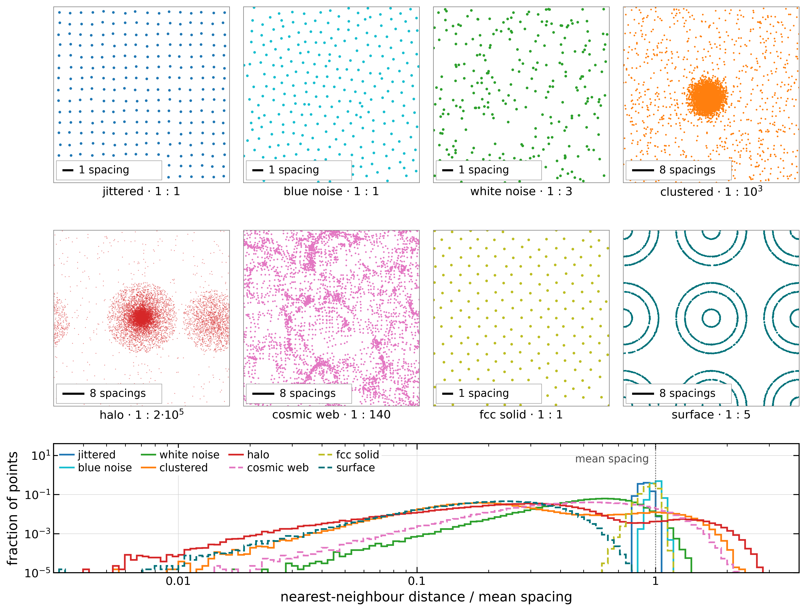

**Against the public libraries.** Full cells on one A100 (codes that return only tetrahedra or neighbours get our face step, timed in), then volumes only, one 72-core node and the moving step; only our own measurements are drawn. The exact-start rows predate the 1.07–1.74× speed-up of the start (now 25.0 M cells/s on jittered input at 128³).

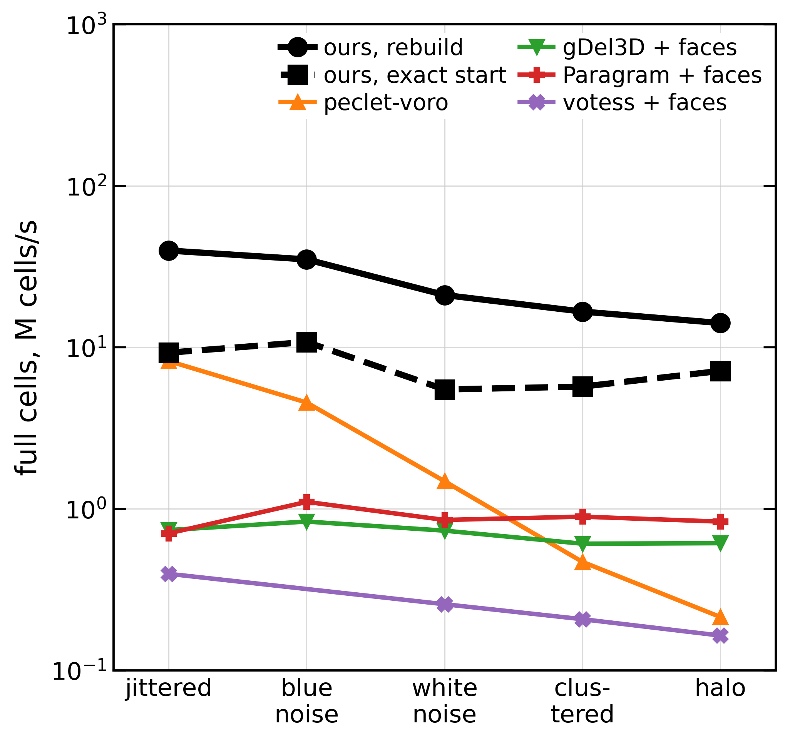

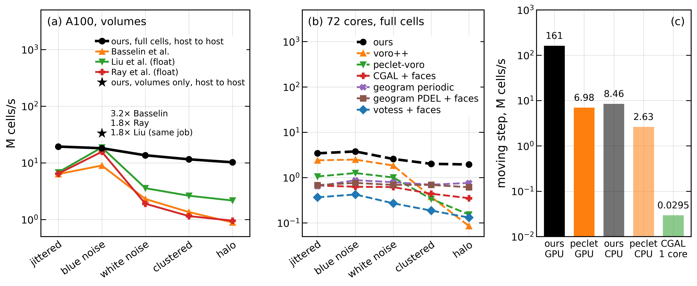

**Where the time goes.** The moving step as a flowchart with its cost per cell by stage, then each library's time split into neighbour search and cell construction: ours takes under 1 ns per cell, the k-nearest-neighbour GPU codes spend 20–55 % of their time finding neighbours.

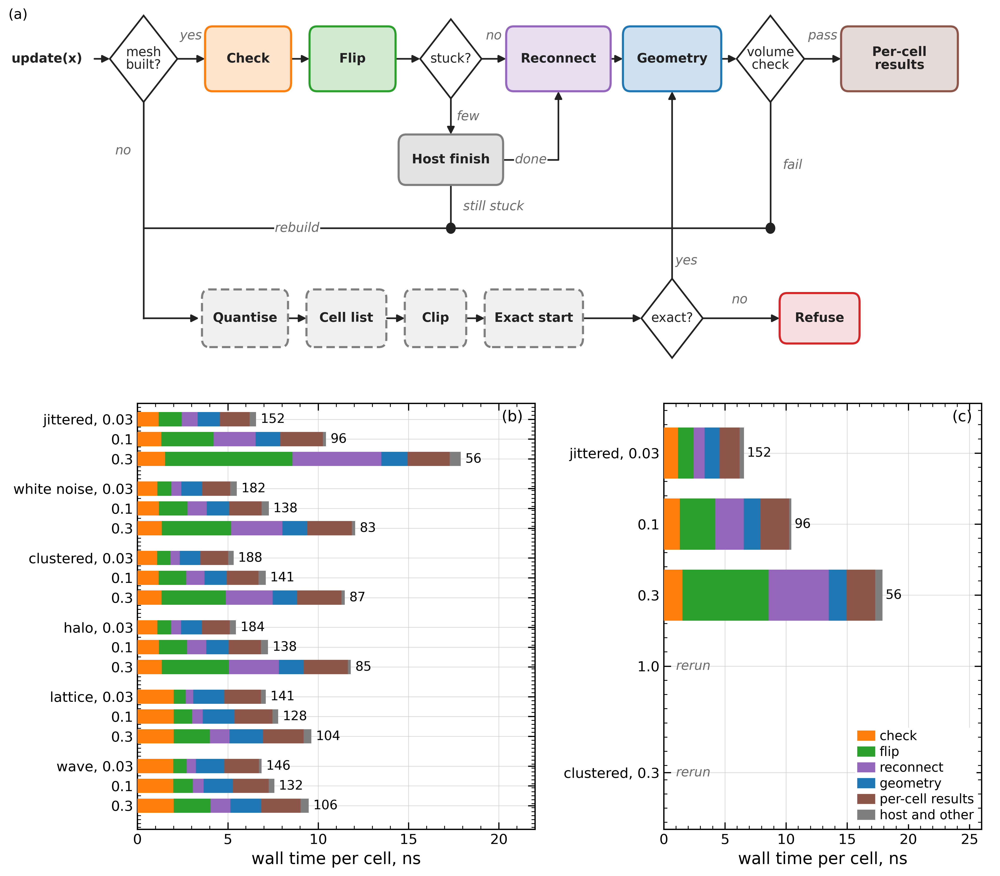

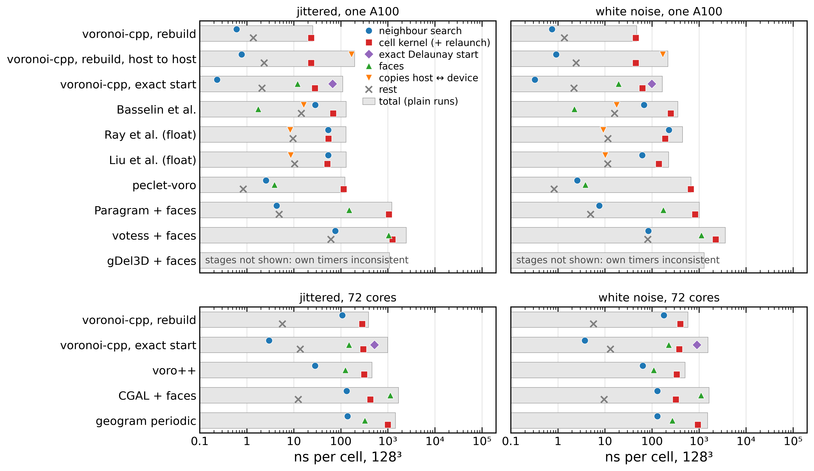

**Throughput against problem size and displacement.** Rebuild, exact start, moving step and memory from 32³ to 256³ (panel (b) predates the exact-start speed-up); the moving step against how far points move per step, the grey band being the exact start.

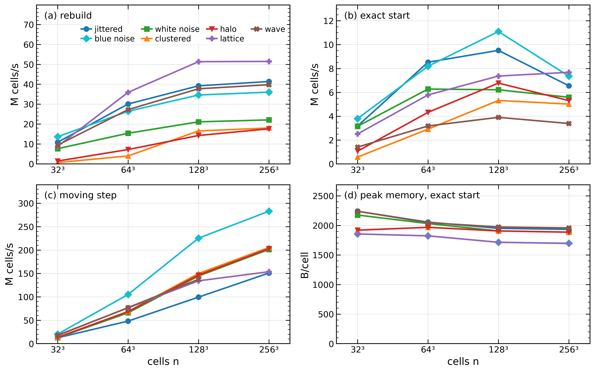

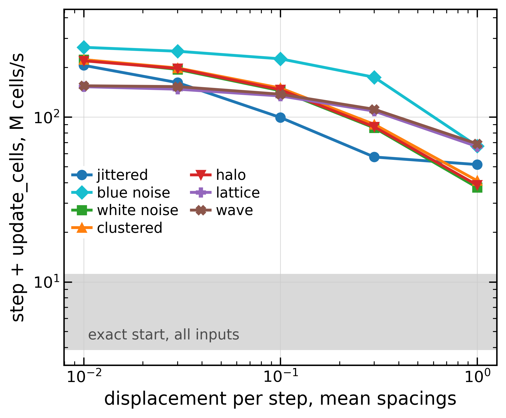

**Re-sort over a long run.** 500 steps with a Hilbert re-sort every 50 steps, which restores memory order and gained 1.3–1.5× over the run (figure of 2026-11-10). Since 2026-11-18 the re-sort is on by default, every 25 updates, and the step is 2.2× faster than before over 500 steps at 0.1 spacings, 128³ and 256³ ([measurements](docs/measurements.md#the-2-step-branch-step-2x-2026-11-18)). The step levers of the same day (repair kernels in registers, the screen's centre kept in registers) add 1.17–1.21× over 500 steps ([measurements](docs/measurements.md#the-step-levers-branch-step-levers-2026-11-18)). A re-sort allocates nothing (it works in the ring pools): 2.0–2.3 ns/cell at 128³ and 256³. It renumbers the particles: callers follow `permutation()`, with `permute_in_place()` when they must not allocate ([usage](docs/usage.md)).

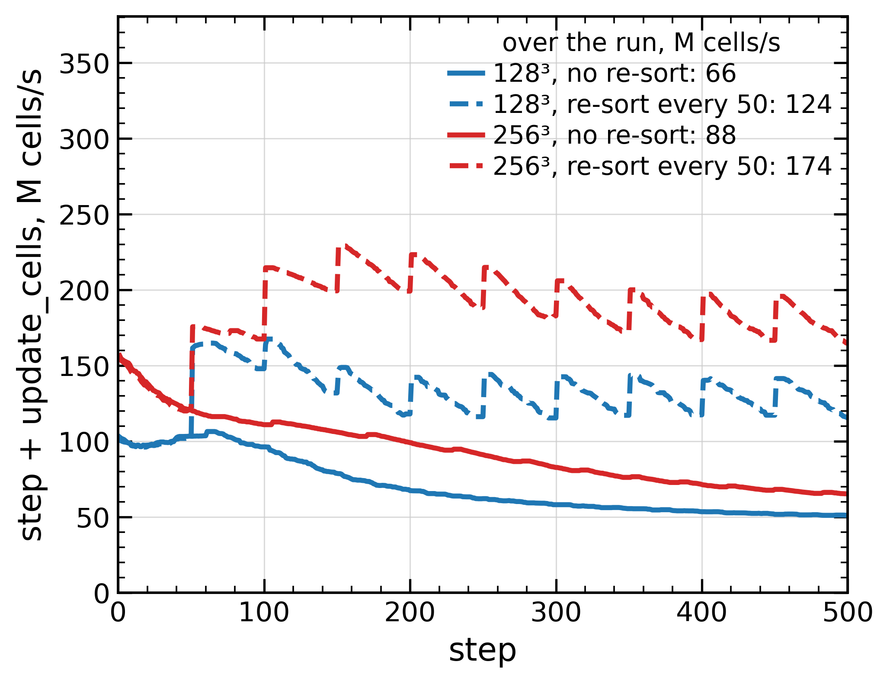

**Speed against quality.** Every library against an independent exact reference on sampled cells: relative volume error, fraction of cells missing and total sampled volume against the box.

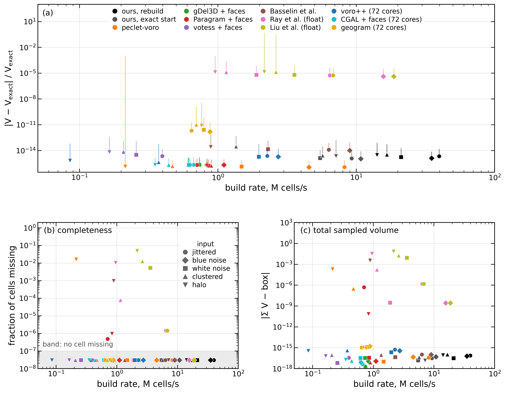

**Application inputs.** Completeness against build rate on cosmic web, fcc solid and surface input; open markers are wrong volumes.

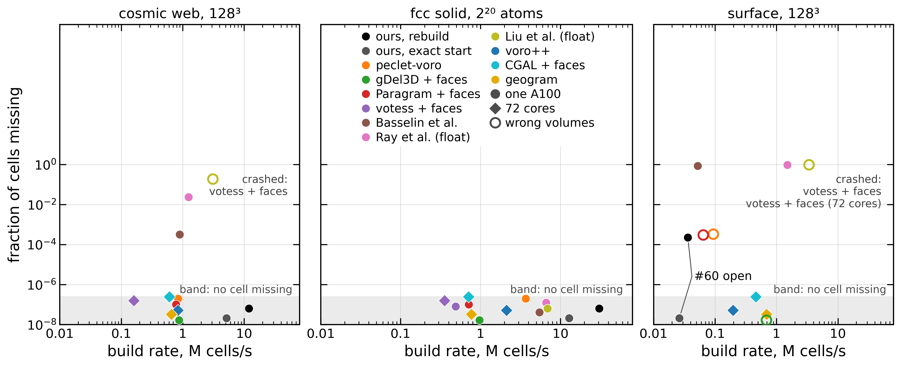

**Volume errors.** Our per-cell volume errors against the exact reference, all at the level of double rounding.

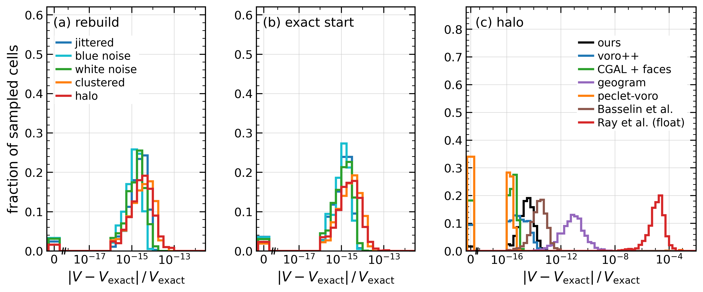

**Memory.** Device bytes per cell at the peak, by array, for the rebuild, exact start and moving step at 128³; then peak bytes per cell for every GPU code, with the limits at which 256³, 384³ and 512³ fit one A100 40 GB.

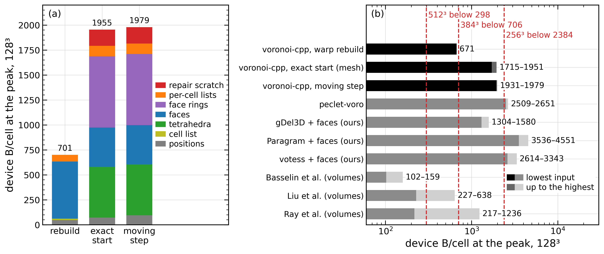

The scripts and data that draw these figures are on the [`paper-figures`](https://github.com/Ulli1991/voronoi-cpp/tree/paper-figures/paper) branch.

## How it works

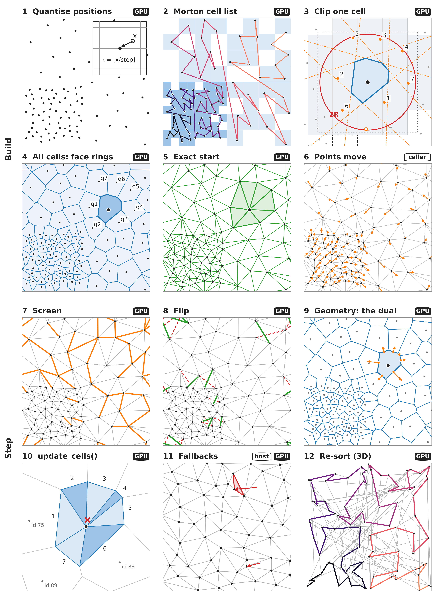

One 2D example of 96 points throughout. Build (rows 1–2): quantise positions, Morton cell list, clip each cell against its neighbours until certified, face rings, exact Delaunay start. Step (rows 3–4): screen the tetrahedra the motion may break, repair them with exact flips, recompute geometry from the dual, per-cell sums, fallbacks, optional re-sort. 3D works the same way with polyhedra and tetrahedra.

Each stage is explained, with figures, in [docs/how_it_works.md](docs/how_it_works.md): the whole method panel by panel, the control flow of `update()`, one step and a rebuild in detail, where the data lives, how the GPU touches memory, and the memory pools and limits.

### The stages, in the order a call runs them

1. **Quantisation and exact predicates** (`exact_predicates.hpp`, `Mesh::snap`). Positions are quantised to integer coordinates on a 2³⁰ grid across the box, where every geometric test can be done exactly. Ties are broken by particle id.
2. **The cell list** (`neighbor_search.hpp`). Particles are sorted along a Morton curve, and each gets a grid level fitted to the local density.
3. **Clipping** (`shell_grid.hpp`, `shell_cell.hpp`, `shell_voronoi.hpp`, `shell_voronoi_warp.hpp`, `shell_limits.hpp`). Each cell is cut from a large cube by its neighbours' bisectors, nearest first, until no particle within twice its radius is left. Its face rings are written in a canonical form (faces by neighbour id, each ring from its least id), so the mesh's numbering does not depend on how a cut keeps its vertices.
4. **The exact start** (`tet_start.hpp`). The clipped face rings become tetrahedra, which are checked exactly; the cells around any error are clipped again exactly.
5. **The persistent tetrahedra** (`tet_mesh.hpp`). Vertices, adjacency, circumcentres and face rings are kept from step to step.
6. **The repair** (`tet_repair.hpp`). Each step screens for tetrahedra that may fail, then flips them in rounds on the device; votes settle conflicting flips.
7. **The fallbacks** (`tet_local.hpp`, `tet_flips.hpp`, `voronoi_mesh.hpp`). Stuck regions are clipped again on the device and stitched in, or the whole mesh is rebuilt (the host finish is opt-in); a mesh whose volumes do not fill the box is rebuilt too.
8. **Geometry** (`tet_mesh.hpp`). Circumcentres, then face areas and centroids, then cell volumes.
9. **`update_cells()`** (`tet_cells.hpp`). Per-cell face lists, with volumes and centroids summed in a fixed order.
10. **Memory order** (`mesh_order.hpp`, optional, `Layout`). Between the repair and the geometry: cells re-sorted along a curve, tetrahedra and faces after them; faces numbered by owner; an owner bit in list entries.

2D (`voronoi_mesh_2d.hpp`, `polygon_clip.hpp`, `tri_mesh.hpp`, `tri_repair.hpp`, `tri_finish.hpp`) runs the same stages on triangles, with exact clipping. 1D (`sorted_mesh.hpp`) quantises the generators to a 2⁵² grid, sorts them and supports `insert()` and `remove()`.

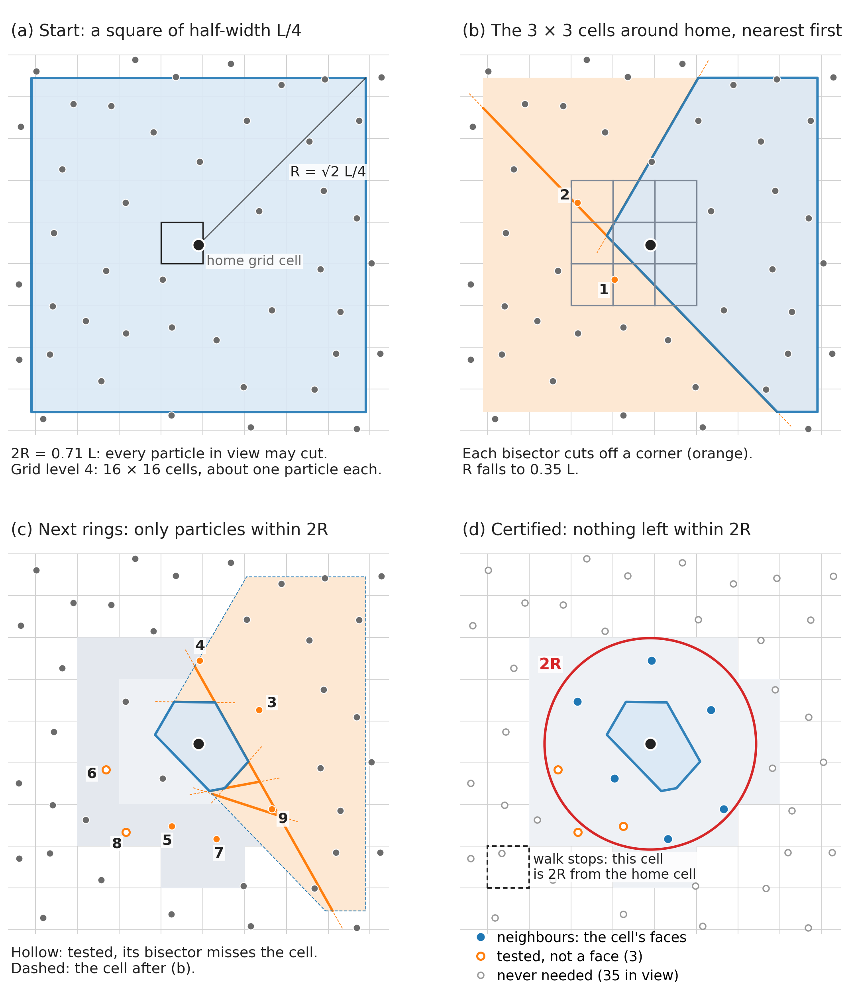

How one cell is clipped. The start square is a quarter of the box wide on each side of the generator; each bisector, nearest first, cuts off a corner. The walk stops once no particle within 2R (red) is left, and most particles are never looked at.

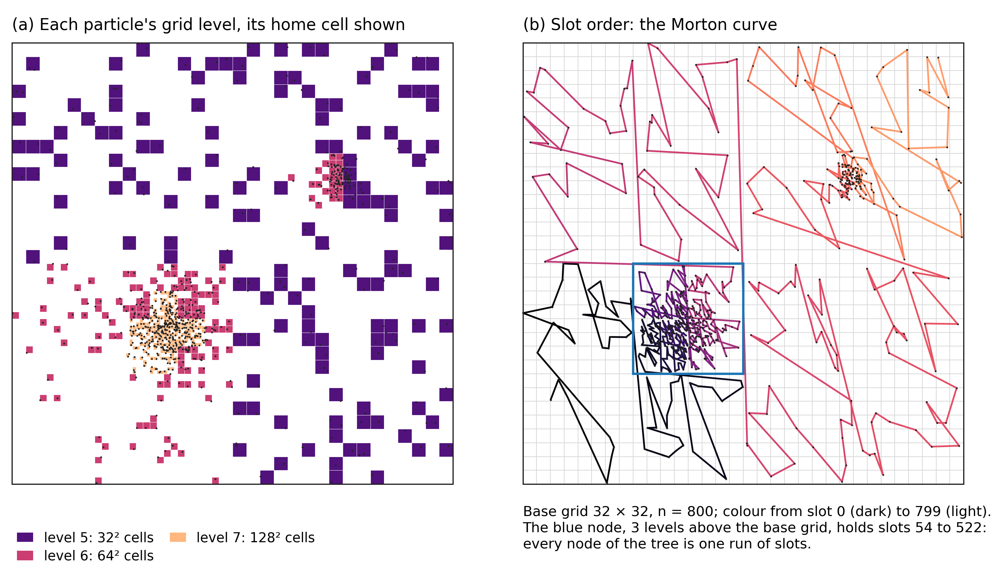

Left: each particle's grid level, fine in the clumps and coarse in the background. Right: the slot order along the Morton curve; every node of the tree, such as the blue one, holds one run of slots.

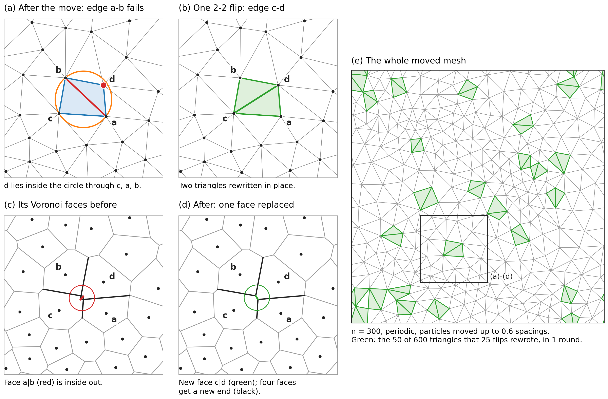

A flip in 2D: d moved inside the circle through c, a, b, and one flip replaces edge a-b with c-d. In the Voronoi dual this replaces one face and moves the ends of four; the rest of the mesh is untouched.

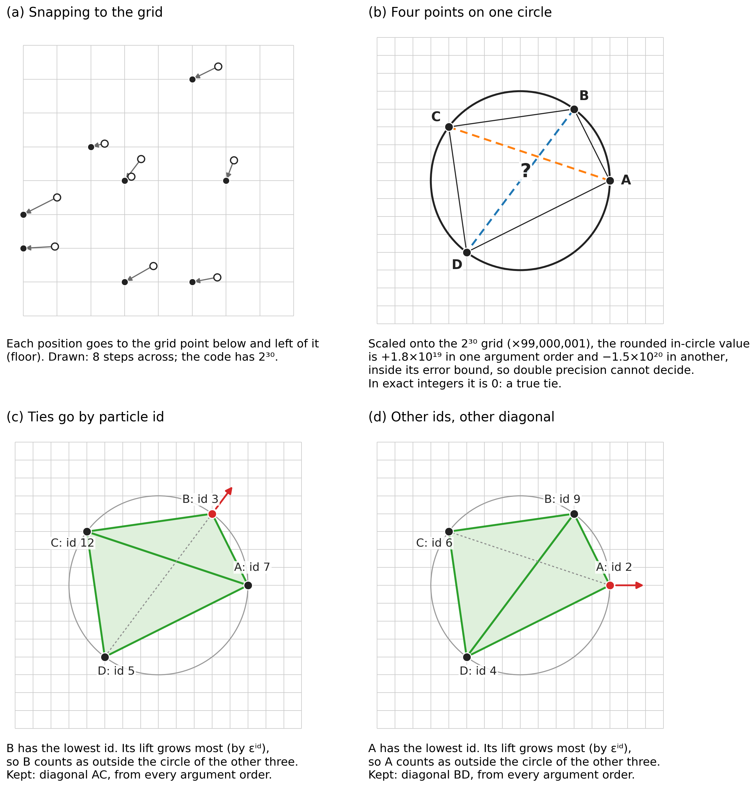

Four points exactly on one circle: rounded arithmetic gives opposite answers in different argument orders. The exact test sees the tie, and the particle ids decide it the same way for every caller.

## What it computes

Every path takes positions in a periodic box, quantises them to integer coordinates on a 2³⁰ grid (across the longest side) and decides topology with exact predicates. Rates are on one A100 at 1305 MHz, double, jittered input ([measurements](docs/measurements.md#rebuild-start-and-step-rates)); B/cell is the peak GPU memory per cell.

| Path (API) | Returns | Exact topology | M cells/s; B/cell | For |
|---|---|---|---|---|
| Full rebuild: `voronoi::Mesh<3>::rebuild(x)`, or the first `update(x)` | per cell `volume()`, `centroid()` (after `update_cells()`), face list `cell_face_start()` / `cell_face()`; per face `owner()`, `neighbour()`, `area()` (vector), `face_centroid()`; the Delaunay tetrahedra (`tetrahedra()`, an internal accessor) | yes: clipping, then an exact check of every tetrahedron, exact rebuild where it fails | 25.3 (128³, the exact start: clipping with rings + tetrahedra); 1951 | a Voronoi or Delaunay mesh of a point set: mesh generation, neighbour graphs, geometry |
| Clipping rebuild alone: `shell_voronoi::construct_warp` into `shell_voronoi::Cells` | per cell status, volume, centroid, face count; per owned face neighbour, area vector, centroid | certified cells (no particle within twice the cell's radius left uncut), rounded cuts; no exact check of the topology afterwards ([#30](https://github.com/Ulli1991/voronoi-cpp/issues/30)) | 42.6 (128³); 701 | cells of a static point set when faces are wanted and no persistent mesh |
| Moving step: `Mesh<3>::update(x)` + `update_cells()` | the same as the full rebuild, repaired by exact flips; face numbers kept where no flip touched them; particles renumbered along a Hilbert curve every 25 updates (`permutation()`; `Layout::every = 0` keeps them) | yes | 202 at 0.03 mean spacings per step (128³); 1911 (128³, re-sorts included) | moving meshes: particles that move a little each step (moving-mesh hydro such as [luna-cpp](https://github.com/Ulli1991/luna-cpp), Lagrangian particle methods) |
| Volumes only: `shell_voronoi::volumes_and_centroids(exec, box, x, volume, centroid)` | per cell volume and centroid, bit-identical to the clipping rebuild's | certified cells, as the clipping rebuild | 43.1 (128³, device to device, cell list included); 101 | density estimates (1 / volume), Lloyd relaxation and centroidal Voronoi tessellations, molecular-dynamics and point-cloud analysis |
| 2D: `voronoi::Mesh<2>` | the same as `Mesh<3>` on triangles (edges as faces, areas as volumes) | yes | build 100, step 765 (2²⁰ cells, 0.03 spacings); 537–574 | 2D meshes and particle sets |
| Geometry derivatives: `voronoi::GeometryDerivative<Mesh>` (`geometry_derivative.hpp`), 2D and 3D | how V, c (per cell) and A, x_f (per face) change with the generator positions at the current topology: `tangent(dx, dV, dc, dA, dxf)` and its transpose `adjoint(Vbar, cbar, Abar, xfbar, xbar)` | the mesh's (the derivative holds the topology fixed) | 3D 128³: tangent 163, adjoint 35.7; 2D 2²⁰: 1241, 429 ([measurements](docs/measurements.md#geometry-derivatives-63)); scratch 199 (3D), 68 (2D) on top of the mesh | shape and mesh optimisation (centroidal tessellations, energies of V and A), sensitivities and inverse problems on moving meshes |
| 1D: `voronoi::Mesh<1>` | sorted cells: lengths, centroids, the two faces per cell | yes | 18,905 per moving step (2²⁰ cells, 1095 MHz, older code) | 1D tests and particle methods; periodic ends or walls (`voronoi::Ends`) |

Faces cost most of the memory: a 3D cell has about 16 faces (15.9 measured; each stored once, 8 per cell), so when faces are not needed, `volumes_and_centroids` takes 101 B/cell against 671 for the clipping rebuild with faces, both measured with the cell list in the library benchmark.

Not available yet: weighted (power, Laguerre) diagrams; non-periodic boxes in 2D and 3D (only periodic; 1D has walls); face velocities (the caller computes them from the motion); cells larger than the certification rule allows (about 6 or more particles across the shortest side, see [usage.md](docs/usage.md#what-a-caller-can-rely-on)). The fast warp kernel is CUDA only; other backends (OpenMP, Serial, HIP) run the per-thread kernel, the same cells.

## Install and build

Dependencies: CMake 3.16 or later and a C++17 compiler (gcc 14/15 tested); Kokkos 5.0 (5.0.2 in CI, 5.0.99 on Raven) with CUDA, OpenMP or Serial. CUDA uses `Kokkos_ARCH_AMPERE80` on an A100, Kokkos' `nvcc_wrapper`, CUDA 13.0 and `Kokkos_ENABLE_CUDA_LAMBDA` (the default in 5.x). Nothing else: the library is header-only (`src/neighbour_search/`, `src/voronoi_construct/`) and CMake exports it as `voronoi_library`.

CUDA (A100), on Raven:

```sh
module load gcc/14 cuda/13.0 cmake
cmake -S . -B build-cuda -DCMAKE_BUILD_TYPE=Release \
  -DCMAKE_PREFIX_PATH=/u/uli/kokkos-cuda \
  -DCMAKE_CXX_COMPILER=/u/uli/kokkos-src/bin/nvcc_wrapper
cmake --build build-cuda -j4
```

OpenMP (CPU), on Raven:

```sh
module load gcc/15 cmake
cmake -S . -B build-omp -DCMAKE_BUILD_TYPE=Release \
  -DCMAKE_PREFIX_PATH=/u/uli/kokkos-gcc15 -DCMAKE_EXPORT_COMPILE_COMMANDS=ON
cmake --build build-omp -j4
```

Elsewhere, point `CMAKE_PREFIX_PATH` at a Kokkos installation with the backend you want. The compiler flags in use, sanitizer and lint builds, the repository layout and CI are in [docs/usage.md](docs/usage.md).

## Using it: `voronoi::Mesh`

```cpp
#include "voronoi_mesh.hpp"

voronoi::Mesh<3> mesh(Kokkos::DefaultExecutionSpace{}, box);   // a cube of side box, or
// voronoi::Mesh<3> mesh(exec, exact_predicates::Box(lx, ly, lz)); // any three sides
mesh.update(x);          // x(i, a): positions in [0, side a), particle i = index i
// ... move the particles ...
voronoi::Report r = mesh.update(x);   // repairs the mesh; exact on return
mesh.update_cells();     // per-cell face lists, ordered volumes and centroids
// Faces f < mesh.faces(): owner()(f) < neighbour()(f), area()(f, a) from
// owner to neighbour, face_centroid()(f, a) relative to the owner.
// Cells i: volume()(i), centroid()(i, a) relative to the generator, faces
// cell_face()(k) for k in [cell_face_start()(i), cell_face_start()(i + 1)).
```

- Particles are the caller's indices; ties between cospherical particles are broken by index, so a permuted input gives the permuted mesh.
- Each face is stored once, by the lower id, so a flux applied with opposite signs conserves exactly; `update_cells()` sums in a fixed order and gives the same bits every run.
- Every cell must be certified within one periodic image: in practice about 6 or more particles across the shortest side; otherwise `update()` throws, stating the rule.
- Options: `clip(x, cells)` for a local rebuild, `volumes_and_centroids` without a mesh, `set_layout(voronoi::Layout)` to keep memory order on long runs, `for_each_face` and `faces_on_read` to skip stored face rows, `same_bits_as_host` for the host's bits on a GPU; `voronoi::Engine` (`voronoi_engine.hpp`) picks cpu, gpu or hybrid at run time in a build with both backends.

Geometry derivatives (2D and 3D, `#include "geometry_derivative.hpp"`):

```cpp
voronoi::GeometryDerivative<voronoi::Mesh<3>> d(mesh);  // after update() and update_cells()
d.tangent(dx, dV, dc, dA, dxf);              // position changes dx -> changes of V, c, A, x_f
d.adjoint(Vbar, cbar, Abar, xfbar, xbar);    // adds the transpose to xbar (an empty bar counts as zero)
```

- They differentiate the formulas the mesh evaluates, with the offsets between quantised positions taken as continuous; the topology is held fixed, so across a flip the derivative is one-sided (the geometry itself is continuous there).
- The adjoint gathers per vertex and per cell in a fixed order, with no atomics: the same bits every run. Details and costs: [docs/usage.md](docs/usage.md#geometry-derivatives).

Everything a caller can rely on, and the options of the benchmark driver `voronoi_bench`, is in [docs/usage.md](docs/usage.md#what-a-caller-can-rely-on).

## Measured performance

One A100 40 GB, double precision, periodic unit box, M cells/s (million cells built or updated per second of GPU time); jittered input unless stated.

| M cells/s | 128³ | 256³ |
|---|---|---|
| Full rebuild (warp clipping), jittered / white noise / halo | 42.6 / 22.2 / 16.9 | 42.8 / 22.5 / 18.3 |
| Exact start (clipping with rings + Delaunay check) | 25.3 | 22.2 |
| Volumes and centroids only (device to device) | 43.1 | 44.6 |
| Moving step + `update_cells()`, 0.03 / 0.1 / 0.3 spacings per step, first ten steps | 202 / 127 / 74.7 | 263 / 190 / 109 |
| The same over 500 steps of a smooth flow (re-sort every 25 updates, its cost included) | 230 / 170 / 101 | – / 229 / – |

Peak GPU memory: 701 B/cell for a plain rebuild, 1911 B/cell for a moving step with face lists, re-sorts included (128³).

- All rates, every input, long runs, GPU against a CPU node, and 2D and 1D: [docs/measurements.md](docs/measurements.md).
- Against the other public Voronoi and Delaunay libraries, with the full table and what cannot be matched: [docs/library_benchmark.md](docs/library_benchmark.md#the-full-table).
- Every change tried, with its measured effect and why it was kept or dropped: [docs/tried.md](docs/tried.md).

## Tests

Fourteen CTest programs (23 tests) specify the library against exact references that share no code with it: predicates, clipping, the start, the repair after every step, the `voronoi::Mesh` contract, special cases, distortion flows, 2D and 1D, fuzzing and metamorphic tests, and the geometry derivatives against central differences. What each specifies, run times and what PASS means are in [TESTING.md](TESTING.md).

```sh
ctest --test-dir build-cuda --output-on-failure         # A100: ~5 minutes
OMP_NUM_THREADS=1 ctest --test-dir build-omp            # one CPU core
```

## Limitations and open items

- Periodic boxes only in 2D and 3D (1D has walls); box sides from 1e-75 to 3e77; particles on one grid position are refused by name.
- Two fuzz cases are not yet explained ([#45](https://github.com/Ulli1991/voronoi-cpp/issues/45)); builds where most cells are large, such as points on surfaces, are slow ([#49](https://github.com/Ulli1991/voronoi-cpp/issues/49), [#60](https://github.com/Ulli1991/voronoi-cpp/issues/60)).
- Memory limits 3D on one A100 to about 256³ today ([#28](https://github.com/Ulli1991/voronoi-cpp/issues/28)); multi-GPU, refinement and derefinement are not implemented yet.

Every limit and open bug: [docs/limitations.md](docs/limitations.md) and the [issues](https://github.com/Ulli1991/voronoi-cpp/issues).

## Roadmap

Next: bound the time of builds with large cells ([#49](https://github.com/Ulli1991/voronoi-cpp/issues/49)), cut memory to 384³ on one A100 ([#28](https://github.com/Ulli1991/voronoi-cpp/issues/28)), point insertion and removal in 2D and 3D ([#25](https://github.com/Ulli1991/voronoi-cpp/issues/25)), multi-GPU, and refinement in 3D. What is done and the full list: [docs/limitations.md](docs/limitations.md#roadmap).
