# voronoi-cpp

voronoi-cpp computes exact Voronoi tessellations, and their dual Delaunay triangulations, of points in a periodic box on GPUs, in 3D, 2D and 1D (`voronoi::Mesh<D, Exec>`). For every cell it returns the volume, the centroid and the faces with their neighbours, area vectors and centroids; when the points move, it repairs the mesh with exact flips instead of rebuilding it, and the result stays exact. It is a header-only C++17 library on Kokkos: CUDA (validated on an A100 40 GB), plus OpenMP and Serial builds that run the same code.

Uses include mesh generation, neighbour graphs, density estimates, Lloyd relaxation and moving meshes; the finite-volume hydro code [luna-cpp](https://github.com/Ulli1991/luna-cpp) is one application: it builds against this repository's latest `main` by default (fetched at configure time; a fixed commit or a local checkout on request) and takes only the mesh, through `voronoi_library` and `voronoi::Mesh` (this repository contains no solver). The topology is exact, and so is the geometry up to rounding in every box tested, except two fuzz cases not yet explained ([#45](https://github.com/Ulli1991/voronoi-cpp/issues/45)).

The library will be renamed **kikkou** (亀甲, kikkō, the tortoise-shell pattern), namespace `kikkou::`, once the open work has landed. BSD 3-Clause, see [LICENSE](LICENSE).

## Results

One NVIDIA A100 40 GB at 1305 MHz, double precision, periodic unit box, unless stated; CPU rows on one 72-core node (2 × Xeon 8360Y). Every code runs on the same points with the same timing scope; measurements of 12–16 November 2026, some rows older than the latest speed-ups, as the captions say.

1. **Exact on every input.** Topology is decided by exact predicates on positions quantised to integer coordinates on a 2³⁰ grid. Every cell is built on all eight inputs, with median volume errors of 10⁻¹⁵ (at most about 10⁻¹³) against an independent exact reference; the float GPU codes lose up to 20 % of cells on cosmic web and nearly all on surfaces.
2. **Fast full Voronoi cells.** 42.6 M cells/s on jittered points at 128³ with faces, areas, centroids and neighbours, 4–55× faster than the other public libraries on the same GPU; volumes and centroids only, 33 M cells/s, 1.8–3.2× faster than the fastest float GPU codes. On a CPU node it is ahead of multithreaded voro++ on every input.
3. **A persistent moving mesh.** Exact GPU flips repair the mesh at 190–263 M cells/s per step (with per-cell lists and sums) at 256³ when points move 0.1 spacings per step, 4–16× faster than rebuilding, and each step is checked against a fresh exact build.
4. **Memory.** About 2000 B/cell for the full moving mesh, so 256³ (16.8 M cells) fits on one A100 40 GB.

**Two operations are timed, and they differ by an order of magnitude.** *Building* the mesh from scratch turns a set of points into the complete Voronoi mesh; a simulation does it once at the start (and after a rare failure). The *mesh update* brings an existing mesh up to date after the points moved a little; a simulation does it every time step. It is the cost of the mesh alone (repairing the tetrahedra by flips, recomputing the geometry, the per-cell lists and sums), with no hydrodynamics in it: a code built on the library adds its own solver on top, so that code's cell updates per second (Figs. 11–13 come from such a code) are lower than the mesh-update rates here, and the two must not be compared. On jittered points at 128³ the build runs at about 40 M cells/s and the mesh update at about 160 M cells/s. Figs. 1–8 are about the build, Figs. 9–10 about the mesh update, Figs. 11–13 about a hydrodynamics code using both.

### Building the mesh from scratch

**Fig. 1: Building the mesh.** One 2D example of 96 points, computed by the library's 2D mesh. Panels: 1 quantise positions (inset: one grid cell, much enlarged), 2 Morton cell list, 3 clip one cell, 4 all cells with their face rings, 5 exact Delaunay start, 6 the caller moves the points. All but 6 run on the GPU.

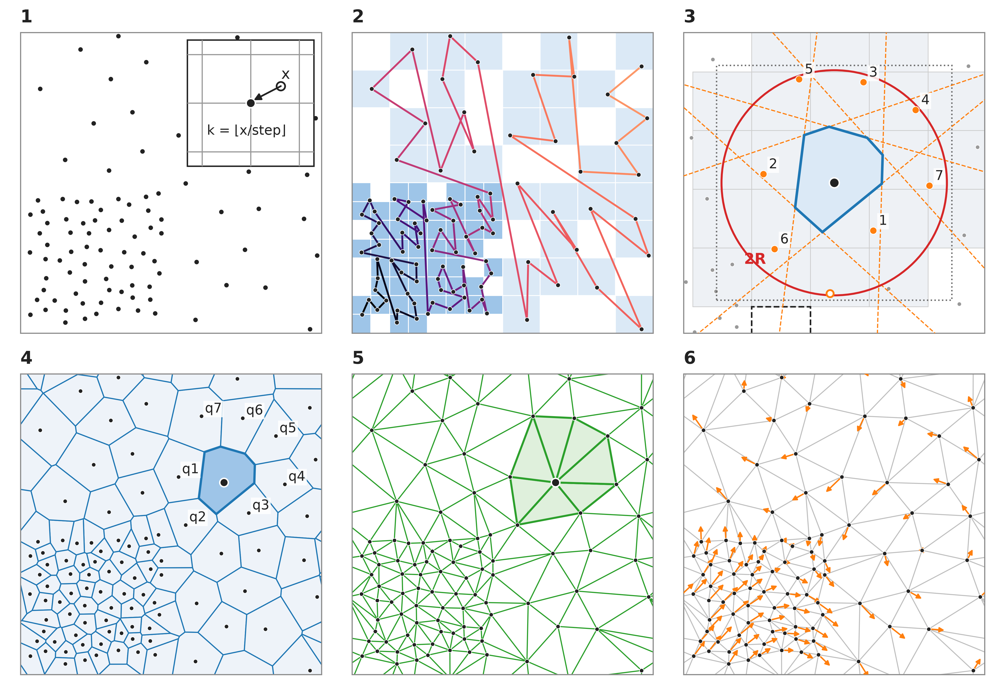

**Fig. 2: Clipping one cell.** (a) The start square, a quarter of the box wide on each side of the generator; R is the distance to its farthest corner, and every particle within 2R may still cut the cell. (b) The 3 × 3 grid cells around the home cell, nearest particle first: each bisector cuts off a corner (orange) and R falls. (c) The next rings of grid cells; only particles within 2R are tested, hollow ones were tested and their bisector missed the cell (dashed: the cell after (b)). (d) Certified: no particle is left within 2R (red), the walk stops at the first grid cell 2R away (dashed square), and most particles were never looked at. In (d): blue, the neighbours that give the cell its faces; orange rings, particles tested whose bisector missed the cell; grey rings, particles never tested.

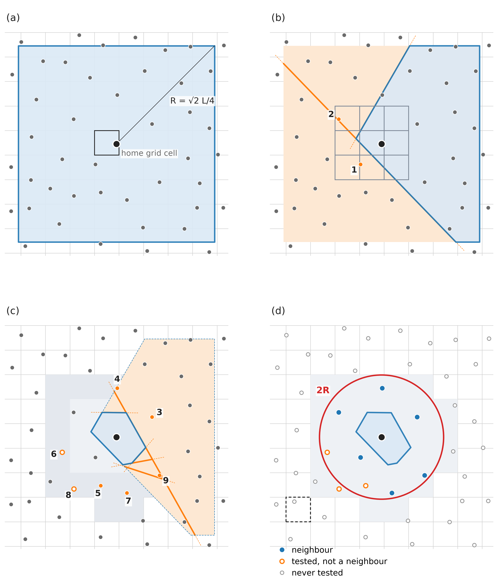

**Fig. 3: The integer grid and exact ties.** The code never decides a geometric question in floating point: it maps every position to integers and evaluates its tests exactly. (a) The mapping: each position goes to the grid point below and left of it. Drawn with 8 steps across; the code has 2³⁰ per box side. (b) Why: four grid points exactly on one circle. Which diagonal the mesh takes depends on the sign of the in-circle test; in double precision that sign comes out + in one argument order and − in another, inside the rounding error, while in exact integers it is 0, a true tie. (c), (d) The rule for a tie: the particle with the lowest id (red) counts as outside the circle of the other three, so the same diagonal is kept from every argument order, on every thread and on host and device alike; with other ids the other diagonal is kept.

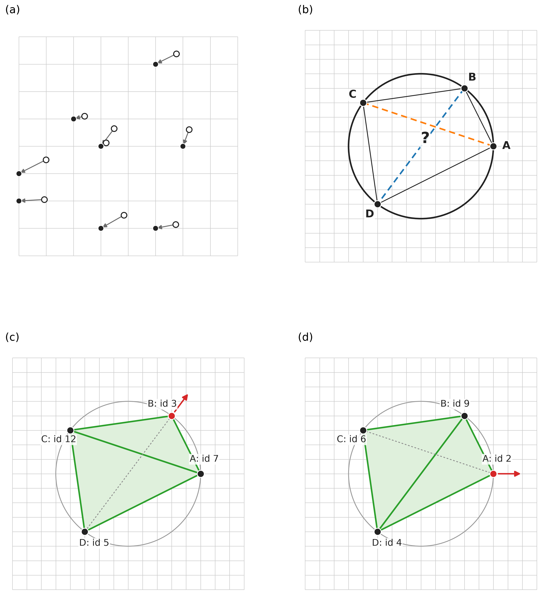

**Fig. 4: Test inputs.** Five synthetic and three application inputs (cosmic web, a thermal fcc solid, points on noisy shells and tori), each as a thin slice with its density contrast. Lengths are in units of the mean spacing Δ = L / N^(1/3), the distance between neighbours if the N points filled the box of side L evenly; the bar in each panel is Δ or 8 Δ. Below, the distribution of each point's distance to its nearest neighbour in units of Δ (dotted line: Δ itself): the wider the distribution, the harder the input for every library.

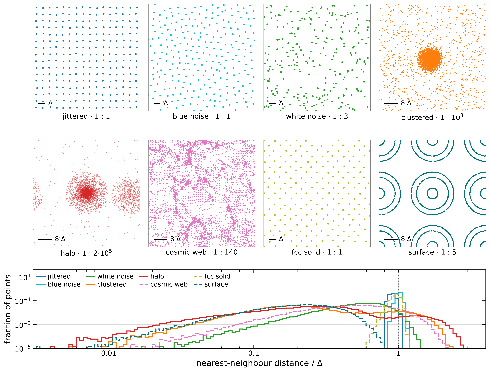

**Fig. 5: Speed of the build against the public libraries.** Every curve is one code building the mesh of about two million points (128³) from scratch, in million cells per second, on each of the eight inputs. *Top, one A100, full cells* (faces, areas, centroids and neighbours for every cell): this work twice, as the plain rebuild (clipping only) and as the exact start (the checked mesh a moving run starts from); codes that return only tetrahedra or neighbours have our face construction added and timed. *Bottom left, one A100, volumes and centroids only*, for the codes that offer nothing more, timed from points in host memory to results in host memory; the star is this work's volumes-only path. *Bottom right, one 72-core CPU node, full cells.* An open marker means the code misses cells or returns wrong volumes on that input; a missing marker means it crashed or was not run (this work has no CPU or host-to-host run on the last inputs). The points of this work on surface, and all its exact-start points, are older than the current code: main now builds the surface at 0.29 M cells/s with no cell refused (figure: 0.036), and the exact start at 25 M cells/s on jittered input (figure: 9.5). Split by stage, the neighbour search of this work takes under 1 ns per cell, while the k-nearest-neighbour GPU codes spend 20–55 % of their build time finding neighbours.

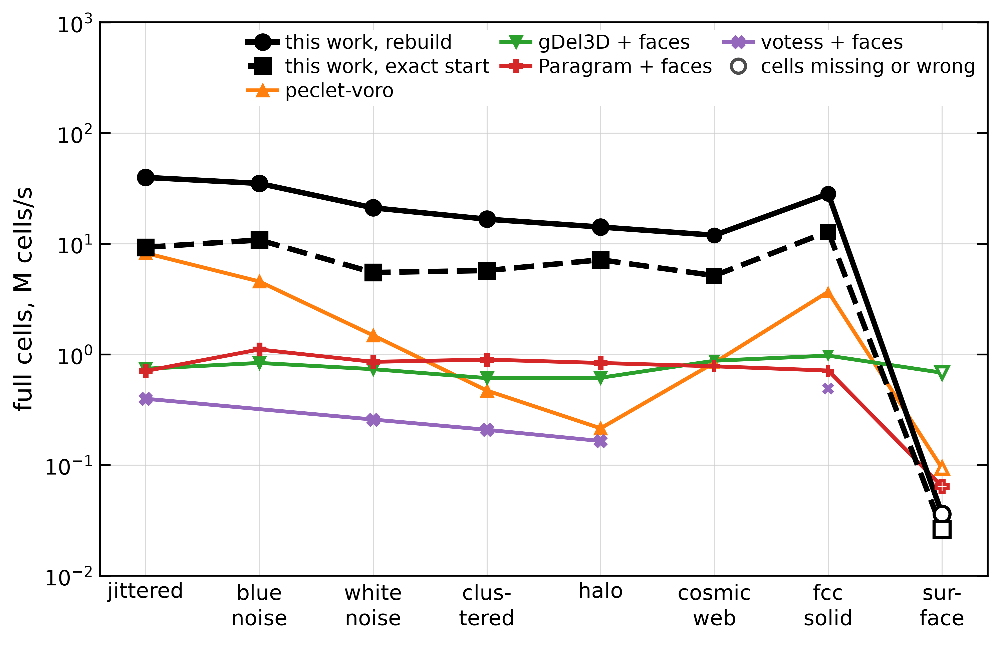

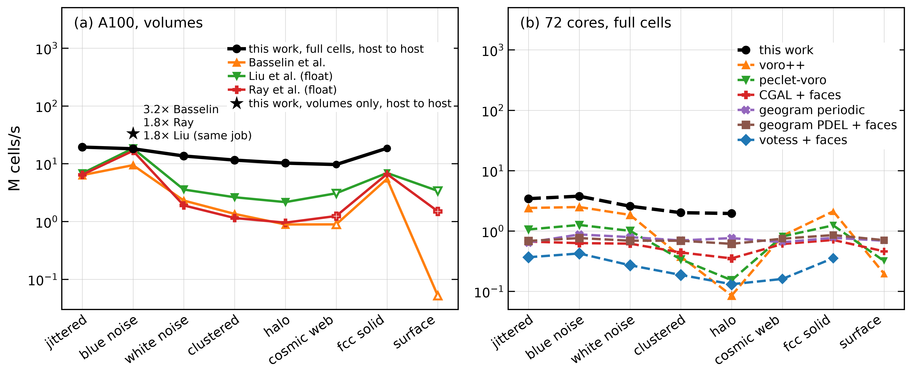

**Fig. 6: Build speed against correctness.** Every library at 128³ against an independent exact reference, one point per code and input. (a) Relative volume error of 1000 sampled cells on the five synthetic inputs: the marker is the median, the line reaches the largest error. Most codes have their median at the level of double rounding (10⁻¹⁵), geogram at 10⁻¹² and the two single-precision codes at 10⁻⁵. (b)–(e) The fraction of cells a code fails to return, on the synthetic inputs and on the three application inputs; an open marker means returned volumes are wrong. The grey band holds the codes with no cell missing (spread vertically only to tell them apart). votess crashed on cosmic web and on surface and is not drawn there. The surface points of this work predate the work on issue #60 (rebuild then: 2.3 in 10⁴ cells missing, 0.036 M cells/s); main now certifies every cell there, at 0.29 M cells/s.

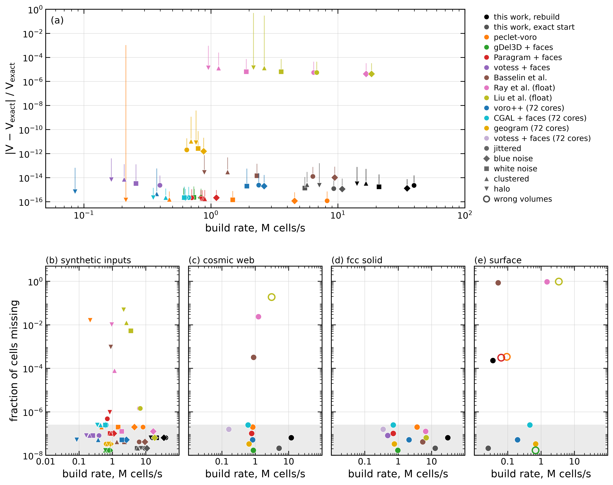

**Fig. 7: The build against problem size.** From 32³ to 256³ points on one A100, per input: (a) the plain rebuild, (b) the exact start, (c) the exact start's peak device memory per cell. Panel (b) predates the speed-up of the exact start.

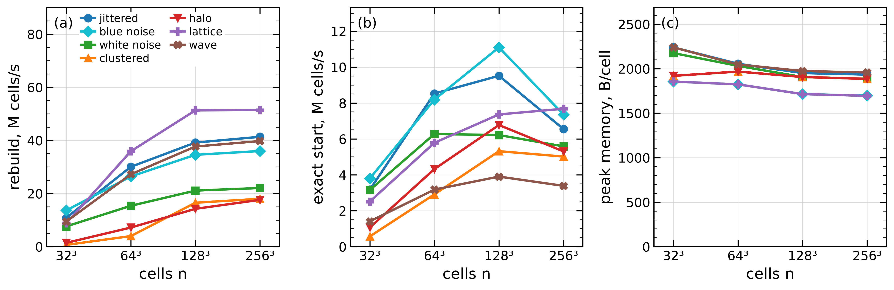

**Fig. 8: Memory.** (a) Device bytes per cell at the peak, by array, for the rebuild, the exact start and the mesh update at 128³. (b) Peak bytes per cell for every GPU code, from the lowest to the highest of the five inputs. One A100 with 40 GB holds 256³ cells below 2384 bytes per cell, 384³ below 706 and 512³ below 298.

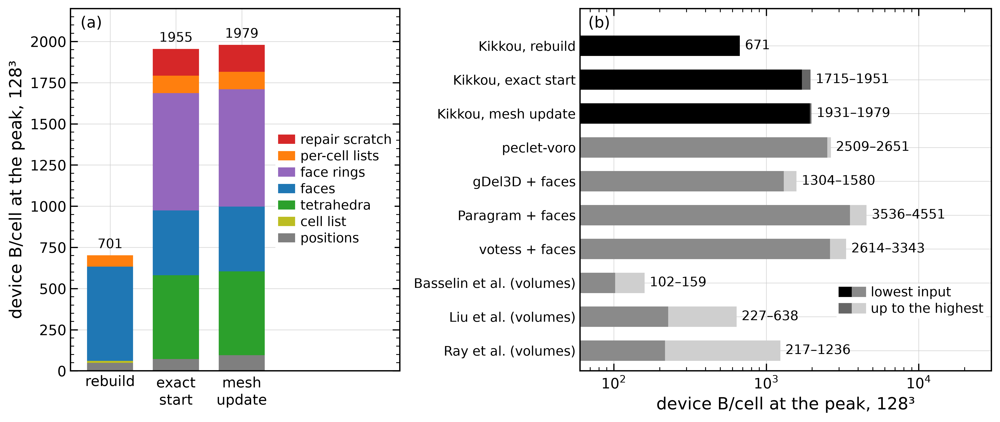

### Updating the mesh after the points moved

**Fig. 9: One update of the mesh.** The same example after the points moved (Fig. 1, panel 6). Panels: 1 screen: the triangles the motion may have broken (orange), 2 flip: failing edges (red, dashed) replaced by exact flips (green) in rounds, 3 geometry from the dual: circumcentres, then faces, 4 per-cell results summed in a fixed order, 5 fallbacks: a region the flips cannot repair is rebuilt (on the host or the GPU), 6 re-sort along a space-filling curve (3D only, shown in 2D). All on the GPU unless noted.

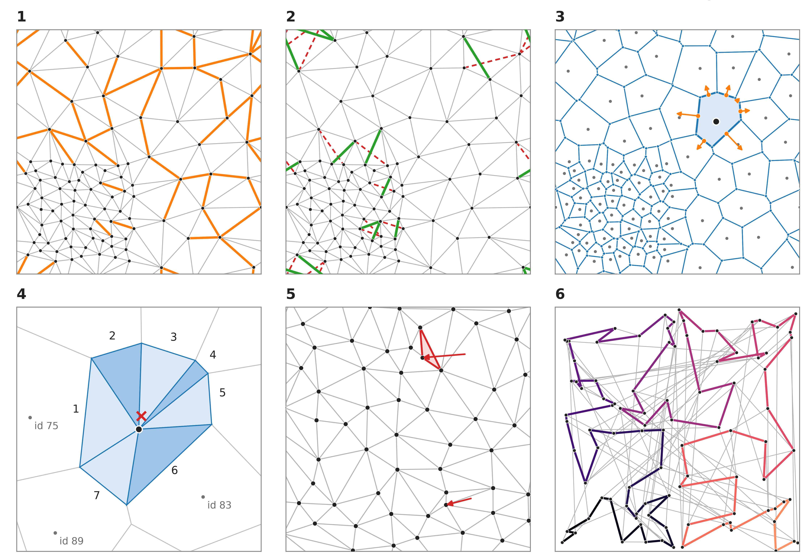

**Fig. 10: Speed of the mesh update (the mesh alone, no solver).** (a) Against problem size, per input, at 0.1 spacings per step. (b) Against how far the points move per step (128³); the grey band is the exact start, the cost of building again instead. Split by stage, the cost that grows with the displacement is the flipping and reconnecting of the mesh; the check, the geometry and the per-cell results stay about the same (jittered: 6.6 ns per cell at 0.03 spacings, 17.9 ns at 0.3). (c) Over 500 steps with and without a re-sort of the mesh in memory every 50 steps. (d) Against the mesh update of the other codes that have one, jittered input at 128³. 500 steps with a Hilbert re-sort every 50 steps, which restores memory order and gained 1.3–1.5× over the run (figure of 2026-11-10). Since 2026-11-18 the re-sort is on by default, every 25 updates, and the step is 2.2× faster than before over 500 steps at 0.1 spacings, 128³ and 256³ ([measurements](docs/measurements.md#the-2-step-branch-step-2x-2026-11-18)). The step levers of the same day (repair kernels in registers, the screen's centre kept in registers) add 1.17–1.21× over 500 steps ([measurements](docs/measurements.md#the-step-levers-branch-step-levers-2026-11-18)). A re-sort allocates nothing (it works in the ring pools): 2.0–2.3 ns/cell at 128³ and 256³. It renumbers the particles: callers follow `permutation()`, with `permute_in_place()` when they must not allocate ([usage](docs/usage.md)).

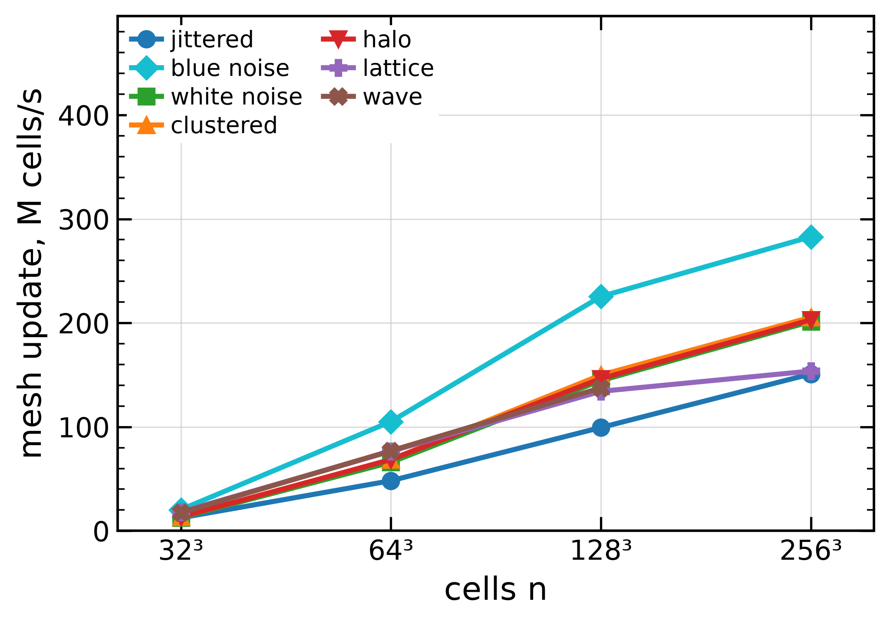

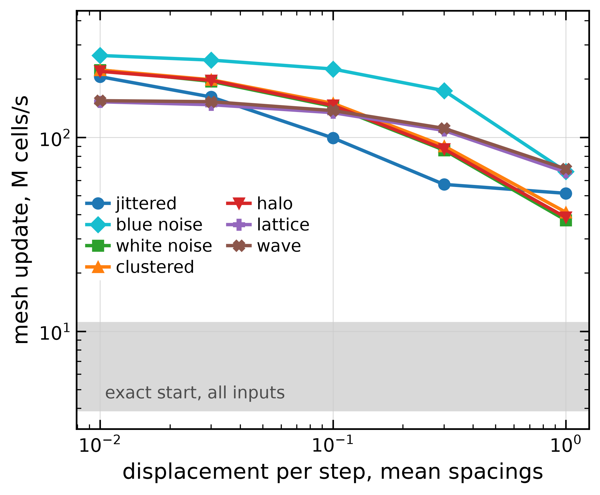

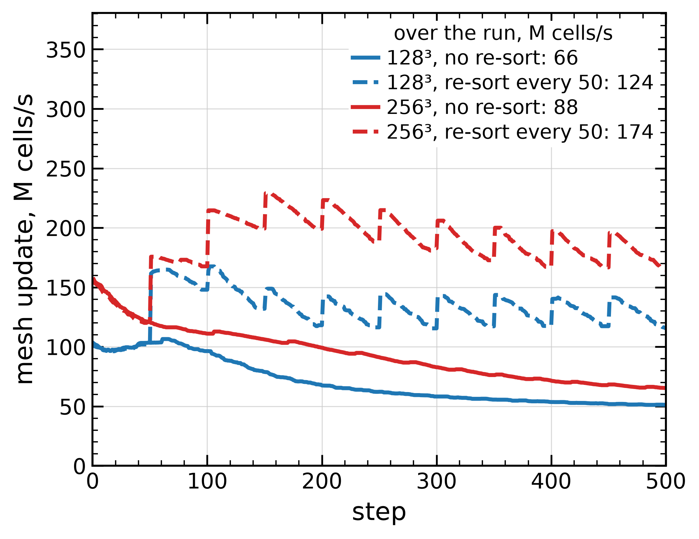

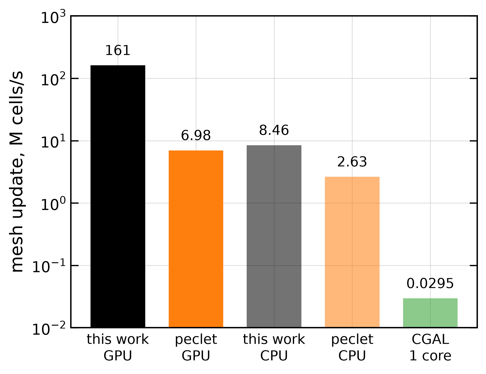

### A moving-mesh code on the library

**Fig. 11: 3D isentropic vortex.** luna-cpp's 3D isentropic (Yee) vortex: L1 errors of density and velocity against resolution for the moving mesh, the static mesh and LUNA's Cartesian MUSCL scheme (runs of an earlier library version).

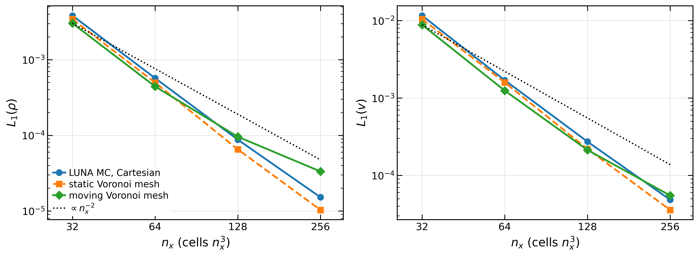

**Fig. 12: Titarev–Toro shock–entropy interaction.** luna-cpp on the 1D moving mesh at 8192 cells against LUNA's Cartesian MUSCL scheme, the static mesh, a high-resolution LUNA run and AthenaK (PPMX): the whole tube, and zooms behind the shock, on the entropy waves, on the waves near the shock and on the shock (figure of luna-cpp, `docs/figures/titarev_toro.png`).

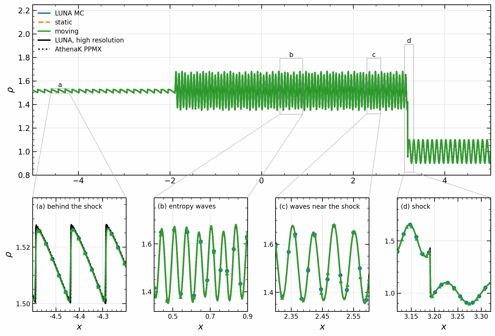

**Fig. 13: Kelvin–Helmholtz instability.** The smooth shear layer of McNally, Lyra & Passy (2012) with luna-cpp on one MI300A. Left: the density at t = 2 on the moving mesh at 1024² cells. Right: the amplitude of the seeded velocity mode against time on the moving and the static mesh at 256², 512² and 1024² (the three lie on one another), with the slope of linear theory for this setup, σ = 2.83 (the linearised compressible Euler equations about the same density and velocity profiles, `paper/scripts/kh_linear_mcnally.py`). The measured growth rates between t = 0.6 and 1.2 are 2.81, 2.84 and 2.85 on the moving mesh and 2.84, 2.85 and 2.85 on the static mesh, within 0.7 % of theory.

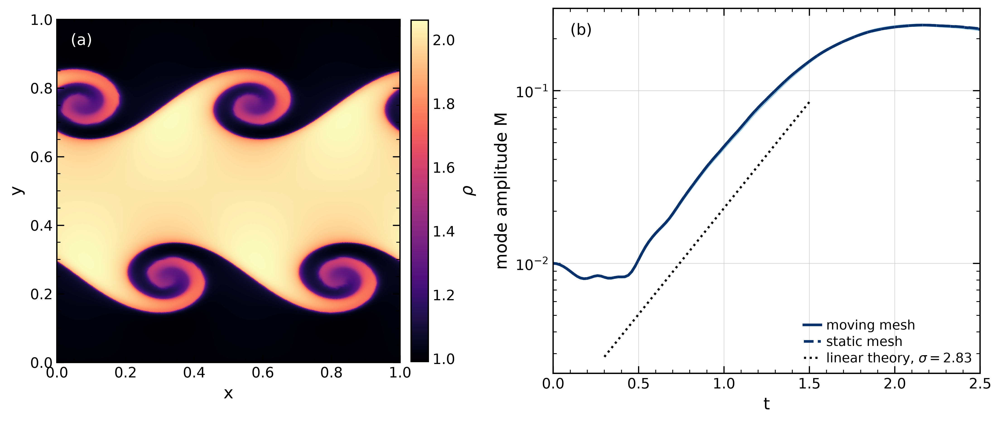

The figures are numbered in the paper's order; a letter marks the parts of one figure. Each is drawn by one script in [`paper/scripts`](paper/scripts) from the data in [`paper/data`](paper/data); the PDFs are next to the PNGs in [`paper/figures`](paper/figures).

## How it works

Fig. 1 above shows the build in one 2D example and Fig. 9 the moving step; Figs. 2 and 3 show the two central ideas of the build, the clipping of a cell and the exact decisions.

Each stage is explained, with figures, in [docs/how_it_works.md](docs/how_it_works.md): the whole method panel by panel, the control flow of `update()`, one step and a rebuild in detail, where the data lives, how the GPU touches memory, and the memory pools and limits.

### The stages, in the order a call runs them

1. **Quantisation and exact predicates** (`exact_predicates.hpp`, `Mesh::snap`). Positions are quantised to integer coordinates on a 2³⁰ grid across the box, where every geometric test can be done exactly. Ties are broken by particle id.
2. **The cell list** (`neighbor_search.hpp`). Particles are sorted along a Morton curve, and each gets a grid level fitted to the local density.
3. **Clipping** (`shell_grid.hpp`, `shell_cell.hpp`, `shell_voronoi.hpp`, `shell_voronoi_warp.hpp`, `shell_limits.hpp`). Each cell is cut from a large cube by its neighbours' bisectors, nearest first, until no particle within twice its radius is left. Its face rings are written in a canonical form (faces by neighbour id, each ring from its least id), so the mesh's numbering does not depend on how a cut keeps its vertices.
4. **The exact start** (`tet_start.hpp`). The clipped face rings become tetrahedra, which are checked exactly; the cells around any error are clipped again exactly.
5. **The persistent tetrahedra** (`tet_mesh.hpp`). Vertices, adjacency, circumcentres and face rings are kept from step to step.
6. **The repair** (`tet_repair.hpp`). Each step screens for tetrahedra that may fail, then flips them in rounds on the device; votes settle conflicting flips.
7. **The fallbacks** (`tet_local.hpp`, `tet_flips.hpp`, `voronoi_mesh.hpp`). Stuck regions are clipped again on the device and stitched in, or the whole mesh is rebuilt (the host finish is opt-in); a mesh whose volumes do not fill the box is rebuilt too.
8. **Geometry** (`tet_mesh.hpp`). Circumcentres, then face areas and centroids, then cell volumes.
9. **`update_cells()`** (`tet_cells.hpp`). Per-cell face lists, with volumes and centroids summed in a fixed order.
10. **Memory order** (`mesh_order.hpp`, optional, `Layout`). Between the repair and the geometry: cells re-sorted along a curve, tetrahedra and faces after them; faces numbered by owner; an owner bit in list entries.

2D (`voronoi_mesh_2d.hpp`, `polygon_clip.hpp`, `tri_mesh.hpp`, `tri_repair.hpp`, `tri_finish.hpp`) runs the same stages on triangles, with exact clipping. 1D (`sorted_mesh.hpp`) quantises the generators to a 2⁵² grid, sorts them and supports `insert()` and `remove()`.

The cell list and the repair by flips have their own figures in [docs/how_it_works.md](docs/how_it_works.md).

## What it computes

Every path takes positions in a periodic box, quantises them to integer coordinates on a 2³⁰ grid (across the longest side) and decides topology with exact predicates. Rates are on one A100 at 1305 MHz, double, jittered input ([measurements](docs/measurements.md#rebuild-start-and-step-rates)); B/cell is the peak GPU memory per cell.

| Path (API) | Returns | Exact topology | M cells/s; B/cell | For |
|---|---|---|---|---|
| Full rebuild: `voronoi::Mesh<3>::rebuild(x)`, or the first `update(x)` | per cell `volume()`, `centroid()` (after `update_cells()`), face list `cell_face_start()` / `cell_face()`; per face `owner()`, `neighbour()`, `area()` (vector), `face_centroid()`; the Delaunay tetrahedra (`tetrahedra()`, an internal accessor) | yes: clipping, then an exact check of every tetrahedron, exact rebuild where it fails | 25.3 (128³, the exact start: clipping with rings + tetrahedra); 1951 | a Voronoi or Delaunay mesh of a point set: mesh generation, neighbour graphs, geometry |
| Clipping rebuild alone: `shell_voronoi::construct_warp` into `shell_voronoi::Cells` | per cell status, volume, centroid, face count; per owned face neighbour, area vector, centroid | certified cells (no particle within twice the cell's radius left uncut), rounded cuts; no exact check of the topology afterwards ([#30](https://github.com/Ulli1991/voronoi-cpp/issues/30)) | 42.6 (128³); 701 | cells of a static point set when faces are wanted and no persistent mesh |
| Moving step: `Mesh<3>::update(x)` + `update_cells()` | the same as the full rebuild, repaired by exact flips; face numbers kept where no flip touched them; particles renumbered along a Hilbert curve every 25 updates (`permutation()`; `Layout::every = 0` keeps them) | yes | 202 at 0.03 mean spacings per step (128³); 1911 (128³, re-sorts included) | moving meshes: particles that move a little each step (moving-mesh hydro such as [luna-cpp](https://github.com/Ulli1991/luna-cpp), Lagrangian particle methods) |
| Volumes only: `shell_voronoi::volumes_and_centroids(exec, box, x, volume, centroid)` | per cell volume and centroid, bit-identical to the clipping rebuild's | certified cells, as the clipping rebuild | 43.1 (128³, device to device, cell list included); 101 | density estimates (1 / volume), Lloyd relaxation and centroidal Voronoi tessellations, molecular-dynamics and point-cloud analysis |
| 2D: `voronoi::Mesh<2>` | the same as `Mesh<3>` on triangles (edges as faces, areas as volumes) | yes | build 100, step 765 (2²⁰ cells, 0.03 spacings); 537–574 | 2D meshes and particle sets |
| Geometry derivatives: `voronoi::GeometryDerivative<Mesh>` (`geometry_derivative.hpp`), 2D and 3D | how V, c (per cell) and A, x_f (per face) change with the generator positions at the current topology: `tangent(dx, dV, dc, dA, dxf)` and its transpose `adjoint(Vbar, cbar, Abar, xfbar, xbar)` | the mesh's (the derivative holds the topology fixed) | 3D 128³: tangent 163, adjoint 39.7; 2D 2²⁰: 1239, 429 ([measurements](docs/measurements.md#geometry-derivatives-63)); scratch 408 (3D adjoint; 199 for the tangent), 68 (2D) on top of the mesh | shape and mesh optimisation (centroidal tessellations, energies of V and A), sensitivities and inverse problems on moving meshes |
| 1D: `voronoi::Mesh<1>` | sorted cells: lengths, centroids, the two faces per cell | yes | 18,905 per moving step (2²⁰ cells, 1095 MHz, older code) | 1D tests and particle methods; periodic ends or walls (`voronoi::Ends`) |

Faces cost most of the memory: a 3D cell has about 16 faces (15.9 measured; each stored once, 8 per cell), so when faces are not needed, `volumes_and_centroids` takes 101 B/cell against 671 for the clipping rebuild with faces, both measured with the cell list in the library benchmark.

Not available yet: weighted (power, Laguerre) diagrams; non-periodic boxes in 2D and 3D (only periodic; 1D has walls); face velocities (the caller computes them from the motion); cells larger than the certification rule allows (about 6 or more particles across the shortest side, see [usage.md](docs/usage.md#what-a-caller-can-rely-on)). The fast warp kernel is CUDA only; other backends (OpenMP, Serial, HIP) run the per-thread kernel, the same cells.

## Install and build

Dependencies: CMake 3.16 or later and a C++17 compiler (gcc 14/15 tested); Kokkos 5.0 (5.0.2 in CI, 5.0.99 on Raven) with CUDA, OpenMP or Serial. CUDA uses `Kokkos_ARCH_AMPERE80` on an A100, Kokkos' `nvcc_wrapper`, CUDA 13.0 and `Kokkos_ENABLE_CUDA_LAMBDA` (the default in 5.x). Nothing else: the library is header-only (`src/neighbour_search/`, `src/voronoi_construct/`) and CMake exports it as `voronoi_library`.

CUDA (A100), on Raven:

```sh
module load gcc/14 cuda/13.0 cmake
cmake -S . -B build-cuda -DCMAKE_BUILD_TYPE=Release \
  -DCMAKE_PREFIX_PATH=/u/uli/kokkos-cuda \
  -DCMAKE_CXX_COMPILER=/u/uli/kokkos-src/bin/nvcc_wrapper
cmake --build build-cuda -j4
```

OpenMP (CPU), on Raven:

```sh
module load gcc/15 cmake
cmake -S . -B build-omp -DCMAKE_BUILD_TYPE=Release \
  -DCMAKE_PREFIX_PATH=/u/uli/kokkos-gcc15 -DCMAKE_EXPORT_COMPILE_COMMANDS=ON
cmake --build build-omp -j4
```

Elsewhere, point `CMAKE_PREFIX_PATH` at a Kokkos installation with the backend you want. The compiler flags in use, sanitizer and lint builds, the repository layout and CI are in [docs/usage.md](docs/usage.md).

## Using it: `voronoi::Mesh`

```cpp
#include "voronoi_mesh.hpp"

voronoi::Mesh<3> mesh(Kokkos::DefaultExecutionSpace{}, box);   // a cube of side box, or
// voronoi::Mesh<3> mesh(exec, exact_predicates::Box(lx, ly, lz)); // any three sides
mesh.update(x);          // x(i, a): positions in [0, side a), particle i = index i
// ... move the particles ...
voronoi::Report r = mesh.update(x);   // repairs the mesh; exact on return
mesh.update_cells();     // per-cell face lists, ordered volumes and centroids
// Faces f < mesh.faces(): owner()(f) < neighbour()(f), area()(f, a) from
// owner to neighbour, face_centroid()(f, a) relative to the owner.
// Cells i: volume()(i), centroid()(i, a) relative to the generator, faces
// cell_face()(k) for k in [cell_face_start()(i), cell_face_start()(i + 1)).
```

- Particles are the caller's indices; ties between cospherical particles are broken by index, so a permuted input gives the permuted mesh.
- Each face is stored once, by the lower id, so a flux applied with opposite signs conserves exactly; `update_cells()` sums in a fixed order and gives the same bits every run.
- Every cell must be certified within one periodic image: in practice about 6 or more particles across the shortest side; otherwise `update()` throws, stating the rule.
- Options: `clip(x, cells)` for a local rebuild, `volumes_and_centroids` without a mesh, `set_layout(voronoi::Layout)` to keep memory order on long runs, `for_each_face` and `faces_on_read` to skip stored face rows, `same_bits_as_host` for the host's bits on a GPU; `voronoi::Engine` (`voronoi_engine.hpp`) picks cpu, gpu or hybrid at run time in a build with both backends.

Geometry derivatives (2D and 3D, `#include "geometry_derivative.hpp"`):

```cpp
voronoi::GeometryDerivative<voronoi::Mesh<3>> d(mesh);  // after update() and update_cells()
d.tangent(dx, dV, dc, dA, dxf);              // position changes dx -> changes of V, c, A, x_f
d.adjoint(Vbar, cbar, Abar, xfbar, xbar);    // adds the transpose to xbar (an empty bar counts as zero)
```

- They differentiate the formulas the mesh evaluates, with the offsets between quantised positions taken as continuous; the topology is held fixed, so across a flip the derivative is one-sided (the geometry itself is continuous there).
- The adjoint gathers per vertex and per cell in a fixed order, with no atomics: the same bits every run. Details and costs: [docs/usage.md](docs/usage.md#geometry-derivatives).

Everything a caller can rely on, and the options of the benchmark driver `voronoi_bench`, is in [docs/usage.md](docs/usage.md#what-a-caller-can-rely-on).

## Measured performance

One A100 40 GB, double precision, periodic unit box, M cells/s (million cells built or updated per second of GPU time); jittered input unless stated.

| M cells/s | 128³ | 256³ |
|---|---|---|
| Full rebuild (warp clipping), jittered / white noise / halo | 42.6 / 22.2 / 16.9 | 42.8 / 22.5 / 18.3 |
| Exact start (clipping with rings + Delaunay check) | 25.3 | 22.2 |
| Volumes and centroids only (device to device) | 43.1 | 44.6 |
| Moving step + `update_cells()`, 0.03 / 0.1 / 0.3 spacings per step, first ten steps | 202 / 127 / 74.7 | 263 / 190 / 109 |
| The same over 500 steps of a smooth flow (re-sort every 25 updates, its cost included) | 230 / 170 / 101 | – / 229 / – |

Peak GPU memory: 701 B/cell for a plain rebuild, 1911 B/cell for a moving step with face lists, re-sorts included (128³).

- All rates, every input, long runs, GPU against a CPU node, and 2D and 1D: [docs/measurements.md](docs/measurements.md).
- Against the other public Voronoi and Delaunay libraries, with the full table and what cannot be matched: [docs/library_benchmark.md](docs/library_benchmark.md#the-full-table).
- Every change tried, with its measured effect and why it was kept or dropped: [docs/tried.md](docs/tried.md).

## Tests

Fourteen CTest programs (23 tests) specify the library against exact references that share no code with it: predicates, clipping, the start, the repair after every step, the `voronoi::Mesh` contract, special cases, distortion flows, 2D and 1D, fuzzing and metamorphic tests, and the geometry derivatives against central differences. What each specifies, run times and what PASS means are in [TESTING.md](TESTING.md).

```sh
ctest --test-dir build-cuda --output-on-failure         # A100: ~5 minutes
OMP_NUM_THREADS=1 ctest --test-dir build-omp            # one CPU core
```

## Limitations and open items

- Periodic boxes only in 2D and 3D (1D has walls); box sides from 1e-75 to 3e77; particles on one grid position are refused by name.
- Two fuzz cases are not yet explained ([#45](https://github.com/Ulli1991/voronoi-cpp/issues/45)); builds where most cells are large, such as points on surfaces, are slow ([#49](https://github.com/Ulli1991/voronoi-cpp/issues/49), [#60](https://github.com/Ulli1991/voronoi-cpp/issues/60)).
- Memory limits 3D on one A100 to about 256³ today ([#28](https://github.com/Ulli1991/voronoi-cpp/issues/28)); multi-GPU, refinement and derefinement are not implemented yet.

Every limit and open bug: [docs/limitations.md](docs/limitations.md) and the [issues](https://github.com/Ulli1991/voronoi-cpp/issues).

## Roadmap

Next: bound the time of builds with large cells ([#49](https://github.com/Ulli1991/voronoi-cpp/issues/49)), cut memory to 384³ on one A100 ([#28](https://github.com/Ulli1991/voronoi-cpp/issues/28)), point insertion and removal in 2D and 3D ([#25](https://github.com/Ulli1991/voronoi-cpp/issues/25)), multi-GPU, and refinement in 3D. What is done and the full list: [docs/limitations.md](docs/limitations.md#roadmap).
