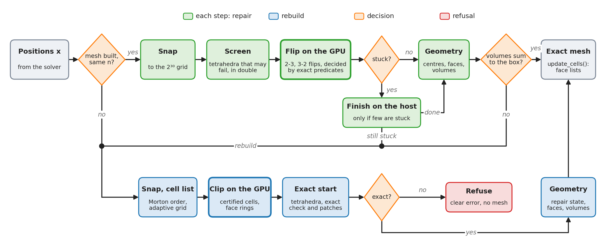
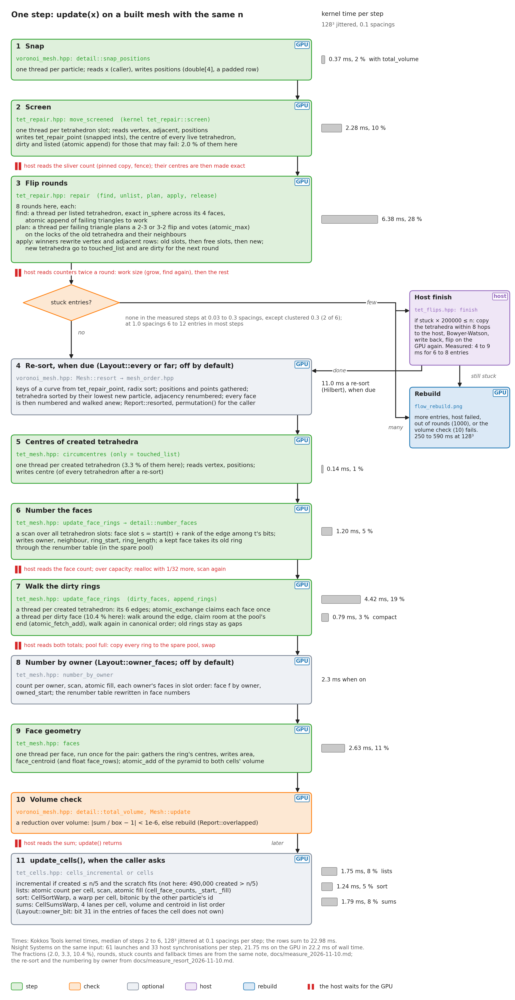
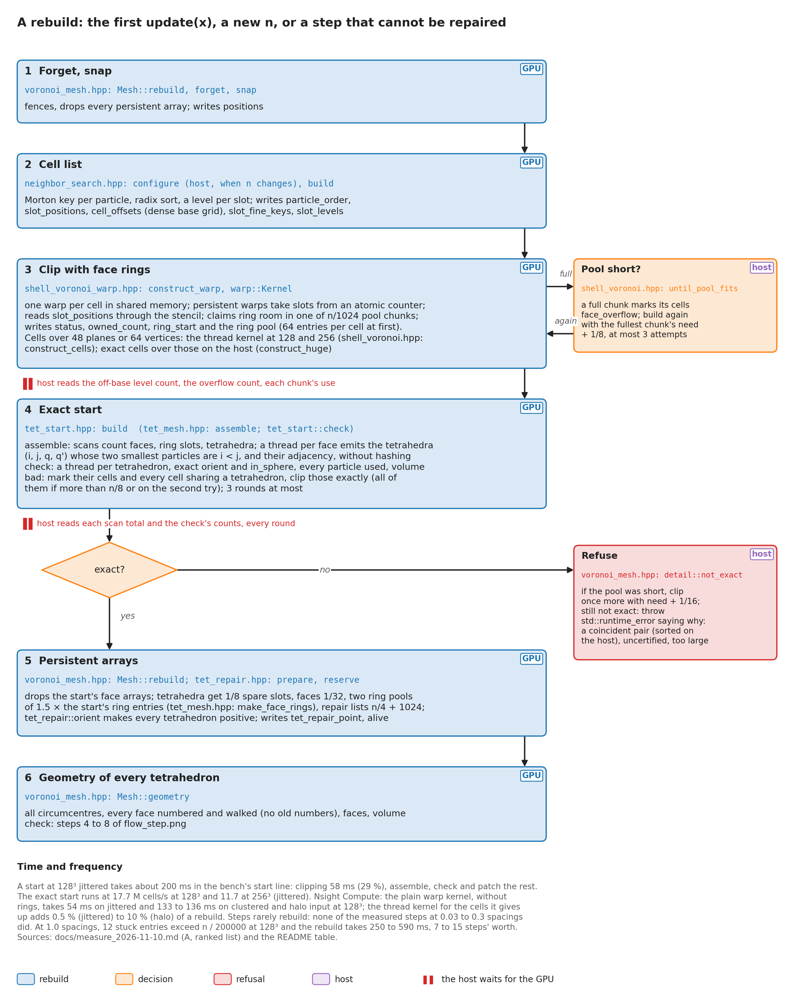
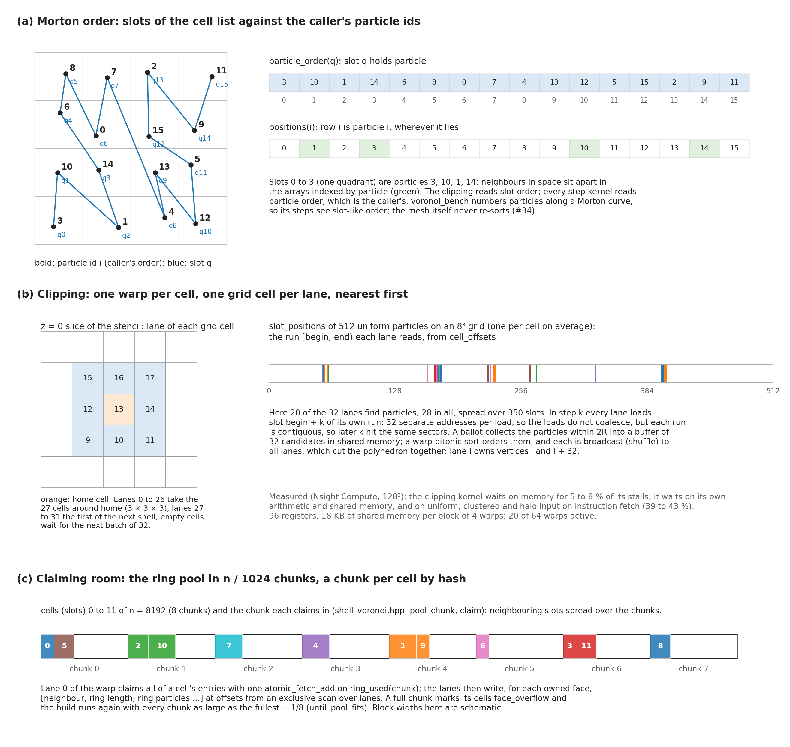
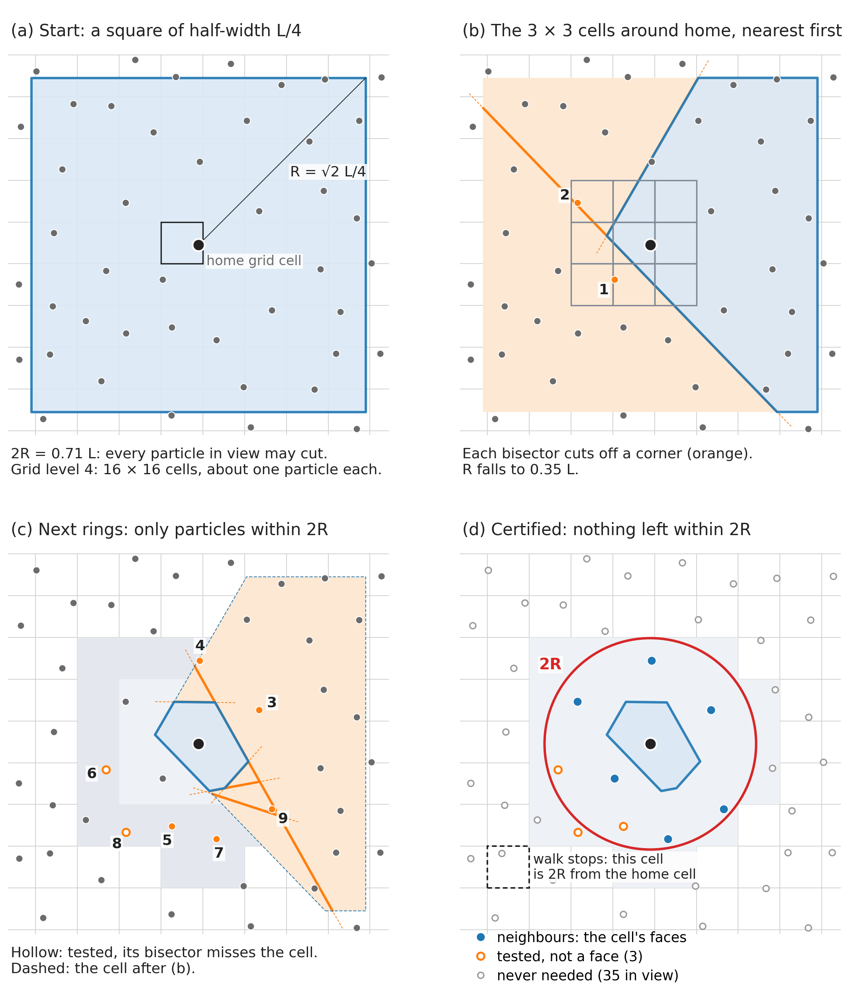
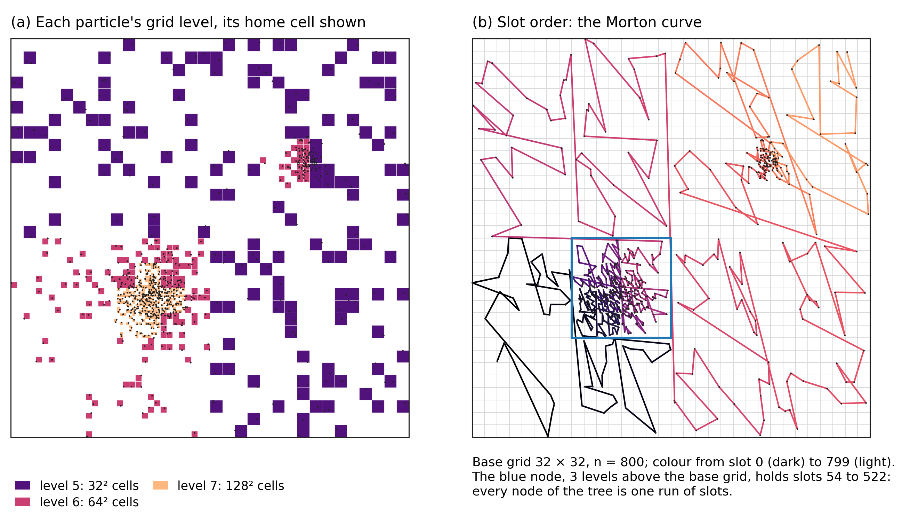
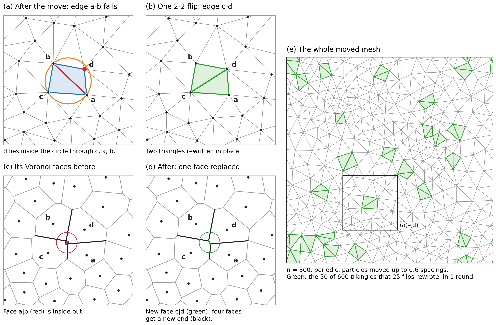
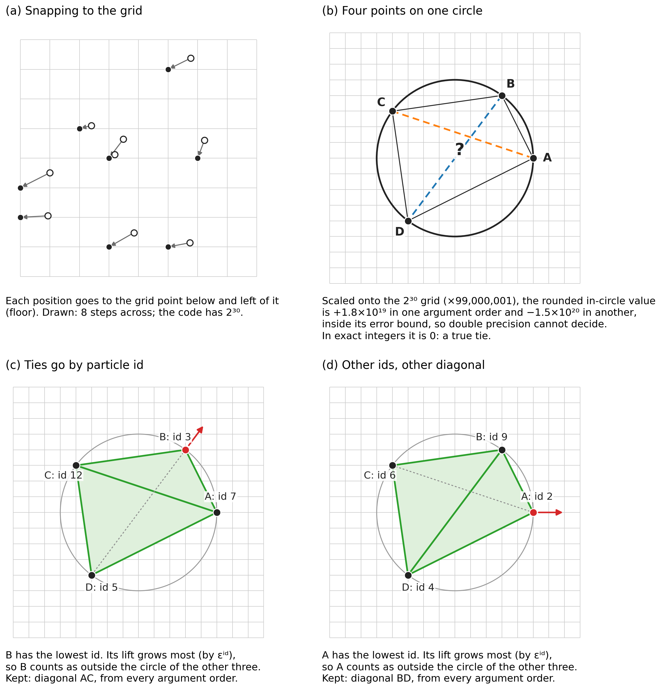

# voronoi-cpp

A C++ library that builds exact Voronoi meshes of moving particles on GPUs. You hand it particle positions in a periodic box and get back the faces, cell volumes and centroids a finite-volume code needs. When the particles move, it repairs the mesh instead of rebuilding it, and the result stays exact. It is written in Kokkos: CUDA (validated on an A100 40 GB), plus OpenMP and Serial builds that run the same code for checks. `voronoi::Mesh<D, Exec>` is complete for D = 3, 2 and 1.

The topology is exact, and so is the geometry up to rounding in every box tested, except for a few fuzz cases where a build numbers one face twice ([#48](https://github.com/Ulli1991/voronoi-cpp/issues/48)) and two others not yet explained ([#45](https://github.com/Ulli1991/voronoi-cpp/issues/45)); see [Limitations](#limitations-and-open-items).

The finite-volume hydro is a separate code, [luna-cpp](https://github.com/Ulli1991/luna-cpp), which takes only the mesh from here (as a submodule, through `voronoi_library` and `voronoi::Mesh`); this repository contains no solver.

The library will be renamed **kikkou** (亀甲, kikkō, the tortoise-shell pattern), with the namespace `kikkou::`, once the open work has landed.

BSD 3-Clause, see [LICENSE](LICENSE).

## Install and build

Dependencies:

- CMake 3.16 or later and a C++17 compiler (gcc 14/15 tested).
- Kokkos 5.0 (5.0.2 in CI, 5.0.99 on Raven) with CUDA, OpenMP or Serial. CUDA uses `Kokkos_ARCH_AMPERE80` on an A100, Kokkos' `nvcc_wrapper`, CUDA 13.0, and `Kokkos_ENABLE_CUDA_LAMBDA` (the default in 5.x).
- Nothing else: the library is header-only (`src/neighbour_search/`, `src/voronoi_construct/`) and CMake exports it as `voronoi_library`.

CUDA (A100), on Raven:

```sh
module load gcc/14 cuda/13.0 cmake
cmake -S . -B build-cuda -DCMAKE_BUILD_TYPE=Release \
  -DCMAKE_PREFIX_PATH=/u/uli/kokkos-cuda \
  -DCMAKE_CXX_COMPILER=/u/uli/kokkos-src/bin/nvcc_wrapper
cmake --build build-cuda -j4
```

OpenMP (CPU), on Raven:

```sh
module load gcc/15 cmake
cmake -S . -B build-omp -DCMAKE_BUILD_TYPE=Release \
  -DCMAKE_PREFIX_PATH=/u/uli/kokkos-gcc15 -DCMAKE_EXPORT_COMPILE_COMMANDS=ON
cmake --build build-omp -j4
```

Elsewhere, point `CMAKE_PREFIX_PATH` at a Kokkos installation with the backend you want. On Raven, build with at most `-j4` on the login node, or inside a Slurm job, and run GPU work through Slurm (`scripts/bench_a100.sh`).

### Compiler flags in use

- Release: `-O3 -DNDEBUG` (CMake's default), C++17 required (Kokkos sets `-std=c++20`), warnings `-Wall -Wextra -Wpedantic` on the programs.
- CUDA: `nvcc_wrapper` with `-extended-lambda -arch=sm_80`. The warp clipping kernel uses `Kokkos::LaunchBounds<128, 5>`, which caps it at 96 registers; 18 KB of shared memory per block.
- OpenMP: `-fopenmp` from Kokkos. The project sets no `-march`; `-DCMAKE_CXX_FLAGS=-march=icelake-server` is worth adding on Raven's CPUs.
- `-DCMAKE_EXPORT_COMPILE_COMMANDS=ON` (always on in `CMakeLists.txt`) writes the database clang-tidy needs: `bash scripts/lint_cpp.sh build-omp` (Raven: `module load clang/20`).
- `-DVORONOI_SANITIZERS=ON` adds address and undefined-behaviour sanitizers to a host build.

## Using it: `voronoi::Mesh`

```cpp
#include "voronoi_mesh.hpp"

voronoi::Mesh<3> mesh(Kokkos::DefaultExecutionSpace{}, box);   // a cube of side box, or
// voronoi::Mesh<3> mesh(exec, exact_predicates::Box(lx, ly, lz)); // any three sides
mesh.update(x);          // x(i, a): positions in [0, side a), particle i = index i
// ... move the particles ...
voronoi::Report r = mesh.update(x);   // repairs the mesh; exact on return
mesh.update_cells();     // per-cell face lists, ordered volumes and centroids
// Faces f < mesh.faces(): owner()(f) < neighbour()(f), area()(f, a) from
// owner to neighbour, face_centroid()(f, a) relative to the owner.
// Cells i: volume()(i), centroid()(i, a) relative to the generator, faces
// cell_face()(k) for k in [cell_face_start()(i), cell_face_start()(i + 1)).
```

What a caller can rely on:

- Particles are the caller's indices. Ties between cospherical particles are broken by index (symbolic perturbation), at the start and in every repair. A permuted input gives the permuted mesh, except that on exact ties faces of zero area can differ.
- Positions are snapped to the grid of the exact predicates, 2³⁰ steps across the longest side, the same step on every axis; topology and geometry both come from the snapped positions. A side that is not a whole number of steps is rounded to one (relative change below 2⁻³¹ longest / side; none for sides in power-of-two ratios such as 2 x 2 x 1/16). `sides()` gives the box used; `box()` is a cube's side.
- Every cell must be certified within one periodic image: its radius must stay below 3/16 of the shortest tile side, and below 1/8 of it where a tile holds fewer than about 180 particles (32 in 2D). The box is cut into tiles of side / round(side / shortest side) along each axis; a cube is one tile. In practice that is about 6 or more particles across the shortest side (a 5³ lattice is refused, 6³ is not; a slab of 16 cells is fine). Otherwise `update()` throws, stating this rule ([#31](https://github.com/Ulli1991/voronoi-cpp/issues/31)).
- `update()` repairs the mesh; the first call, or a change of n, builds it. If the device repair leaves stuck triangles, it finishes on the host or rebuilds on the device, chosen by how many entries are stuck, not by a clock (`voronoi::Fallback`).
- Faces are stored once, by the lower id, so a flux applied with opposite signs conserves exactly. Cell volumes after `update()` are summed with atomics. `update_cells()` sums volumes and centroids over each cell's faces in a fixed order, giving the same bits every run, and builds the per-cell face lists for gathers.
- `clip(x, cells)` rebuilds the listed cells by clipping, independent of the persistent mesh, and returns each face once (a local mode for substeps of active cells). It builds exact cells.
- `rebuild(x)` builds the exact mesh from scratch. `scratch(bytes)` lends device memory between updates.
- `set_layout(voronoi::Layout)` (3D, all off by default) keeps the memory order on long moving runs ([#34](https://github.com/Ulli1991/voronoi-cpp/issues/34)). `every = k` re-sorts the cells along `curve` (Hilbert by default; Morton, Moore, Gray-coded Morton, row-major, reverse Cuthill-McKee) every k updates and at every build, the tetrahedra and faces after them; `far` re-sorts when that share of faces joins cells over 64 ids apart. A re-sort renumbers the cells: when `Report::resorted` is set, cell i is the particle the caller passed as `permutation()(i)`, and the caller renumbers every per-particle array it keeps, positions too, before the next update (`permute(view)` does it). Each particle keeps its neighbours; its geometry agrees to rounding (1e-14), not to the bit. `owner_faces` numbers the faces by owner (`owned_start()(i)` is cell i's first), `owner_bit` sets bit 31 in a list entry whose cell does not own the face (`Mesh::list_face(e)`, `Mesh::list_owned(e)`); neither changes a bit of the geometry. Together they make luna-cpp's hydro 16 % faster on moving Sedov 128³ and cost the mesh 2.3 ms a step and 168 B/cell: +1 % a whole step.
- The dimension is a template parameter, `voronoi::Mesh<D, Exec>` with `exact_predicates::BoxN<D>`; `Box` is `BoxN<3>` (research_notes/dimension_design_2026-11-02.md).
- `voronoi::Mesh<2>` has the contract of `Mesh<3>` on triangles (`voronoi_mesh_2d.hpp`), with two differences. `volume()` is current after `update_cells()` only. There are always exactly 3n faces, numbered for good: a flip gives its face new particles, and a face can have zero length on a lattice. A repaired mesh equals a fresh build bit for bit.

## How it works



What `update()` does with new positions. Normally the mesh is repaired by exact flips on the GPU, which is the green path. If a repair can't finish, or the first time, the mesh is rebuilt from scratch by clipping, the blue path. Input that can't give an exact mesh is refused with an error.

Each stage is explained, with figures, in [docs/how_it_works.md](docs/how_it_works.md); sections 12 to 14 cover memory order, the arrays and the pools.

### One step in detail



Every stage of a step on a built mesh: its kernel (file and function), what it reads and writes, and whether it runs on the GPU or the host. The bars give each stage's share of a step at 128³ (22.98 ms). Flips, the ring walk and face geometry take most of it. Red marks are the 33 places per step where the host waits for the GPU. Grey boxes are optional: the re-sort and the numbering by owner of `Layout`, off by default.

### A rebuild in detail



The same for a full build: snap, cell list, clipping with face rings, the exact start, and the persistent arrays sized with spare room. It shows the pool-retry loop and the refusal.

### Where the data lives


Every array, its bytes per cell, who writes and who reads it (luna-cpp included), and how long it stays valid; the arrays of faces by owner (`Layout`) add 168 B/cell. Everything is on the GPU; the host keeps only counts and nine pinned counters.

### How the GPU touches memory



Clipping: particles in Morton slots, one warp per cell, lanes taking stencil cells of the cell list, and ring-pool chunks claimed by hash.


A step, on a small real mesh: each face computed once by its owner and read by both cells, which reads coalesce and which gather or scatter, a flip's gather and scatter over the tetrahedron rows, and the fixed-order sums of `update_cells()`.

### Memory pools and limits


Peak bytes per cell against what one A100 40 GB holds at 256³ and 384³; where each 32-bit offset overflows (#50); how each pool is sized, grown, and what happens when it runs short.

### The stages, in the order a call runs them

1. **Snapping and exact predicates** (`exact_predicates.hpp`, `Mesh::snap`). Positions go to a grid of 2³⁰ steps across the box, where every geometric test can be done exactly. Ties are broken by particle id.
2. **The cell list** (`neighbor_search.hpp`). Particles are sorted along a Morton curve, and each gets a grid level fitted to the local density.
3. **Clipping** (`shell_grid.hpp`, `shell_cell.hpp`, `shell_voronoi.hpp`, `shell_voronoi_warp.hpp`, `shell_limits.hpp`). Each cell is cut from a large cube by its neighbours' bisectors, nearest first, until no particle within twice its radius is left.
4. **The exact start** (`tet_start.hpp`). The clipped face rings become tetrahedra, which are checked exactly; the cells around any error are clipped again exactly.
5. **The persistent tetrahedra** (`tet_mesh.hpp`). Vertices, adjacency, circumcentres and face rings are kept from step to step.
6. **The repair** (`tet_repair.hpp`). Each step screens for tetrahedra that may fail, then flips them in rounds on the device; votes settle conflicting flips.
7. **The fallbacks** (`tet_flips.hpp`, `voronoi_mesh.hpp`). Stuck triangles are rebuilt on the host, or the whole mesh is rebuilt, and a mesh whose volumes do not fill the box is rebuilt too.
8. **Geometry** (`tet_mesh.hpp`). Circumcentres, then face areas and centroids, then cell volumes.
9. **`update_cells()`** (`tet_cells.hpp`). Per-cell face lists, with volumes and centroids summed in a fixed order.
10. **Memory order** (`mesh_order.hpp`, optional, `Layout`). Between the repair and the geometry: cells re-sorted along a curve, tetrahedra and faces after them; faces numbered by owner; an owner bit in list entries.

2D (`voronoi_mesh_2d.hpp`, `polygon_clip.hpp`, `tri_mesh.hpp`, `tri_repair.hpp`, `tri_finish.hpp`) runs the same stages on triangles, with exact clipping. 1D (`sorted_mesh.hpp`) sorts the generators on a 2⁵² grid and supports `insert()` and `remove()`.



How one cell is clipped. The start square is a quarter of the box wide on each side of the generator; each bisector, nearest first, cuts off a corner. The walk stops once no particle within 2R (red) is left, and most particles are never looked at.



Left: each particle's grid level, fine in the clumps and coarse in the background. Right: the slot order along the Morton curve; every node of the tree, such as the blue one, holds one run of slots.



A flip in 2D: d moved inside the circle through c, a, b, and one flip replaces edge a-b with c-d. In the Voronoi dual this replaces one face and moves the ends of four; the rest of the mesh is untouched.



Four points exactly on one circle: rounded arithmetic gives opposite answers in different argument orders. The exact test sees the tie, and the particle ids decide it the same way for every caller.

## Measured performance

One A100 40 GB, double precision, periodic unit box. Rates are M cells/s: million cells built or updated per second of GPU time. luna-cpp quotes its hydro in G cell updates/s; 154 M cells/s is 0.154 G. Memory is in bytes per cell and GB of 10⁹ bytes. Jobs, commits and further setup are in [docs/measurements.md](docs/measurements.md). The 128³ rebuild and step rows are current (with the fixes of #29, #30, #35, #36 and #45, 1305 MHz). The 256³ column is the code just before those fixes, at 1095 MHz; the fixes cost moving steps 2 to 5 % and rebuilds nothing.

| M cells/s | 2,097,152 cells (128³) | 16,777,216 cells (256³) |
|---|---|---|
| Full rebuild (warp clipping), jittered | 39.4 | 33.7 |
| Full rebuild, uniform random | 19.7 | 17.0 |
| Full rebuild, clustered (Gaussian blobs, ~1:500) | 15.4 | 14.1 |
| Full rebuild, halo (1:10⁴ core to edge) | 14.1 | |
| Full rebuild, lattice / wave | 49.2 / 37.9 | |
| Exact start (warp with rings + `tet_start::build`), jittered | 17.7 | 11.7 |
| Moving-mesh update, 0.03 spacings per step | 196 | 182 (with `update_cells()`) |
| Moving-mesh update, 0.1 spacings per step | 114 | 129 (with `update_cells()`) |
| Moving-mesh update, 0.3 spacings per step | 55.7 | |
| `update_cells()` alone, 0.03 / 0.1 / 0.3 spacings (older code) | 574 / 448 / 436 | |
| Update + `update_cells()`, 0.03 / 0.1 / 0.3 spacings (older code, bit-reproducible) | 154 / 94 / 51 | |

Spacings per step is how far a smooth flow moves the points per step, in mean interparticle spacings. 0.03 is a typical hydro step and 0.3 a very large one, with more flips per step and lower throughput. The six inputs (jittered lattice, uniform random, clustered, halo, lattice, wave) are described in the measurements file.

GPU memory, as the peak of all arrays the mesh allocates: a plain warp rebuild takes 701 B/cell (656 at 256³); a step with face lists peaks at 1998 B/cell, the same at 128³ and 256³: 1950 for the mesh's arrays, the rest the bench's positions. The arrays and pools are in the figures above.

A thin slab (Lz = 16 spacings, up to 16.8M cells) rebuilds at the cube's rate, 39.9 M cells/s for jittered input.

### Long runs

The rates above are early steps. On a smooth flow where every cell moves, the mesh loses its memory order and the step slows from 124 M cells/s at step 100 to 61 at step 500 (128³, 0.1 spacings, update and `update_cells()`, [#34](https://github.com/Ulli1991/voronoi-cpp/issues/34)). A Hilbert re-sort every 50 updates (`Layout`) keeps it: 121 M cells/s over 500 steps against 81.6 without, re-sorts paid (each about one step's time); at 256³ 166 against 127. Hilbert, Moore and Morton are within 1 %, row-major and reverse Cuthill-McKee 11 to 13 % slower. Flows with little bulk motion do not show the decay: on Sedov the loss is at most 4.5 % over a run. Tables in [docs/measure_resort_2026-11-10.md](docs/measure_resort_2026-11-10.md).

### GPU against a full CPU node, same code

Older code (see the measurements file) built with the OpenMP backend on one Raven CPU node (2x Xeon Platinum 8360Y, 72 cores), against one A100, at 2,097,152 cells in double, in M cells/s:

| | 72-core CPU node | A100 | A100 / CPU |
|---|---|---|---|
| Full rebuild, jittered / uniform / clustered | 4.1 / 2.8 / 2.0 | 39.9 / 19.9 / 15.5 | 9.7 / 7.0 / 7.9 |
| Moving-mesh update, 0.03 / 0.3 spacings | 11.5 / 1.7 | 202 / 57 | 17.5 / 33 |
| `update_cells()` | 43 | 343 | 7.9 |

Every phase gains more than the A100's 3.9 times the node's memory bandwidth. The CPU build is the generic Kokkos path with no hand vectorisation, so a CPU-tuned code would narrow the gap.

### 2D and 1D

`voronoi::Mesh<2>` on one A100 at 1305 MHz, double, 0.03 spacings per step:

| M cells/s | jittered | random | clustered | lattice |
|---|---|---|---|---|
| Build, 2²⁰ cells | 100 | 50 | 44 | 115 |
| Step (repair, faces, cell lists), 2²⁰ | 765 | 791 | 789 | 749 |
| Build, 2²⁴ cells | 134 | 58 | 52 | 168 |
| Step, 2²⁴ | 1056 | 1059 | 1061 | 1023 |

Jittered at 0.1 / 0.3 spacings: 770 / 744 at 2²⁰, 1024 / 1015 at 2²⁴. Peak GPU memory is 537 to 574 B/cell.

`voronoi::Mesh<1>`, mesh phases of a moving Sod run: 18,905 M cells/s at 2²⁰ and 39,351 at 2²⁴ (1095 MHz, older code).

## Tests

Thirteen CTest programs, 22 tests, specify the library. Oracles, run times and what PASS means are in [TESTING.md](TESTING.md).

| Test | Specifies |
|---|---|
| `exact_predicates` | signs equal an independent integer evaluation; ties; periodic images; snapping for any box |
| `clipping` | cells certified, closing and on the bisectors (brute force); thread, warp and exact kernels agree |
| `mesh` | `from_rings` against a host construction; adjacency, exact check, volumes |
| `start` | the start is the Delaunay tetrahedralization (brute-force oracle) for 13 layouts and several boxes |
| `repair` | after every step of a flow the mesh equals an exact rebuild |
| `voronoi_mesh` | the contract of `voronoi::Mesh` that luna-cpp relies on |
| `order` | the curves (Hilbert and Moore continuous, Moore closed); a re-sort's permutation contract for every ordering (the caller's rows follow, each particle keeps its neighbours, geometry to rounding); faces by owner and the owner bit change no bit |
| `mesh_cases.*` | 3D special cases against an oracle that shares no code with the library: coincident points, extreme contrast, thin boxes, high valence, large motion, fallbacks, bits across backends |
| `distortion` | 14 flows that wind the mesh up, with no solver: shear, vortex, Taylor-Green, turbulence, collapse, expansion and more |
| `mesh2d` | the 2D mesh against independent oracles; a repaired mesh equals a fresh build bit for bit; steps of order the box |
| `mesh1d` | the 1D line: sorting, walls, insert and remove |
| `mesh_fuzz` | random point sets, boxes and motions against the oracle, plus every saved failing case in `src/test/fuzz_cases/`; ctest runs a smoke set, `scripts/mesh_fuzz_cpu.sh` and `scripts/mesh_fuzz_gpudev.sh` run campaigns |
| `metamorphic` | exact transformations of the input give the transformed mesh: shifts by whole grid steps, axis swaps and rotations, permuted ids, a doubled box; 3D, 2D, 1D. Geometry agrees to rounding (tolerance 1e-10); a doubled box is exact |

```sh
ctest --test-dir build-cuda --output-on-failure         # A100: ~5 minutes
OMP_NUM_THREADS=1 ctest --test-dir build-omp            # one CPU core
sbatch -o build-cuda/bench-%j.out scripts/bench_a100.sh build-cuda   # ctest + A100 checks
```

`voronoi_bench` (`src/bench/`) times and checks the pipeline:

```text
voronoi_bench rebuild <n> <distribution> [repeats=5] [--no-check] [--memory] [--box=Lx,Ly,Lz]
voronoi_bench step <n> <distribution> <displacement> [steps=10] [--verify] [--memory] [--kernels] [--checksum] [--box=Lx,Ly,Lz]
                    [--order=every] [--curve=morton|hilbert|moore|gray|row|rcm] [--every=k] [--far=share] [--owner-faces] [--owner-bit] [--dump-cells=path]
```

`rebuild` times the warp clipping. `--order=k` prints the memory order every k steps; `--curve`, `--every`, `--far`, `--owner-faces` and `--owner-bit` set the `Layout`, and the bench's points follow each re-sort; `--dump-cells` writes each particle's cell for `scripts/resort_bits.py`. `--box` (default 1,1,1) sets the periodic box; `--box=2,2,0.0625` with 4194304 jittered points is a 512 x 512 x 16 slab. Distributions: uniform, jittered, lattice, wave, clustered, halo, or `<sc|bcc|fcc|shells|planes|pairs>@<perturbation in spacings>`.

## Limitations and open items

Open bugs, found by fuzzing the mesh against an oracle that shares no code with it:

- **A full build can number one face twice** ([#48](https://github.com/Ulli1991/voronoi-cpp/issues/48)): two rows of one pair with the same ring; the cells around it are then wrong (closure 0.02, total volume off by 1e-4), and `update()` does not see it. Found in 3 boxes of the CPU fuzz and in 3 of 604 A100 cases (up to 4.5M particles).
- Of the 24 fuzz cases of [#45](https://github.com/Ulli1991/voronoi-cpp/issues/45), 19 were rounding and are fixed (centres stored in grid steps, below); 3 are #48, and 2 are not explained: a repaired mesh 2.5 % off a fresh build in one cell (fresh_volume, hcp box), and a cell centroid 1e-3 of the cell off brute force in a unit cube.
- OpenMP and CUDA can pick different valid tetrahedra on the same input; each backend is deterministic ([#38](https://github.com/Ulli1991/voronoi-cpp/issues/38)). In 2D a repaired mesh can differ from a fresh build in the last bits on some inputs ([#39](https://github.com/Ulli1991/voronoi-cpp/issues/39)).
- The fuzz campaign so far: about 116,000 3D, 2 million 1D and 31,000 2D cases on the CPU, and 920 on the A100, 604 of them from 3e4 to 1.6e7 particles (113 above a million). Of those 604, 85 ran out of time (120 s, or 280 s from a million up): builds with large cells, a void or nearly coplanar points take minutes ([#49](https://github.com/Ulli1991/voronoi-cpp/issues/49)).

Other limits:

- Bit-reproducible moving runs cost 2.4 to 4.7 % on the mesh step alone.
- CUDA and Serial give different last bits of volumes and centroids ([#27](https://github.com/Ulli1991/voronoi-cpp/issues/27)).
- Clipping alone is not watertight on uniform random input at 2.1M cells; the exact start makes the mesh exact.
- Particles on one grid position (grid step box / 2³⁰) have no Voronoi cell. `update()` refuses them on every path with a `std::runtime_error` naming a pair by id, and does not merge them. Finding out takes a rebuild, so such a step costs one. After a refusal there is no mesh (no faces, no particles) and the next `update()` builds from scratch. Zero particles are a `std::invalid_argument` and change nothing.
- `update()` does not look at its input: a NaN or infinite coordinate is snapped to some grid position, with no error.
- A cell may hold up to 16000 planes and 32000 vertices during its exact clipping; past 128 planes or 256 vertices it is built on the host. Past those limits `update()` refuses, naming them. Particles around a void cost O(k²) at the start: about 1 s at k = 2000, 2 minutes at k = 20000 with a particle in the middle (8 CPU threads).
- A step of order the box (random kicks of 0.6 box) can end the device repair with nothing stuck on a mesh that covers the torus many times. `update()` sees it in the total volume of the cells, off the box by more than 1e-6, and rebuilds (`Report::overlapped`). That check is on the volume alone: a wrong mesh whose volumes still add up to the box within 1e-6 would pass it.
- `Fallback::cheapest` takes the host path only up to n / 200000 stuck entries (10 at 2.1M cells, none below 200000); the rest is a rebuild, which needs the memory of a start. The host path stops after 2²⁰ tetrahedra of local Delaunay builds (about a second on one core) and the step rebuilds instead ([#33](https://github.com/Ulli1991/voronoi-cpp/issues/33)).
- Geometry rounds with the positions: the relative volume of a cell h grid steps wide is good to about 4e-8 / h. Position differences are taken in whole grid steps (fixed in [#29](https://github.com/Ulli1991/voronoi-cpp/issues/29)), and circumcentres are computed and stored in grid steps, wrapped into the box, so equal centres of cospherical tetrahedra get equal bits whatever corner or periodic image they come from ([#45](https://github.com/Ulli1991/voronoi-cpp/issues/45)); a box whose step is not a power of two is then as good as any other. #29 costs moving steps 1 to 3.5 %, #45 another 1 to 2 %. It is exact down to clumps of 512 steps (error 8e-10), and particles one grid step apart are still exact.
- The device repair breaks down near one spacing of motion per step (stuck triangles, host or rebuild fallback); substepping helps.
- Ghost particles (multi-GPU), repair limited to active regions, and refinement and derefinement are not implemented yet.
- Box sides from 1e-75 to 3e77 (`Mesh<3>`, `Mesh<2>`): past these the geometry, which multiplies up to four lengths, over- or underflows a double (measured: exact from 1e-76 to 3e77 with 907 points, from 1e-75 with 262144, wrong past 1e78). Float face rows narrow it to 1e-16 to 1e20. Outside, the constructor throws `std::invalid_argument` ([#32](https://github.com/Ulli1991/voronoi-cpp/issues/32)). Boxes in cgs units (3.086e24) are inside.
- Periodic boxes only (any three sides; see the certification limit above for thin slabs). Only 1D has walls.
- A periodic `Mesh<1>` with every particle on one grid step has no cells: `update()`, `order()` and `remove()` refuse it with a `std::runtime_error` naming a pair ([#37](https://github.com/Ulli1991/voronoi-cpp/issues/37)); after the refusal there is no mesh and the next `update()` builds. Doubled particles are otherwise allowed in 1D, ties by id. `Mesh<1>` needs at least 3 particles (`std::invalid_argument`).
- `voronoi::Mesh<2>` refuses as `Mesh<3>` does: particles on one grid position by name, cells out of certified reach, no particles; it also refuses a cell of more than 256 edges. A refused update leaves no mesh and the next builds. Its repair is checked by the sum of the signed areas (`Report::overlapped`), and a step that leaves triangles wider than half a period, or takes more than 1000 rounds, ends in a rebuild.
- Memory limits 3D on one A100 to about 256³ today: with luna-cpp's hydro a moving run peaks at 2255 B/cell (2319 in double precision), of which the mesh's start peak alone is 1728. The target is 384³, about 720 B/cell ([#28](https://github.com/Ulli1991/voronoi-cpp/issues/28)).

## Roadmap

Done: exact 3D, 2D and 1D meshes, incremental cell lists, special-case tests, the refusals above, a mesh fuzz driver, and the fixes of the silent volume errors ([#29](https://github.com/Ulli1991/voronoi-cpp/issues/29), [#30](https://github.com/Ulli1991/voronoi-cpp/issues/30)), the 2D hang ([#36](https://github.com/Ulli1991/voronoi-cpp/issues/36)) and a bad read in the host fallback ([#35](https://github.com/Ulli1991/voronoi-cpp/issues/35)), the reach rule ([#31](https://github.com/Ulli1991/voronoi-cpp/issues/31)), a bound on the host path ([#33](https://github.com/Ulli1991/voronoi-cpp/issues/33)), cgs-sized boxes on CUDA ([#26](https://github.com/Ulli1991/voronoi-cpp/issues/26)) and a stated box range ([#32](https://github.com/Ulli1991/voronoi-cpp/issues/32)).

1. Fix the doubled face of a build ([#48](https://github.com/Ulli1991/voronoi-cpp/issues/48)), bound the time of builds with large cells ([#49](https://github.com/Ulli1991/voronoi-cpp/issues/49)), and explain the last two cases of [#45](https://github.com/Ulli1991/voronoi-cpp/issues/45).
2. Mesh speed: done, the re-sort ([#34](https://github.com/Ulli1991/voronoi-cpp/issues/34)) and faces numbered by owner (+16 % hydro on Sedov, but its numbering pass gives most of it back: +1 % a whole step); next fewer clips, and the repair rounds and fixed cost per step.
3. Cut memory to 384³ on one A100 ([#28](https://github.com/Ulli1991/voronoi-cpp/issues/28)): float faces, `tet_centre`, repair lists, start peak.
4. Point insertion and removal ([#25](https://github.com/Ulli1991/voronoi-cpp/issues/25)): done in 1D (`Mesh<1>::insert`, `remove`), then 2D and 3D.
5. Clustered rebuild tuning.
6. Multi-GPU: overlapped against blocking communication across two nodes first.
7. Refinement and derefinement in 3D.

## Repository layout

- `src/neighbour_search/`, `src/voronoi_construct/`: the library.
- `src/test/`: the tests and their support code; `mesh_cases_test` has its groups in `src/test/mesh_cases/` (one file per group, shared helpers in `common.hpp`). `src/bench/`: `voronoi_bench`, `mesh2d_bench`.
- Used by luna-cpp, keep: `voronoi_library`, `src/test/check.hpp`, `src/test/support.hpp` (and what it includes), `src/bench/device_memory.hpp`.
- `scripts/`: lint and A100 benchmark, test and `compute-sanitizer` (`sanitize_a100.sh <build> <memcheck|racecheck|initcheck|synccheck>`) scripts.
- `research_notes/`, `reports/`: status notes and surveys.

CI (`.github/workflows/checks.yml`) checks the comment rules (a header per file, a docstring on every multi-line library definition, comment runs of 3 lines at most) and the formatting of changed lines (`.clang-format`, `scripts/check_format.py`), runs clang-tidy (ordinary build) and the CPU tests (ordinary and sanitizer builds) against a pinned Serial Kokkos 5.0.2. It does not run GPU jobs.
