# How voronoi-cpp works

One section per stage, in the order a call to `voronoi::Mesh<3>::update` runs them. Each says what the stage does, what goes in and comes out, why it is done this way, what can go wrong and how that is caught, and where to read the code. 2D and 1D follow at the end. Finer details are in [design.md](design.md).

The construction figures are drawn by `scripts/construction_figures.py` from real point sets. The geometry comes from Python ports of the library's 2D code, checked against `scipy.spatial` (see [design.md](design.md#construction-figures-scriptsconstruction_figurespy)). Most of them are 2D, where a picture is honest. 3D does the same with one more dimension, and the text says where it differs.
The figures of the control flow, the data, the GPU access patterns and the memory pools (sections 12 to 14) are drawn by `scripts/flow_detail.py`, `data_figure.py`, `access_figures.py` and `memory_figure.py`. Their rules are read from the code of main, their numbers come from [measure_2026-11-10.md](measure_2026-11-10.md), [measurements.md](measurements.md) and the README, and each figure names its source.

**The whole method on one example.** 96 particles in a periodic square (64 in a dense patch, 32 around it), the same particles in every panel: the build (1 to 5), a step (6 to 10), the fallbacks (11) and the optional re-sort (12). Each panel says what happens, which file and function do it, and whether it runs on the GPU or the host; the sections below take each stage in turn. `scripts/overview_figure.py` runs `Mesh<2>` and its stages on these particles through a small driver (`scripts/overview_mesh2d.cpp`, Kokkos Serial on the host) and draws what the library returns: slots and levels, rings, triangles, the screen's list, the flips, circumcentres, faces, cell lists and sums. The walk of the one clipped cell (panel 3) comes from the Python port of `construction_figures.py`, which the script checks against the library's slots, levels and the ring of every cell. 2D stands in for 3D: polygons for polyhedra, triangles for tetrahedra, 2-2 flips for 2-3 and 3-2 flips, `polygon_clip` and `tri_*` for `shell_voronoi` and `tet_*` (each panel's second code line names the 3D code); `update_cells()` is the same code in both. The re-sort exists only in `Mesh<3>`: panel 12 orders the particles along a 2D Hilbert curve on the library's 2D faces, after many steps of an area-preserving flow. Panel 11's jump leaves one inverted triangle; with `Fallback::host` the host replaces a patch of 11 triangles and the mesh is exact, while the default (`cheapest`) rebuilds, since 96 cells allow no host work (n / 4000). In panel 7 many edges are listed because the box is tiny: an edge longer than a quarter of the box always goes to the exact test. The PDFs next to the PNGs are for print, readable at two journal columns.

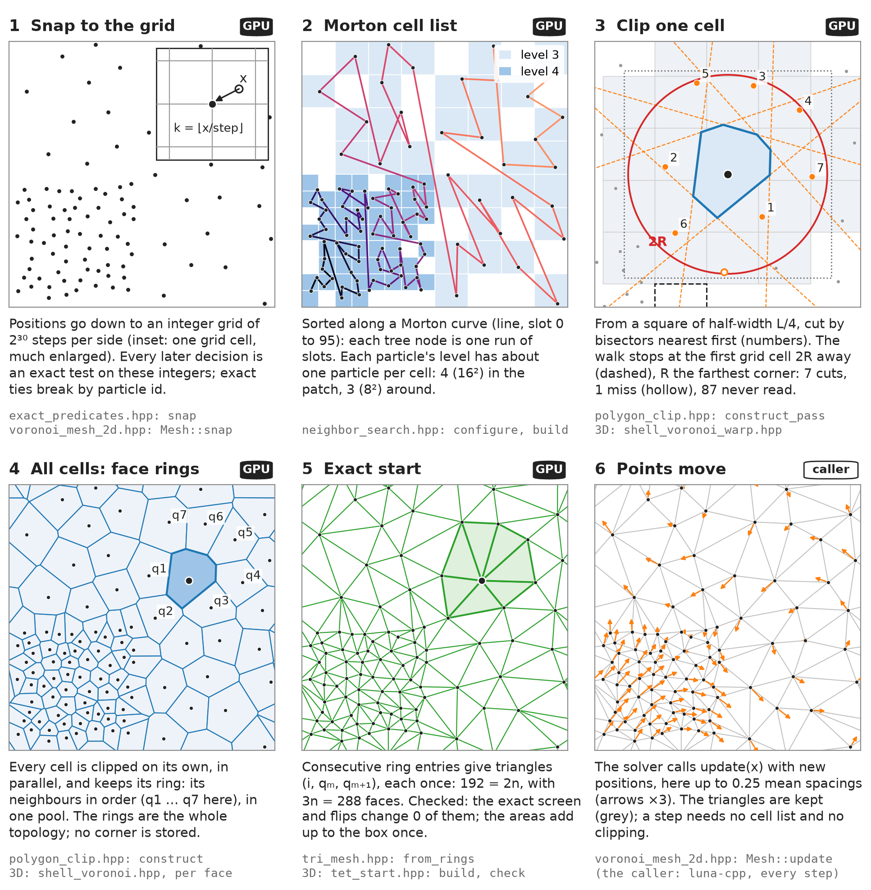

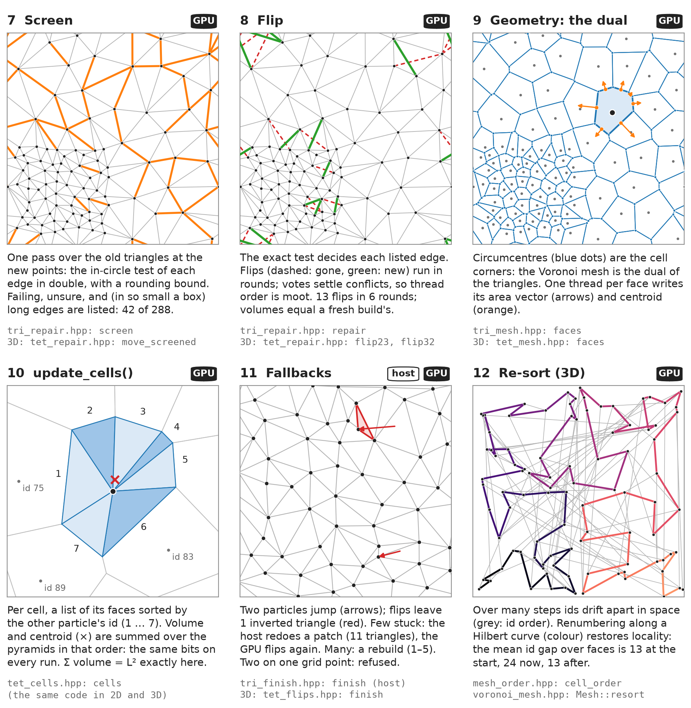

The control flow of one `update()`, with its decisions:

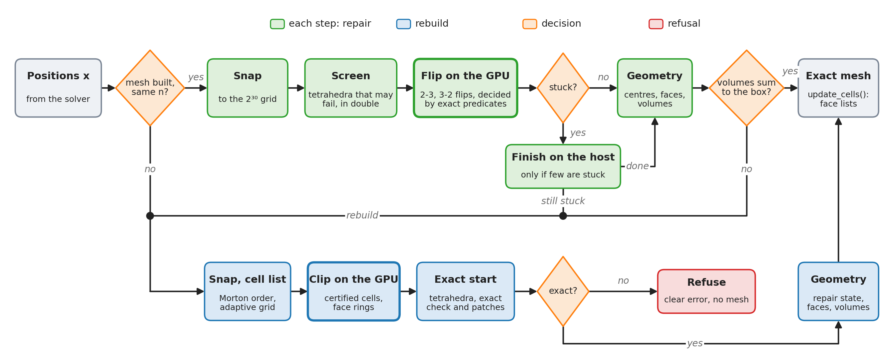

**One step, in detail.** Each box names its kernels (file: function), what they read and write, and whether they run on the GPU or the host. The bars are each stage's kernel time per step at 128³, jittered input, 0.1 spacings per step: the Kokkos Tools table of [measure_2026-11-10.md](measure_2026-11-10.md#a-cost-of-a-moving-step), 22.98 ms in all. The red marks are where the host waits for the GPU: it copies a count back and fences (the sliver count, the work size and counters of each flip round, the face count, the ring totals, the volume sum), because the count sizes the next launch. Nsight Systems counts 33 such synchronisations and 61 launches per step on that input. What to take from it: the flip rounds and the bookkeeping of face numbers and rings are over half of a step (12.8 ms), the geometry itself (centres, faces, cell sums) a fifth (4.6 ms). The waits cost little at this size: 21.75 ms of GPU time in 22.2 ms of wall time.

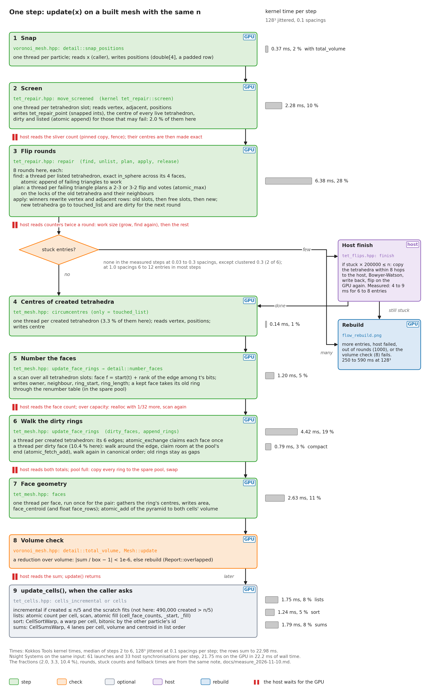

**A rebuild, in detail.** The clipping with face rings, the exact start, then the persistent arrays, sized from the start with spare room. The host waits after each clipping pass (the count of off-base levels and of overflowing cells, the use of every pool chunk) and after each scan and check of the start. What to take from it: at 128³ a start is about 200 ms, 29 % of it clipping; a step rebuilds only when the repair cannot finish, which none of the measured steps at 0.03 to 0.3 spacings needed, and then it costs 7 to 15 steps.

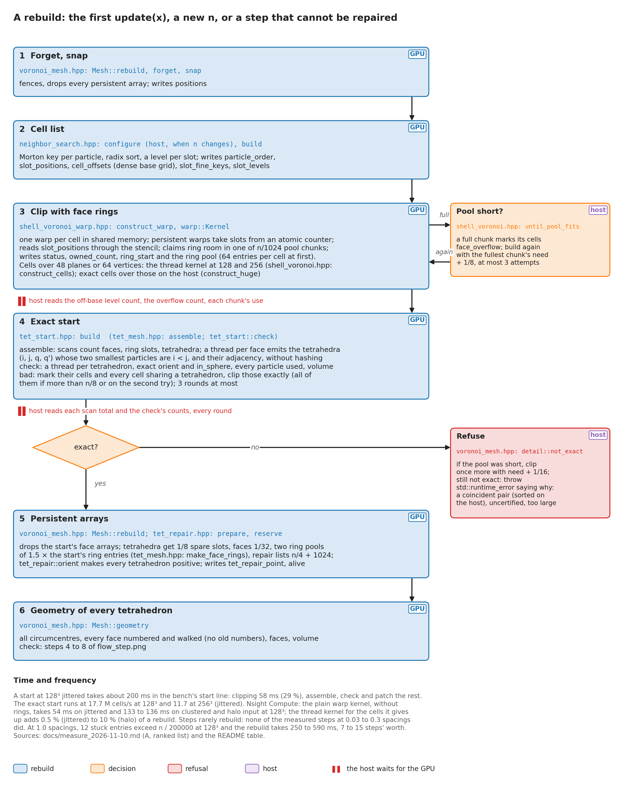

## 1. Snapping and exact predicates

**What.** Every position is moved to a grid of 2³⁰ steps across the longest side of the box, the same step on every axis. Every geometric decision is then made on these grid points by exact predicates: the orientation of four points, and whether a point lies inside the sphere through four others.

**In and out.** In: positions `x(i, a)` in `[0, side a)`. Out: snapped positions (`k × step`, `k` an integer). The predicates take integer differences between grid points, wrapped to the nearest periodic image.

**Why.** Rounded arithmetic can answer "inside or outside?" differently for the same four points, depending on their order or on which thread asks. Two cells would then disagree about a face they share, and the mesh would have holes. On the grid, differences are exact integers, so a predicate can be computed exactly whenever doubles are not sure. Each predicate first evaluates its determinant in double with a bound on the rounding error. Only when the value lies inside the bound does it repeat the evaluation in integers: 128 bits for the orientation, a 256-bit sum for the in-sphere test (in 2D, 64 and 128 bits).

**Range.** The predicates are exact for any box, but the geometry (circumcentres, areas, volumes) multiplies up to four lengths in doubles. It stays finite and exact for sides from 1e-75 to 3e77, narrower with float face rows (1e-16 to 1e20); the constructor refuses other sides ([#32](https://github.com/Ulli1991/voronoi-cpp/issues/32)).

**Float keys.** The warp clipping keeps its float keys and plane normals in units of the tile width, so the size of the box never reaches them: a cube of side 3.086e24 builds on CUDA ([#26](https://github.com/Ulli1991/voronoi-cpp/issues/26)).

**Ties.** Points that lie exactly on one sphere (on a lattice, for example) give an exact zero. The tie is broken by symbolic perturbation: each point's lift |p|² is raised by εⁱᵈ, so the particle with the lowest id is raised most. Every caller, in any argument order, gets the same answer, so the mesh is one well-defined Delaunay tetrahedralization even for cospherical input.

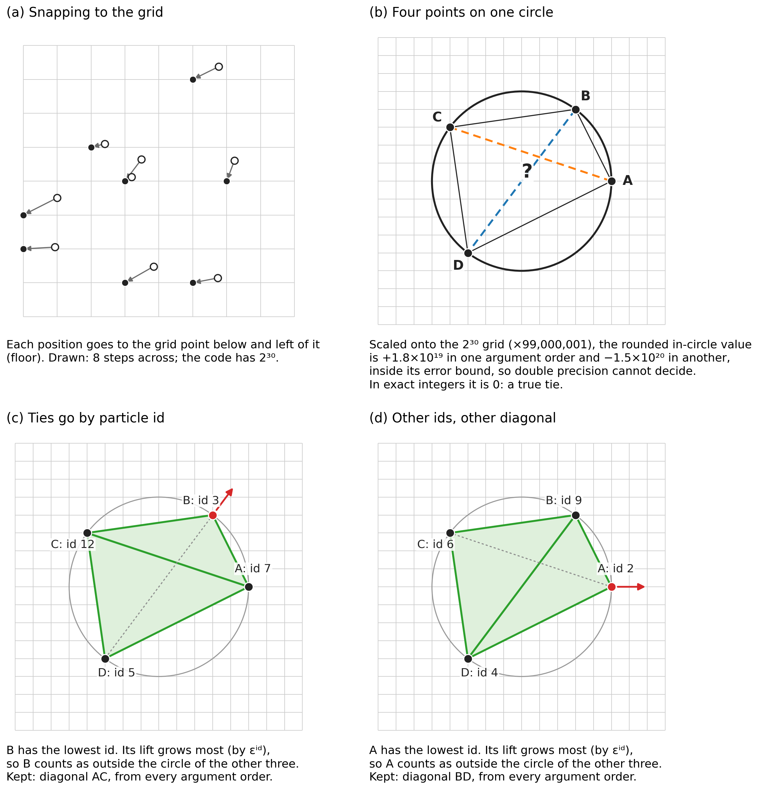

(a) Snapping takes each position down to the grid point below and to the left (floor); the drawing shows 8 steps, the code has 2³⁰. (b) Four points on one circle, scaled onto the real grid: the rounded test gives opposite signs in two argument orders, both inside its error bound, and the exact value is 0. (c, d) The lowest id counts as outside the circle of the other three, so the diagonal that avoids it is kept; other ids keep the other diagonal.

**What can go wrong.** Two particles on one grid point have no bisector and no cell. `update()` refuses them with an error that names a pair. A side that is not a whole number of steps is rounded to one, and `sides()` returns the box actually used. `update()` does not check its input: a NaN is snapped to some grid point without an error.

**Read.** `exact_predicates.hpp` (`BoxN`, `snap`, `orient`, `in_sphere`), `exact_predicates_2d.hpp` (`in_circle`), `Mesh::snap` in `voronoi_mesh.hpp`.

## 2. The cell list

**What.** The particles are sorted along a Morton curve, and each particle is given a grid level whose cells hold about one particle near it.

**In and out.** In: snapped positions. Out: `order(q)`, the particle in slot q; `positions(q)` in slot order; `cell_offsets`, a dense table over the base grid (base cell c owns slots `[cell_offsets(c), cell_offsets(c + 1))`); `fine(q)`, the Morton key inside the base cell, 10 levels deeper; and `level(q)`.

**Why.** On a Morton curve every node of the quadtree (octree in 3D) owns one contiguous run of slots. A grid cell at any level is therefore found either from the dense table, for the base level and coarser, or by a binary search on `fine`, for finer levels. No tree is stored. The level per particle lets clipping walk small cells in a clump and large ones in a void. The rule: take the deepest node around the particle that holds at least 64 particles, then go down by log₄ (log₈ in 3D) of its count. Ties in the sort keep particle-id order, so the slot order is deterministic. The base grid has about one particle per cell on average (2^levels cells per side, levels between 2 and 10), and a long box is cut into near-cubic tiles, each the root of its own tree.

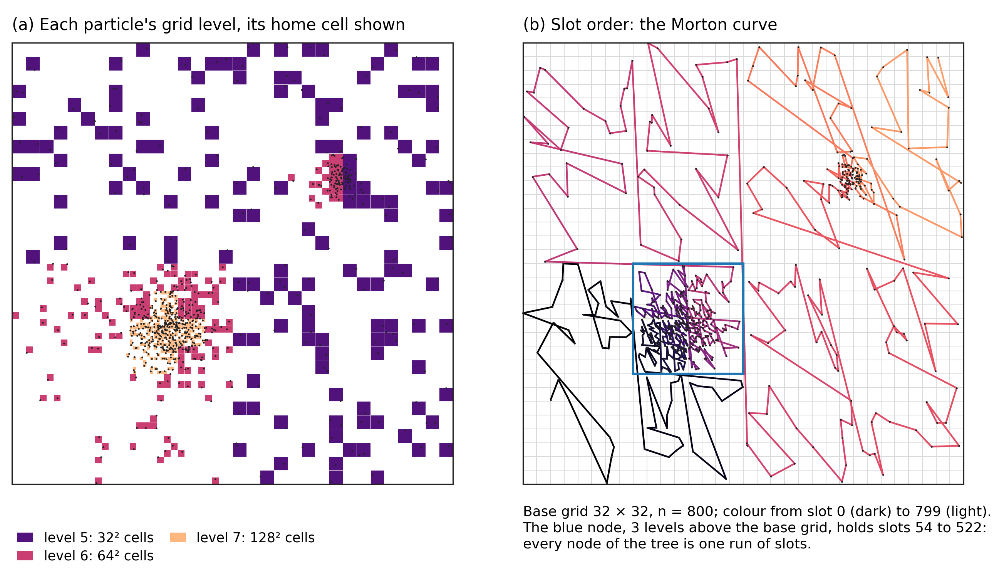

(a) Each particle's grid level, drawn as its home cell at that level: coarse cells in the sparse background, fine ones in the clumps. There is no single adaptive tree; levels belong to particles. (b) The slot order. The code puts the x bit above the y bit, so the curve runs up before it runs across. The blue node holds one run of slots.

**What can go wrong.** A box far longer than it is wide has too many tiles for the keys to fit in 64 bits; `configure` throws. The list is built on a rebuild and for `clip()`. A repair step does not rebuild it, because the repair needs no neighbour search.

**Read.** `neighbor_search.hpp` (`configure`, `build`).

## 3. Clipping one cell

**What.** Each cell is built on its own. It starts as a big cube around the generator and is cut by the bisector of each nearby particle, nearest first, until no particle left can cut it.

**In and out.** In: the cell list. Out, per cell: a status, and its faces. A rebuild records face rings: for each face it owns, the neighbour and the ring of particles whose bisectors bound the face. `clip()` records face geometry instead. A face belongs to the cell with the lower id.

**Why it stops.** Let R be the largest distance from the generator to a vertex of the current cell. A particle farther than 2R cannot cut it. The walk visits grid cells at the particle's level in rings of increasing distance from the home cell. It stops at the first grid cell lying 2R or more from the home cell, and the cell is then certified. If the stencil (at most 4 cells out) ends first, the walk goes one level coarser and skips the cells it has already covered.

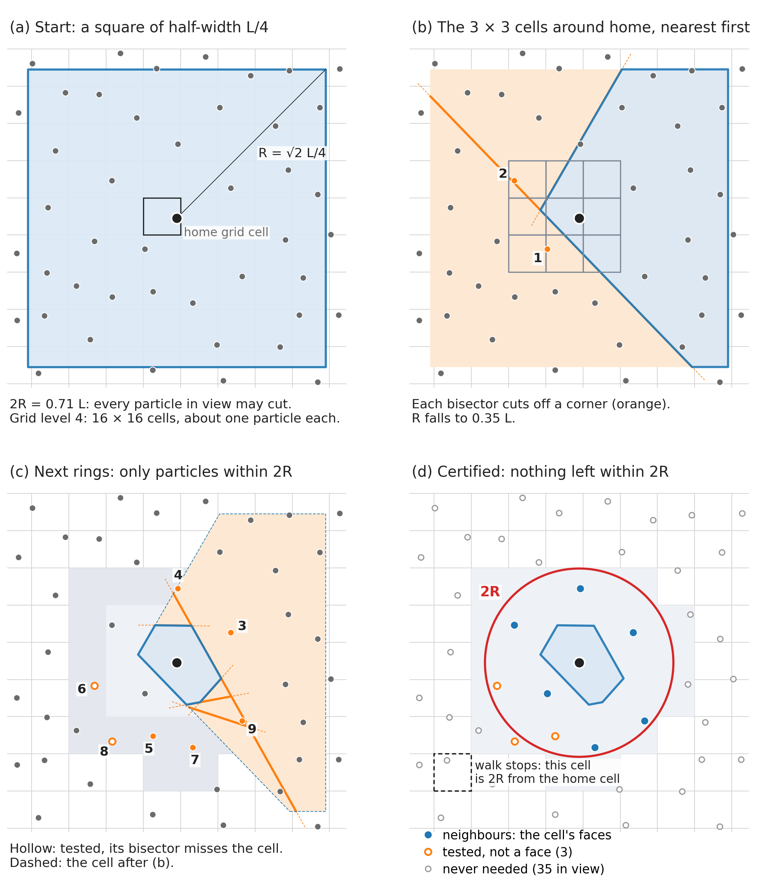

(a) The start is a square (a cube in 3D) of half-width L/4, a quarter of the shortest side, so at first every particle in view may cut. (b) The particles of the 3 × 3 cells around home, clipped nearest first. Each bisector cuts a corner off, and R shrinks. (c) Later rings add only particles within 2R. Hollow ones are tested, but their bisector misses the cell. (d) The cell is certified. Grey particles were never needed.

**Nearest first, within a batch.** Candidates are not sorted globally. A small buffer is sorted and clipped whenever it fills or a batch ends: in 2D after each ring of the stencil (16 candidates), in 3D every 32 grid cells (32 candidates). The order changes how much work a cell takes, not which cell comes out (up to rounding in the rounded cells).

**Two kernels.** On CUDA one warp builds one cell in shared memory (`shell_voronoi_warp.hpp`): lanes share the vertices and planes, a cut is done by all lanes at once, and persistent warps take cells from a counter. Other backends, and cells that overflow the warp's capacities, use a thread per cell (`shell_voronoi.hpp`). Both use rounded cells in double, cutting a vertex when it lies beyond a bisector by more than a rounding tolerance. An exact cell (`ExactCell`) decides every cut by the exact perturbed in-sphere sign; the start uses it to patch (stage 4).

**Pools.** Faces and rings go into one shared pool. The ring pool is split into chunks, and each cell claims room in a chunk chosen by a hash of its slot, so that the claims do not all wait on one counter. A cell whose chunk is full is marked `face_overflow`, and the build runs again with a pool sized from what was needed.

**What can go wrong**, by status:

- `uncertified`: the walk reached the coarsest grid the box allows and was not done. The walk ends at level 2 (4 grid cells per tile side, reach 1) and certifies most at level 3 (reach 3 of 8 cells), so R must stay below 3/16 of the shortest tile side, and below 1/8 of it for a particle that starts at level 2 (fewer than about 2^(2.5 D) particles in its tile); farther, the cell could meet its own periodic image. A thin slab with too few particles across it is refused, with that reason.
- `plane_overflow`, `vertex_overflow`: more than 48 planes or 64 vertices. The cell is built again with 128 and 256, and then on the host as an exact cell with 16000 and 32000. Past that, `update()` refuses.
- `face_overflow`: the pool chunk is full, so the build runs again with more room.
- `degenerate`: a cut that rounding could not resolve (planes that do not meet in one point, too few vertices left) or a volume that is not positive. The exact start rebuilds the cell.

**Read.** `shell_grid.hpp` (`Grid`, `Stencil`, `level_reach`, `stencil_cell`), `shell_cell.hpp` (`RoundedCell`, `ExactCell`, `clip`), `shell_voronoi.hpp` (`construct_pass`, `Cells`), `shell_voronoi_warp.hpp`, `shell_limits.hpp` (status codes, capacities).

## 4. The exact start: rings to tetrahedra

**What.** The start turns the clipped face rings into tetrahedra, checks exactly that they form the Delaunay tetrahedralization, and rebuilds by exact clipping the cells around anything that is wrong.

**In and out.** In: the face rings of all cells. Out: tetrahedra with their adjacency, exactly the Delaunay tetrahedralization of the snapped positions, ties broken by id.

**Rings to tetrahedra.** The face of particles i < j has a ring q₁ … qₖ: the particles whose bisectors bound it, in order around the edge i-j. Each consecutive pair gives a tetrahedron (i, j, qₘ, qₘ₊₁). A tetrahedron has six edges, so six faces could name it; it is written only by the face of its two smallest particles. Adjacency comes from the rings too, without hashing.

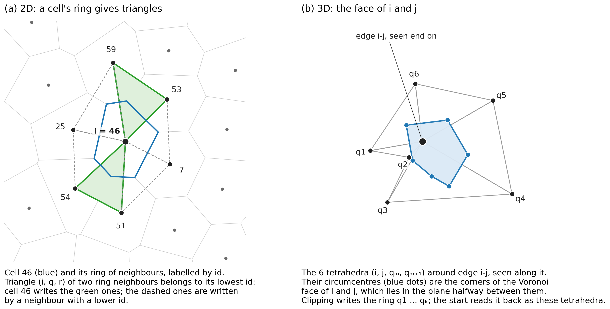

(a) In 2D a cell's ring gives triangles (i, q, r), each written by its lowest id. (b) In 3D, seen along the edge i-j: the tetrahedra around the edge, and their circumcentres, the corners of the face of i and j.

**Why a check.** Clipping in double decides near-ties by rounding, so two neighbouring cells can disagree about a face. Then the tetrahedra have holes or overlaps: on lattices and other near-degenerate input, and now and then on random input. The check (`tet_start::check`, one thread per tetrahedron) asks: is it flat; does the tetrahedron across each face point back; does its far vertex lie on the other side and outside this circumsphere (exact, perturbed); is every particle used; do the volumes add up to the box. These hold for the Delaunay tetrahedralization and for nothing else.

**Repair of the start.** The particles of failing tetrahedra are marked, the mark grows to every particle sharing a tetrahedron with a marked one, and those cells are clipped again as exact cells. Exact cells agree with each other by construction. If more than n/8 cells are marked, or on the second try, every cell is rebuilt exactly. There are three rounds at most.

**What can go wrong.** If the result is still not exact, `update()` throws. The message says why: particles on one grid point (named), uncertified cells, cells too large for the exact clipping, or else the counts of each status.

**Read.** `tet_start.hpp` (`build`, `check`), `tet_mesh.hpp` (`assemble`, `represent_dropped`).

## 5. The persistent tetrahedra

**What.** The tetrahedra are kept from step to step, with everything the next steps need.

**What is stored**, in `tet_mesh::Mesh`:

| Field | Per | Holds |
|---|---|---|
| `vertex(t, 0..3)` | tetrahedron | its four particles |
| `adjacent(t, k)` | tetrahedron | the tetrahedron across the face opposite corner k |
| `centre(t)` | tetrahedron | its circumcentre (a Voronoi vertex) in grid steps, in [0, period), and squared radius |
| `edges(t)` | tetrahedron | 6 bits: which of its edges it represents; every edge has exactly one representative, so a scan over the bits numbers the faces |
| `owner(f)`, `neighbour(f)` | face | the two particles, owner < neighbour |
| `ring_start(f)`, `ring_length(f)`, `ring` | face | the tetrahedra around the edge, in a canonical order |

The repair keeps its own state in `tet_repair::State`: which slots are alive, which tetrahedra are dirty, the vote locks, the free slots, the work and stuck lists.

**Why.** A step then costs only one circumcentre per tetrahedron a flip created, the geometry of the faces, and repairs where the Delaunay test fails. Four corners of a tetrahedron sit in one row, so a random read touches one memory sector. Face rings are stored in a canonical order, starting from the tetrahedron whose other two ids are least, so a face's geometry is summed in the same order whichever tetrahedron represents it.

**Read.** `tet_mesh.hpp` (`Mesh`, `FaceRings`).

## 6. The per-step repair

**What.** After the particles move, flips restore the Delaunay property where it broke.

**In and out.** In: new positions and the tetrahedra of the last step. Out: the Delaunay tetrahedralization of the new positions, the list of tetrahedra created (for the geometry), and stuck entries if some triangles could not be repaired.

**Screen.** `move_screened` snaps the new positions, computes every circumcentre in double, and lists the tetrahedra that may fail: a neighbour's far vertex inside or near the circumsphere, or a bad shape. The margin covers the snapping (a move of at most √3 grid steps). It only lists; the decisions come next, and they are exact.

**Flip rounds.** Each round:

1. Find, among the dirty tetrahedra, the shared triangles that fail the exact local Delaunay test.
2. Plan a flip for each: the 2-3 flip if the two tetrahedra form a convex pair, else a 3-2 flip around an edge with three tetrahedra. The plan must close its cavity exactly.
3. Vote. Each plan writes a key into the locks of the tetrahedra it would rewrite and of their outer neighbours (atomic max). The key is the round in the high bits and a hash of the plan index below. A later round always outvotes an earlier one, so the locks never need resetting, and the winners do not depend on the order of the work list.
4. Apply the plans that hold all their locks. Their new tetrahedra are dirty for the next round. Losers retry.

In 2D the same scheme runs with Lawson's 2-2 flip:

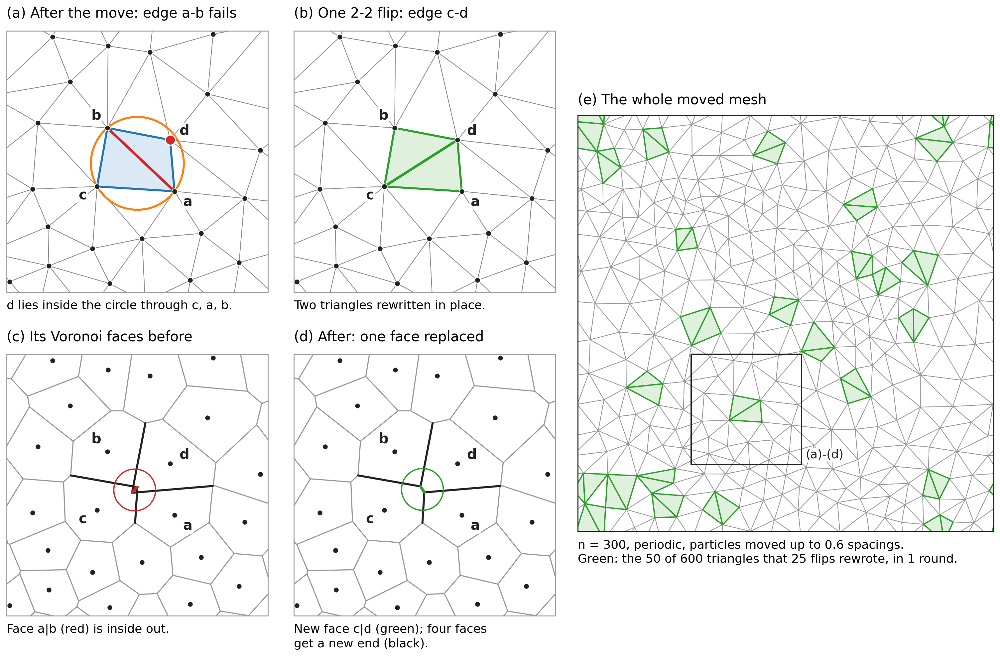

(a) After a move, d lies inside the circle through c, a, b, so the edge a-b fails. (b) One flip replaces it with c-d and rewrites two triangles in place. (c, d) In the Voronoi dual, the face a|b, which is inside out before the flip, is replaced by c|d; four faces get a new end and every other face is untouched. (e) A whole moved mesh, with the triangles the repair rewrote.

**What can go wrong.** A triangle that no flip can repair, a plan that does not close its cavity, or a tetrahedron turned inside out is listed as stuck. When a round finds nothing left to flip, the stuck ones are tried again as long as that makes progress. A repair that runs out of rounds (1000) is unfinished. Both cases go to the fallbacks.

**Read.** `tet_repair.hpp` (`move_screened`, `repair`, `plan`, `flip23`, `flip32`, `closes`, `priority`).

## 7. The fallbacks and refusals

**Host finish.** `tet_flips::finish` copies the tetrahedra within 8 adjacency steps of the stuck entries to the host and rebuilds them there by Bowyer-Watson insertion, using the same exact, perturbed predicates. It writes them back and runs the device repair again. If entries remain, it tries once more with 16 steps.

**Rebuild.** Otherwise the mesh is built from scratch (stages 2 to 4).

**Which one.** `Fallback::cheapest` (the default) uses the host only when the stuck entries number at most n / 200000, because the host costs from 0.1 ms to tens of ms per entry and a rebuild has a fixed cost. `Fallback::host` and `Fallback::rebuild` force one path. The host stops after `host_budget` (2²⁰) tetrahedra made by its local Delaunay builds, about a second on one core, writes nothing back and leaves the step to a rebuild: unbounded, it took 15 minutes on 501 particles that all moved ([#33](https://github.com/Ulli1991/voronoi-cpp/issues/33)). No clock decides, so the same input takes the same path. An unfinished repair always rebuilds.

**The volume check.** A step of the order of the box can leave tetrahedra whose corners see each other through different periodic images. Every local test passes, but the mesh covers the torus several times. After the geometry, `update()` compares the total cell volume with the box (within 1e-6) and rebuilds if it is off (`Report::overlapped`). This catches only meshes whose volume is wrong.

**Refusals.** No particles is a `std::invalid_argument` and changes nothing. Particles on one grid point, cells too wide to certify, and cells too large for the exact clipping are a `std::runtime_error` that says which. After a refusal there is no mesh, and the next `update()` builds from scratch.

**Read.** `voronoi_mesh.hpp` (`update`, `rebuild`, `detail::not_exact`), `tet_flips.hpp` (`finish`).

## 8. Geometry

**What.** Circumcentres, face rings, face areas and centroids, and cell volumes.

**In and out.** In: the tetrahedra and the list of tetrahedra the repair created. Out: for every face f, `area(f)` (a vector from owner to neighbour) and `face_centroid(f)` (relative to the owner); for every cell, `volume(i)`.

**How.**

1. `circumcentres`: one per created tetrahedron (all of them after a build). The corners are sorted by id and every operation is rounded on its own, with no fused multiply-add, so the same tetrahedron gets the same bits whichever kernel computes it. Slivers are computed on the integer grid. A centre is computed and stored in grid steps, wrapped into the box and rounded once, so the centres of cospherical tetrahedra, equal in exact arithmetic, get equal bits whichever corner and periodic image they came from ([#45](https://github.com/Ulli1991/voronoi-cpp/issues/45)); `faces` takes a vertex as the centre minus the owner's whole grid step, rounded once.
2. `update_face_rings`: numbers the faces from the edge bits. A face keeps its ring unless a created tetrahedron lies on it, in which case the ring is walked again around the edge.
3. `faces`: one thread per face. The face polygon (the circumcentres of its ring) is cut into a fan of triangles. Their area vectors sum to the face's area, and their centroids, weighted by area, give the face centroid. Each of the two cells gets the pyramid over the face, area · d / 6 with d the vector between the generators, added by atomics.

**What can go wrong.** Atomics add in any order, so the last bits of `volume()` after `update()` can differ from run to run; `update_cells()` gives fixed bits. Geometry rounds with the positions; the open volume bugs are listed in the README.

**Read.** `tet_mesh.hpp` (`circumcentres`, `update_face_rings`, `faces`).

## 9. `update_cells()`

**What.** Per-cell face lists, and volumes and centroids summed over them in a fixed order.

**In and out.** In: the faces of the last update. Out: `cell_face_start`, `cell_face` (each cell's faces in increasing id of the other particle), `volume()` and `centroid()` (relative to the generator).

**Why.** A solver gathering over a cell's faces needs the list. Sums in a fixed order give the same bits on every run. A pyramid's centroid lies 3/4 of the way from the generator to the face centroid (D/(D + 1) in D dimensions).

**Incremental.** After a repair, only cells at a corner of a created tetrahedron can have gained or lost a face. When at most n/5 tetrahedra were created and the scratch fits, only those lists are sorted again; the others are renumbered. Every cell is summed again, because every face moved.

**Read.** `tet_cells.hpp` (`cells`, `cells_incremental`).

## 10. 2D: `Mesh<2>`

The same stages on triangles, with a few differences.

- **Clipping is exact.** Each cell is a polygon, and every decision about a vertex is the exact perturbed in-circle test, which a double comparison with a rounding bound settles nearly always. Neighbouring cells always agree, so there is no rounded pass and no patching. `tri_mesh::from_rings` turns the rings into triangles: there are always 2n triangles and 3n faces, and slots and face numbers never change.
- **Repair.** `tri_repair::screen` tests every edge in one pass, from the side of the lower apex, and writes every circumcentre. `repair` runs Lawson's 2-2 flips in rounds with the same votes as 3D, six locks per flip. An edge at an inverted triangle flips when both new triangles come out positive.
- **Fallback.** `tri_finish::finish` replaces a patch around inverted triangles on the host. It starts 3 layers deep, adds 2 per attempt, makes at most 7 attempts and takes at most 2048 triangles, and it accepts the patch only if the boundary matches. Then the device repair runs again, for up to 4 passes. `cheapest` uses the host up to n / 4000 stuck triangles.
- **Check.** Twice the sum of the signed triangle areas, in integer grid steps, must equal the box; otherwise the mesh is rebuilt.
- **Volumes.** `volume()` is current only after `update_cells()`, because `update()` adds no atomics. A repaired mesh equals a fresh build bit for bit.

**Read.** `voronoi_mesh_2d.hpp`, `polygon_clip.hpp`, `tri_mesh.hpp`, `tri_repair.hpp`, `tri_finish.hpp`, `exact_predicates_2d.hpp`.

## 11. 1D: `Mesh<1>`

**What.** The generators sorted by position, faces at the midpoints, and each cell the length between its faces.

**How.** Positions are snapped to a finer grid of 2⁵² steps (a double's resolution), and the order is decided on the integers, with ties by id, so it is exact. Volumes and centroids are exact multiples of a quarter step. A periodic line closes the order into a cycle. A line with walls puts a mirror of each end generator behind the wall, so the end cells reach the walls exactly. `update(x)` checks in one pass whether the last order still holds, and sorts again only if particles crossed. A periodic line with every particle on one step would be all one gap, so it is refused, naming a pair: the pass that checks the order sees it as its one descent joining equal keys, and after a sort or a removal one more pass compares neighbouring keys.

**Insert and remove.** `insert()` and `remove()` change the line between updates without a sort: a binary search per request and one pass over the line. For each request, `Changes` reports the two neighbours and the lengths the new cell takes from them, or that they take from the removed one. A caller can move conserved quantities by those fractions and conserve them exactly. An insertion is deferred if it lands on a generator or in a gap another request already takes. A removal is deferred if it would leave fewer than three particles, if a neighbour on the line is removed in the same call, or if the id is not on the line.

**What can go wrong.** A periodic line with all particles on one grid step is refused (see above, #37). Fewer than 3 particles are a `std::invalid_argument`.

**Read.** `sorted_mesh.hpp`.

## 12. Memory order and numbering

Which index each array uses, and in which order its rows lie. This section is the one place for it; `scripts/mesh_order.py` holds the labels the figures use. A change of order updates both and renders the figures again. Three of the orders depend on `voronoi::Layout` (all off by default, below).

| Index | Order | Arrays, and where it is set |
|---|---|---|
| particle i | the caller's index; with a re-sort, a curve's order (Hilbert by default) | `positions`, `cell_volume`, `cell_centroid`, `cell_face_start`, `tet_repair_point`. Without `Layout::every` or `far` the mesh never re-sorts particles; with them it renumbers them at every build and when due, and `permutation()(i)` is the caller's index of cell i (`mesh_order.hpp`: `cell_order`, `rcm`; `voronoi_mesh.hpp`: `resort`). `voronoi_bench` numbers them along a Morton curve (`--unsorted`: as generated). |
| slot q | Morton order of the cell list, ties by id | `slot_positions`, `slot_fine_keys`, `slot_levels`; `particle_order(q)` is the particle in slot q. Rebuild and `clip()` only (`neighbor_search.hpp`: `build`). |
| tetrahedron t | slot of `tet_vertex` | at a start, `assemble`'s order, grouped by the face of each tetrahedron's two smallest particles (`tet_mesh.hpp`: `assemble`); a flip reuses its old slots, then pops freed ones, then appends (`tet_repair.hpp`: `repair`); a re-sort orders the live ones by their lowest particle, ties by slot, and drops the dead (`mesh_order.hpp`: `order_tetrahedra`). |
| face slot s | the scan over edge bits | s = `face_rings_start(t)` + the rank of the edge among t's set bits, redone every update (`tet_mesh.hpp`: `number_faces`); the rings and `face_rings_owner`, `_neighbour` use it. |
| face f | the face slot, or by owner | without `Layout::owner_faces` f = s. With it, by owner, an owner's faces in slot order, redone every update (`tet_mesh.hpp`: `number_by_owner`); `owned_start()(i)` is cell i's first. `owner(f) < neighbour(f)` either way; `area`, `face_centroid`, `face_rows` follow f. |
| list entry k | per cell, by the other particle | `cell_face(k)` for k in [`cell_face_start(i)`, `cell_face_start(i + 1)`) (`tet_cells.hpp`: `sort_list`, `CellSortWarp`); with `Layout::owner_bit`, bit 31 is set where the cell does not own the face (`Mesh::list_face`, `list_owned`). |
| ring entry | per face, canonical | `pool[ring_start(f), ring_start(f) + ring_length(f))`, from the tetrahedron whose other two ids are least (`tet_mesh.hpp`: `walk_edge_canonical`). |

**The layouts.** Three optional layouts of `Mesh<3>`, set by `set_layout(voronoi::Layout)`, all off by default. A re-sort renumbers the cells along a space-filling curve and stores the tetrahedra and faces after them. Faces by owner number the faces by their owner. The owner bit marks, in each cell's list, the faces the cell does not own.

**Why.** The cells keep their ids while they move, and a flip puts its new tetrahedra into whatever slots are free, so on a flow where every cell moves the memory order decays: on the bench's smooth flow at 128³, 0.1 spacings per step, the faces of a cell spread over the whole face array and the step runs at half its early rate by step 500 ([#34](https://github.com/Ulli1991/voronoi-cpp/issues/34), [measure_resort_2026-11-10.md](measure_resort_2026-11-10.md)). Faces are otherwise numbered after the tetrahedra that represent them, which are not in owner order even after a build; a solver that gathers over owners reads them scattered.

**The re-sort** (`mesh_order.hpp`, `Mesh::resort`). Each cell gets a key from its snapped position, the top 21 bits per axis: Morton (the cell list's curve), Hilbert (Skilling's transform), Moore (eight Hilbert curves in a closed loop, turned by a small search so that each ends next to where the next begins), Morton read as a Gray code, or row-major. Keys are sorted stably (CUB's radix sort on CUDA), so ties keep the old order. Reverse Cuthill-McKee runs on the Voronoi graph instead: a breadth-first search from a cell of the last level of a search from cell 0, level by level on the device, each level sorted by the place of its first-placed neighbour, then by degree, then by id, and the order reversed. The tetrahedra are then sorted by their lowest new cell (ties by slot), dead slots dropped, adjacency renumbered; faces follow the tetrahedra, and every face ring is walked again. It runs after the repair and before the geometry, every `every` updates or when more than `far` of the faces join cells over 64 ids apart (checked every 16 updates), and at every build.

**The contract.** A re-sort changes the cell ids. `update()` returns `Report::resorted`; then cell i is the particle the caller passed as `permutation()(i)`, and the caller renumbers every per-particle array it keeps, its positions too, before the next update: `permute(v)` does it for a view. The mesh as a set does not change: each particle keeps its neighbours, and volumes, centroids and areas agree to rounding (relative 1e-14), not to the bit, because the orders that fix rounding (the corners of a circumcentre, the start of a face's fan, the order of a cell's sums) follow ids. Exact ties break by id, so on cospherical input a re-sort can also change which zero-area faces exist.

**Faces by owner** (`tet_mesh::number_by_owner`). After the faces are numbered from the tetrahedra (slots), a counting sort by owner, each owner's few faces kept in slot order, gives each face its number; `faces` computes the geometry in that order, and `owned_start()` gives each cell's range. The renumbering table of the incremental `update_cells()` is rewritten in the new numbers, so the same lists and the same bits come out.

**The owner bit.** With `owner_bit`, the entry of a face in the list of the cell that does not own it has bit 31 set; `Mesh::list_face(e)` gives the face, `Mesh::list_owned(e)` the side. A solver then reads no `owner()` to know the sign of a flux.

**Read.** `mesh_order.hpp` (`key`, `MooreTable`, `cell_order`, `rcm`, `order_tetrahedra`), `voronoi_mesh.hpp` (`Layout`, `resort`, `permute`), `tet_mesh.hpp` (`number_by_owner`), `tet_cells.hpp` (`list_face`).

## 13. Where the data lives, and how the GPU touches it

**The arrays.** Every array of the mesh is device memory; none is mirrored. The host keeps only the counts that size the next launch, nine counters in pinned memory that the repair copies back, and short-lived copies for a host finish, for cells that overflow on the device and for a refusal's message. The bars are the bytes per cell at the peak of a step (section C of [measure_2026-11-10.md](measure_2026-11-10.md#c-memory-by-array-at-the-peak-of-a-moving-step-r3)); writers and readers are read from the code, and luna-cpp reads through `voronoi::Mesh`. What to take from it: four kinds of array hold 72 % of the 1950 B/cell, the two ring pools (501), the face geometry (394), the tetrahedron rows (250) and their centres (250). Most arrays are rewritten every step; only the tetrahedra and the ring pool in use are kept and edited where flips change them, and the spare ring pool is scratch that any call may overwrite.

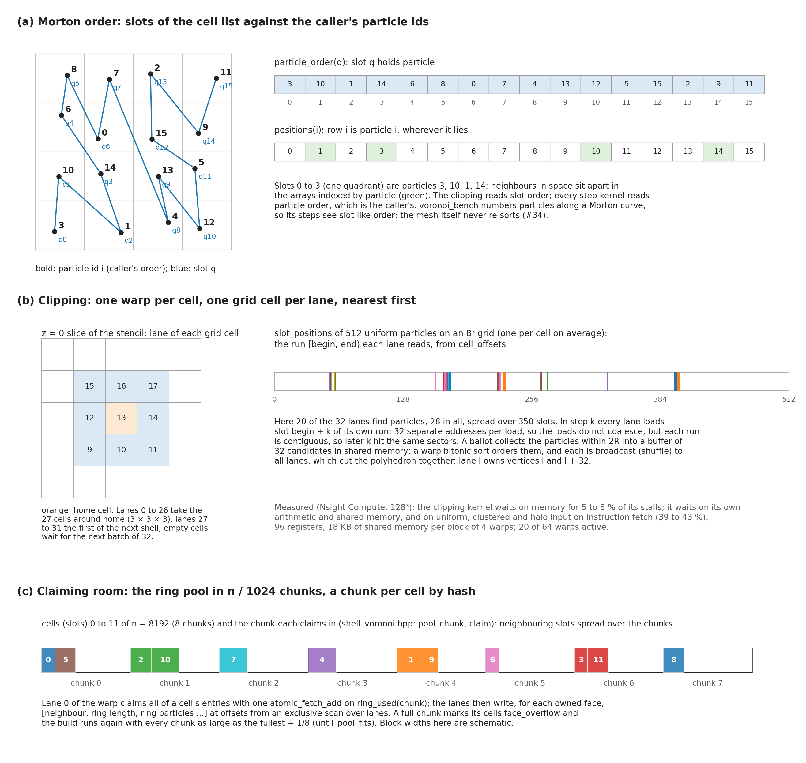

**Access in the clipping.** (a) The cell list sorts particles along a Morton curve, but the mesh's own arrays stay in the caller's order: a step kernel's locality is whatever order the caller gives. (b) One warp builds one cell: each lane takes one grid cell of the stencil, nearest first, and walks its run of slots; the 32 runs lie apart, so a load does not coalesce across lanes, but each lane's run is contiguous. Candidates go through a 32-entry buffer in shared memory, sorted by a warp bitonic sort and broadcast by shuffles to all lanes, which cut the polyhedron together. The measured kernel waits on memory for only 5 to 8 % of its stalls. (c) A cell claims its ring entries with one atomic in one of n/1024 chunks, picked by a hash of its slot, so neighbouring cells spread over chunks instead of queueing on one counter. The example runs are computed with the library's Morton keys and stencil on 512 random points.

**Access in a step.** (d) A face is computed once, by one thread and for both cells: its own rows (owner, ring start, area) are read and written coalesced; its ring's circumcentres are a gather of one 32-byte sector each; the volumes are a scatter of two atomics. (e) A flip plans and votes on rows spread over the tetrahedron array and writes back pointers into its neighbours' rows. (f) `update_cells()` gives each cell 4 lanes, which gather its list in batches of 4 and add the pyramids by shuffles in list order, so the bits equal a sequential loop on every run. The example is a Delaunay mesh of 216 jittered points numbered along a Morton curve, its faces numbered by the library's rule. What to take from it: the step kernels are gathers and scatters through `vertex`, `ring` and the face numbers, and they wait on memory for 63 to 93 % of their stalls at 280 to 860 GB/s ([measure_2026-11-10.md](measure_2026-11-10.md#a-cost-of-a-moving-step)); the order of particles, tetrahedra and faces decides how many sectors they touch.

## 14. Memory management

**Pools.** Each growing array is sized from the start with spare room and grown in place when a step needs more: the tetrahedra by 1/8, the faces and the cell lists by 1/32, the ring pools to 1.5 times the start's entries. Nothing that runs out is lost. A full clipping chunk builds again with a larger pool, at most three times and once more in `rebuild`, then refuses; a full ring pool compacts into its spare; a flip without a slot loses its vote and retries next round after the arrays grow; a full created list makes that step walk every face. `Kokkos::resize` copies, so old and new arrays are both allocated while the tetrahedra grow. (a) The mesh peaks at 1950 B/cell in a step and lower at the start; with luna-cpp's hydro a moving run needs 2319 B/cell, which fits one A100 40 GB at 256³, while 384³ would need about 700 B/cell in all. (b) The pools are indexed by 32-bit ints: the ring pool offsets and the start's ring slots overflow between 256³ and 384³, the cell face lists between 384³ and 512³, the tetrahedron slots between 512³ and 768³. The first two need 64-bit offsets before 384³ ([ideas.md](ideas.md#memory)).

