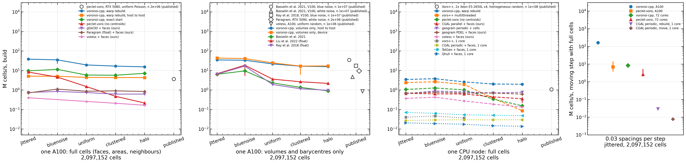

# Library benchmark: methods and results

voronoi-cpp against the public Voronoi and Delaunay codes we could build on Raven: the same point files, the same
periodic box, the same outputs and the same hardware, each code in the configuration its own paper or README gives,
and every number regenerated from raw records by one script (`scripts/library_benchmark.py`). The headline table and
the figure are [below](#the-full-table), the README has a summary; every row and every setting is in
[bench/libraries/results/summary.md](../bench/libraries/results/summary.md).

## The full table

Every public Voronoi and Delaunay code we could build on Raven, on the same point files (our generators, plus blue
noise made by Lloyd iterations as in Ray et al. 2018 and Basselin et al. 2021), in the periodic unit box (images for
codes without one), double where the code allows it, each in the setting its own README gives per input. GPU codes all
ran on A100 nodes (the other codes' rows at 1095 MHz under load; voronoi-cpp's, marked, at 1305 MHz, about 15 % faster),
CPU codes on one 72-core node. M cells/s at 2,097,152 cells (128³), median
of 3 timed runs; the clock runs from the points in memory to all outputs in memory. Codes that return only Delaunay
tetrahedra or neighbour lists get our faces step, timed in ("+ faces (ours)"). Missing: cells without a volume;
error: largest relative volume error against our brute-force exact reference on 1000 sampled cells per input. Methods,
256³, every setting and the provenance: the sections below.

| M cells/s, 128³ | hardware | jittered | blue noise | white noise | clustered | halo | B/cell | missing; error | differs from the first row |
|---|---|---|---|---|---|---|---|---|---|
| **Full cells: volumes, centroids, faces with areas and neighbours** | | | | | | | | | |
| **voronoi-cpp, warp rebuild** | A100 | **37.8** | **34.8** | **19.1** | **16.6** | **15.2** | 671 | 0; 1.6e-13 | 1305 MHz |
| voronoi-cpp, exact start (Delaunay and cells) | A100 | 9.5 | 11.3 | 5.8 | 5.7 | 7.1 | 1951 | 0; 1.5e-13 | 1305 MHz |
| peclet-voro (Peters 2026) | A100 | 8.2 | 4.6 | 1.5 | 0.47 | 0.21 | 2651 | 33,819 on halo | no exact predicates, no centroids |
| Paragram (Taveira et al. 2026) + faces (ours) | A100 | 0.71 | 1.1 | 0.85 | 0.90 | 0.83 | 4551 | 0–2 | float adjacency, images |
| gDel3D (Cao et al. 2014) + faces (ours) | A100 | 0.74 | 0.84 | 0.73 | 0.61 | 0.61 | 1580 | 0; 2e-15 | images, copies timed |
| votess (Singh et al. 2024) + faces (ours) | A100 | 0.40 | fails | 0.26 | 0.21 | 0.16 | 3343 | 0; 4e-13 | images, copies timed |
| voronoi-cpp, warp rebuild (OpenMP) | 72 cores | **3.4** | **3.8** | **2.6** | **2.0** | **2.0** | 495 | 0; 2e-15 | |
| voro++ multithreaded (Lu et al. 2023) | 72 cores | 2.4 | 2.6 | 1.9 | 0.38 | 0.085 | 1700 | 0; 6e-14 | no exact predicates |
| geogram periodic Delaunay + its cells | 72 cores | 0.65 | 0.88 | 0.79 | 0.70 | 0.76 | 530 | 0; 3.6e-9 | scalar areas |
| CGAL parallel Delaunay + faces (ours) | 72 cores | 0.67 | 0.63 | 0.62 | 0.44 | 0.35 | 1947 | 0; 2e-15 | images |
| peclet-voro | 72 cores | 1.06 | 1.26 | 1.01 | 0.34 | 0.15 | 2479 | 61,887 on halo | no exact predicates, no centroids |
| TetGen (Si 2015) + faces (ours) | 1 core | 0.071 | 0.063 | 0.053 | 0.050 | 0.048 | 2181 | 0; 1e-15 | images |
| voro++ (Rycroft 2009) | 1 core | 0.039 | 0.046 | 0.036 | exits | exits | 1034 | exits on points closer than 1e-5 | no exact predicates |
| CGAL periodic Delaunay + faces (ours) | 1 core | 0.027 | 0.029 | 0.030 | 0.029 | 0.030 | 2938 | 0; 2e-15 | |
| Qhull (Barber et al. 1996) + faces (ours) | 1 core | 0.021 | 0.019 | 0.017 | 0.015 | 0.014 | 5013 | 0; 2e-15 | images, no exact predicates |
| **Volumes and barycentres only, host to host** | | | | | | | | | |
| **voronoi-cpp, volumes and centroids only** (`volumes_and_centroids`) | A100 | **34.5** | **33.2** | **21.5** | **16.5** | **15.6** | 126 | 0; 1.6e-13 | 1305 MHz |
| voronoi-cpp, the same, device to device | A100 | 43.1 | 40.4 | 24.3 | 16.7 | 17.0 | 101 | 0; 1.6e-13 | 1305 MHz, no copies |
| Basselin et al. 2021, README setting per input | A100 | 6.3 | 9.4 | 2.3 | 1.4 | 0.89 | 160 | 2023 on halo | images, no exact predicates |
| Liu et al. 2022, README setting per input | A100 | 6.8 | 18.4 | 3.6 | 2.6 | 2.2 | 638 | 3 to 103,092; 3e-5 | float, images |
| VoroGPU (Ray et al. 2018), README setting per input | A100 | 6.5 | 16.7 | 1.9 | 1.2 | 0.96 | 1236 | 0 to 21,471; 2e-4 | float, images |
| **Moving step, 0.03 spacings, with full cells** | | | | | | | | | |
| **voronoi-cpp** (update + `update_cells()`) | A100 | **163** | | | | | | 0; 8e-15 | |
| peclet-voro (`MovingTessellation::step`) | A100 | 7.0 | | | | | | | |
| voronoi-cpp | 72 cores | 8.5 | | | | | | | |
| CGAL periodic, rebuild per step / `move_point` per point | 1 core | 0.029 / 0.008 | | | | | | | |

With full cells on one A100 the warp rebuild is 4 to 55 times faster than peclet-voro, the fastest other GPU code that
returns faces, the gap growing with the density contrast; the codes that need our faces step are 14 to 85 times
slower. Volumes and centroids only (`volumes_and_centroids`, no faces built): on blue noise, in one job on one A100
at 1305 MHz with the same points, host to host from pageable memory, voronoi-cpp builds 33.2 M cells/s at 128³ and
32.5 at 256³, against Liu et al. 18.1 and 24.4, VoroGPU 18.1 and 19.7 (both float, K 35, their blue-noise setting) and
Basselin et al. 10.4 and 11.6 (blue-noise setting): 1.8, 1.8 and 3.2 times faster at 128³, 1.3, 1.7 and 2.8 at
256³ (job 32368078). On every other input the float codes are 5 to 16 times slower and lose cells. On one CPU node,
in one job with multithreaded voro++, the same code built for OpenMP is 1.5 times faster on blue noise (3.8 against
2.5), 1.4 on white noise (2.6 against 1.8), 1.4 on jittered input and 5 to 23 times on clustered and halo input (job
32367276). The moving step is 23 times peclet-voro's. Every voronoi-cpp volume agrees with the exact reference to
1.6e-13 or better; geogram's own cells (double constructions) are off by up to 3.6e-9.



*Build rate at 2,097,152 cells per input: one A100, full cells (left) and volumes and barycentres only (second; the
first two curves are voronoi-cpp's volumes-only build, host to host and device to device); one CPU node, full cells (third; dashed 72
cores, dotted one core); filled markers measured by us (median and range of 3 runs), open markers published by the
authors on other hardware and points. Right: moving step at 0.03 mean spacings. Codes: voro++ (Rycroft 2009, Chaos 19,
041111; multithreaded: Lu, Lazar and Rycroft 2023, CPC 291, 108832), CGAL periodic (Caroli and Teillaud 2009, ESA,
LNCS 5757) and parallel Delaunay (Batista et al. 2010, CGTA 43), geogram (Lévy, github.com/BrunoLevy/geogram), Qhull
(Barber, Dobkin and Huhdanpaa 1996, ACM TOMS 22), TetGen (Si 2015, ACM TOMS 41), gDel3D (Cao, Nanjappa, Gao and Tan
2014, I3D), VoroGPU (Ray, Sokolov, Lefebvre and Lévy 2018, ACM TOG 37), Liu et al. 2022 (IEEE TVCG), Basselin et al.
2021 (Computer Graphics Forum 40), Paragram (Taveira, Lindström, Fatemi, Hammarstrand and Kahl 2026, SIGGRAPH,
arXiv:2605.06408), votess (Singh, Byrohl and Nelson 2024, arXiv:2412.04514), peclet-voro (Peters 2026, Zenodo
10.5281/zenodo.21132443). Full references: bench/libraries/references.bib.*

Not matched: Paragram's adjacency and the cells of Liu et al. and VoroGPU are float; the codes without a periodic box
get 7 to 53 % extra image points; gDel3D, VoroGPU, Liu et al., Basselin et al. and votess take host points, so their
times include the copies (our device rows do not; the host-to-host rows do); gDel3D and votess (GPU) fail at 256³ and
peclet-voro runs out of the A100's memory there; single-core runs only at 128³. The other codes' A100 rows ran at 1095
MHz, voronoi-cpp's at 1305 MHz (about 15 % faster); the blue-noise volumes-only comparison above ran in one job at 1305
MHz for all four codes. Our volumes and centroids are double (32 B/cell copied back); Liu et al. and VoroGPU copy back
volumes only (8 B/cell). The rebuild rows of the [rates table](measurements.md#rebuild-start-and-step-rates) time the
clipping alone; this table adds the cell list and the allocation.

## Results

Rates are M cells/s (input cells per second; images not counted), median of 3 timed runs at 2,097,152 cells (128³)
unless stated, on one A100 or one 72-core CPU node. The other codes' A100 rows ran on node `ravg1002` at an SM clock of
1095 MHz under load; voronoi-cpp's rows (commit 77055a4, branch close-gaps, 2026-11-15) ran on other A100 nodes at 1305
MHz, about 15 % faster, so cross-code ratios are taken within one job (the blue-noise volumes-only job 32368078 ran
all four volumes-only codes at 1305 MHz; section "Same GPU" of summary.md).

**Basselin et al. 2021, run as its README says.** With its blue-noise setting (K 20, P 25, V 30) on our blue noise it
builds 9.0 M cells/s at 128³ and 10.2 at 256³, host to host (padding with images, copy in, kNN, clipping, copy out of
volumes and barycentres). Its own pass timers put the device part (kNN and clipping, relaunches included) at 0.12 s
for 2.4M padded points: 17.5 M original cells/s (19.5 at 256³). The paper's 34.5 M cells/s (V100, 10M blue-noise
seeds, Fig. 10) is 1.8 to 2 times that; our runs add images (+15 %), a 1095 MHz clock and our own blue noise, and the
paper does not say what its bar includes. In job 32368078 (1305 MHz) Basselin's blue-noise setting runs at 10.4 and
11.6 M cells/s host to host, and our volumes-only build (`volumes_and_centroids`: no faces built, volumes and centroids
copied back) at 33.2 and 32.5: 3.2 and 2.8 times faster, in double with the same certification as the full build. Off blue noise Basselin
runs at its other settings' rates (perturbed-grid setting on jittered 6.3, white-noise setting on uniform 2.3,
clustered 1.4, halo 0.9 M cells/s) and leaves cells unbuilt on halo input (2023 cells with the white-noise setting
after its relaunches; 28,055 with the blue-noise setting). Like for like: same points (images added for its box),
double, same A100 jobs. Not matched: no exact predicates, no faces returned, host-to-host scope.

**Full cells (volumes, centroids, faces with areas and neighbours): the headline.** On the A100 at 1305 MHz the warp
rebuild runs at 37.8 / 34.8 / 19.1 / 16.6 / 15.2 M cells/s on jittered / blue noise / uniform / clustered / halo input
(41.5 / 36.2 / 22.1 / 18.3 / 17.7 at 256³), device to device, 671 B/cell. The exact start (Delaunay tetrahedra and
cells) runs at 9.5 / 11.3 / 5.8 / 5.7 / 7.1. The fastest other GPU code with full cells, peclet-voro (periodic, double,
floating-point clipping, no cell centroids), runs at 8.2 / 4.6 / 1.5 / 0.47 / 0.21 at 1095 MHz: the warp rebuild
(at 1095 MHz, earlier jobs: 33.7 / 29.6 / 16.5 / 14.0 / 11.8) is 4 to 55 times faster, more so the less uniform the input; peclet-voro runs out of the A100's 40 GB at 256³ and
leaves 33,819 halo cells unbuilt. Delaunay or neighbour codes with our faces step timed in: gDel3D 0.61–0.84, Paragram
(float) 0.71–1.1, votess 0.16–0.40 M cells/s. Host to host (the whole face pool copied back) the warp rebuild runs at
4.3–5.1.

**Volumes and barycentres only.** `shell_voronoi::volumes_and_centroids` is the warp rebuild with no faces, face counts
or rings recorded: the same walk, certification and fallbacks, volumes and centroids bit-identical to the full build's
(checked with `cmp` on blue noise, jittered and halo input, job 32361903), 101 B/cell on the device. Device to device it
runs at 43.1 / 40.4 / 24.3 / 16.7 / 17.0 M cells/s (44.6 / 41.6 / 25.3 / 20.8 / 19.9 at 256³); host to host from
pageable memory (points copied in, the two arrays copied back, 126 B/cell) at 34.5 / 33.2 / 21.5 / 16.5 / 15.6
(35.1 / 33.0 / 21.9 / 18.5 / 17.7); with pinned host buffers made outside the clock 31.4–37.4 on blue noise, within
the run-to-run spread of the pageable path, so the tables use the pageable one. Building no faces saves 14 % of the
device time on blue noise (34.8 to 40.4); not allocating the 1.1 GB face pool and copying only the two arrays makes the
host-to-host path 1.8 times the old one with the faces built (18.4 → 33.2).

In one job on one A100 (32368078, 1305 MHz, blue noise, each code in its blue-noise setting): voronoi-cpp 33.2 (128³)
and 32.5 (256³) host to host; Liu et al. (tet-centric, K 35, float) 18.1 and 24.4; VoroGPU (K 35, float) 18.1 and 19.7;
Basselin et al. (K 20) 10.4 and 11.6. voronoi-cpp is 1.8 / 1.8 / 3.2 times faster at 128³ and 1.3 / 1.7 / 2.8 at
256³, in double with every cell certified; the float codes' relative volume errors are 4e-6 (median) to 3e-5. Liu et
al.'s and VoroGPU's drivers copy back the volumes only (8 B/cell; ours 32). Off blue noise, in their README setting, the float codes
are 5 to 16 times slower than our host-to-host path and lose cells: VoroGPU (K 190) 164 clustered and 21,471 halo
cells, Liu et al. (K 90) 26,088 and 103,092; with the blue-noise setting K 35 both lose 70 % of the cells of uniform,
clustered and halo input.

**One CPU node, full cells.** The same voronoi-cpp code built for OpenMP runs at 3.4 / 3.8 / 2.6 / 2.0 / 2.0 M cells/s
on 72 cores (3.0 / 3.3 / 2.3 / 1.9 / 1.9 at 256³). In the same job on the same node (32367276) multithreaded voro++
(Lu et al. 2023) runs at 2.4 / 2.5 / 1.8 / 0.38 / 0.085: voronoi-cpp is 1.4 / 1.5 / 1.4 / 5.3 / 23 times faster. Two
changes made the difference (before: 2.6 / 2.2 / 1.7 / 1.4 / 1.3): the host cell list sorted on one thread
(`std::sort`, about 400 of 1000 ms on blue noise) and now uses a parallel stable radix sort (11 ms, the same order), and
the thread kernel takes cells in dynamic chunks of 16 instead of static blocks (7 to 17 %); the volumes are
bit-identical to the earlier ones. Thread binding (close or spread) changes nothing, and 144 hyperthreads are 0 to 18 %
slower than 72 cores (docs/tried.md); geogram's periodic Delaunay with its
Voronoi cells runs at 0.65–0.88 (1.2 at 256³), CGAL's parallel Delaunay with our faces at 0.35–0.67, peclet-voro at
0.15–1.3, votess with our faces at 0.13–0.42. On one core: voronoi-cpp 0.034–0.078, voro++ 0.036–0.046 (it exits on
clustered and halo input: two points closer than 1e-5), TetGen + faces 0.048–0.071, CGAL periodic + faces 0.027–0.030,
Qhull + faces 0.014–0.021.

**Moving mesh, 0.03 spacings per step, with full cells.** voronoi-cpp 163 M cells/s on the A100 (median of steps 2 to
10, at 1305 MHz; 144 at 1095 MHz), 8.5 on 72 cores; peclet-voro 7.0 on the A100 and 2.6 on 72 cores; CGAL's periodic triangulation 0.029
per step rebuilt and 0.008 moving each point, on one core.

**Accuracy.** voronoi-cpp: no cell missing in any run, every sampled volume within 1.6e-13 of the oracle on the GPU and
2e-15 on the CPU, the volume sum within 1e-16 of the box. Our faces step on CGAL, TetGen, Qhull, geogram (PDEL) and
gDel3D tetrahedra: within 2e-15. geogram's own periodic cells (exact predicates, double constructions): 650 to 850 of
1000 sampled cells off by more than 1e-12, up to 3.6e-9. voro++: within 6e-14. votess + our faces: within 4e-13; its
GPU path crashes on blue noise (illegal address) and cannot run 256³. Paragram + our faces: within 3e-15, 1 or 2 cells
open per input. peclet-voro: 33,819 (A100) and 61,887 (CPU) halo cells and 49 clustered (CPU) without a volume.

## Inputs

Points are written once by `library_bench points` ([src/bench/library_bench.cpp](../src/bench/library_bench.cpp)) from
the generators of `src/test/support.hpp` (fixed seed 20261029) and read by every code from the same file
(`bench/libraries/make_points_a100.sh`, job 32225761; blue noise `make_bluenoise_a100.sh`, job 32234292):

| file | points | SHA-256 (first 16 hex) |
|---|---|---|
| jittered_2097152.pts | 128³ lattice, each point moved up to ±0.1 spacing per axis | f7fc0e00d13844c4 |
| bluenoise_2097152.pts | the uniform points after 100 Lloyd iterations (centroidal Voronoi tessellation) | 1c977749703db620 |
| uniform_2097152.pts | independent uniform | d65cd75f4e20157a |
| clustered_2097152.pts | 8 Gaussian blobs (σ 0.04) with 80 %, 20 % uniform; about 1:500 in density | 10c91b377f64b790 |
| halo_2097152.pts | 4 halos ρ ∝ 1/(r² + c²), c = 0.002, 90 %, 10 % uniform; about 1:10⁴ | cf81db50496a43f7 |
| *_16777216.pts | the same at 256³ (blue noise 7c5ba32ceab239f4) | d902c5b8…, 033d9416…, dcb3094c…, a6ed08e4… |
| jittered_2097152_step0.03.trj | jittered 128³ in cell-list (slot) order, and 10 steps of the bench flow, each moving the points 0.03 mean spacings | 2cb9d68fe4e2e940 |

Blue noise as in Ray et al. 2018 and Basselin et al. 2021 (who use Ray et al.'s three distributions: blue noise,
perturbed grid, white noise). Nearest-neighbour distance in mean spacings, mean / minimum / standard deviation: our
blue noise 1.005 / 0.831 / 0.037 against 1.025 / 0.798 / 0.040 for the 100K blue-noise file shipped with Basselin et
al.'s code; our uniform 0.554 / 0.011 / 0.202 against 0.557 / 0.014 / 0.205 for their white noise. Our jittered lattice
(0.899 / 0.802 / 0.042) is far more regular than their perturbed grid (0.641 / 0.057 / 0.180); the tables use the
perturbed-grid setting for it as the closest class.

Format (`bench/libraries/libbench.hpp`): uint64 n, uint64 frames, then frames × n × 3 doubles. Positions are in the
periodic unit box [0, 1)³ on the grid of 2⁻³⁰ that voronoi-cpp snaps to, so every code gets the doubles voronoi-cpp
computes on. The files (5.6 GB) are not in the repository: the generators and seeds are.

## Outputs and groups

Rows are grouped by what the code returns, because a hydro code (and, for example, LAMMPS's neighbour output) needs
the faces:

- **full cells**: volumes, centroids, and per face the neighbour and the area (vector). voronoi-cpp, voro++ (areas and
  unit normals), geogram's periodic cells (scalar areas) and peclet-voro (area vectors, no cell centroids) return them.
  Codes that return Delaunay tetrahedra (CGAL, TetGen, Qhull, geogram PDEL, gDel3D) or neighbour lists (Paragram,
  votess) get "+ faces (ours)", timed in: `bench/libraries/dual_cells.hpp` builds the cells from the tetrahedra (per
  original point, the signed simplices (point, edge midpoint, face circumcentre, tetrahedron circumcentre); OpenMP, as
  many threads as the code), `bench/libraries/clip_cells.hpp` from neighbour lists (a cube cut by the bisector of each
  listed neighbour, in double; OpenMP on the CPU, a CUDA kernel for Paragram). Both are checked: area vectors close to
  2e-16 of their sum, volumes match the oracle.
- **volumes and barycentres**: Basselin et al., VoroGPU (Ray et al.) and Liu et al. clip each cell but return only its
  integrals.
- **topology**: the Delaunay or neighbour-list step of the codes above, alone.

The variants "volumes and centroids only" (`volumes_and_centroids`: no faces built; device to device, host to host
from pageable memory, and from pinned host buffers) give voronoi-cpp the outputs of the volumes-only codes. The older
variant "warp clipping rebuild, host to host, volumes and centroids copied out" builds the faces on the device and
copies back only volumes and centroids.

## What is timed

The clock (`std::chrono::steady_clock`, wall time) runs from the points in the code's natural memory to all of the
row's outputs in memory: for CPU codes host memory; for GPU codes device memory where the API allows (voronoi-cpp's
device rows, peclet-voro, Paragram), otherwise host to host including the copies (gDel3D, VoroGPU, Liu et al.,
Basselin et al., votess: marked "host↔device copies timed"). No file I/O. Padding with images, neighbour search, grids,
allocation and our faces step are inside the clock; destruction is outside.

Protocol (`run_protocol` in `libbench.hpp`): one untimed run that measures the peak memory and writes the volumes for
the accuracy check, untimed warm-up runs until 2 s have passed (the A100's clock ramps up from 210 MHz), then 3 timed
runs. Tables give the median and the min–max of the timed runs (6 for our 128³ A100 rows: two jobs). Moving-mesh steps:
each of the 10 trajectory steps is timed; the tables give the median and range of steps 2 to 10.

Peak memory, in B/cell of the n input cells: on the host the resident set's high-water mark above the resident set at
the start of the run (`/proc/self/clear_refs` reset, `VmHWM`); on the GPU the device use (`cudaMemGetInfo`, total minus
free) sampled every 200 µs on a second thread. A "+" row reports at least its base row's peak (the second variant of a
process starts with the allocator's memory of the first). Basselin et al.'s OpenCL allocations appear small (about 160
B/cell) and may be under-sampled.

## Like for like, and what cannot be matched

- Same points: the files above for every code. Same box: periodic where the code supports it (voronoi-cpp, voro++,
  CGAL `Periodic_3_Delaunay_triangulation_3`, geogram `PeriodicDelaunay3d`, peclet-voro); the others get every periodic
  image within a shell around the box (3 to 8 mean spacings per input, 24 for Paragram's halo at 256³), checked per
  cell (the circumspheres, or twice the reach, of every original cell inside the padded box).
- Same outputs: the groups above; "+ faces (ours)" where a code returns topology only.
- Same precision: double, except Paragram's adjacency (float32, `-use_fast_math`, its default build) and the cells of
  VoroGPU and Liu et al. (float, as their code is written). Exact predicates: voronoi-cpp (on the 2⁻³⁰ grid), CGAL
  (Epick), geogram (PCK), TetGen (Shewchuk) and gDel3D (exact/SoS with a CPU fix-up); the rest use floating-point
  tests.
- Same hardware: every GPU code in chained jobs on one A100 node (`bench/libraries/run_chain_a100.sh`); each job also
  ran our warp rebuild as a reference, so its ratios are free of node differences (section "Same GPU" of summary.md).
  CPU codes on one full node each (2× Xeon Platinum 8360Y, 72 cores, `--exclusive`), at 72 threads for parallel codes
  and at 1 thread at 128³. OpenMP codes run with `OMP_PROC_BIND=spread OMP_PLACES=cores`; geogram, CGAL (TBB) and votess
  run unbound (binding pins their own thread pools to one core: jobs 32226520, 32230805).
- Best configuration: each code's documented defaults, and for the kNN codes the README's setting per input class
  (blue noise: blue-noise setting; jittered: perturbed grid; the rest: white noise). Every setting on every input is in
  summary.md. VoroGPU's white-noise K 190 overflows its int indices at 256³, so K 90 there. Basselin et al.'s `--grid`
  is the paper's restriction domain (a tetrahedral mesh), not an acceleration; the unrestricted diagram ("no clipping"
  in its Fig. 10) is what is run.
- Not matched: gDel3D fails at 256³ (27-bit tetrahedron index) and peclet-voro runs out of memory there; votess's GPU
  path fails at 256³ (int buffer sizes) and on blue noise; single-core runs only at 128³; published numbers are on
  other hardware and points.

## Accuracy

`bench/libraries/oracle_check.cpp` compares each code's volumes with the brute-force oracle of `src/test/oracle.hpp`
(exact 128-bit predicates and long-double clipping against all periodic images; it shares no code with voronoi-cpp) on
1000 cells drawn with a fixed seed from each point file, and checks all n cells for missing or non-positive volumes and
the sum against the box (`bench/libraries/oracle_cpu.sh`; job 32269164, and for the final rows a one-core run on the login node, `accuracy-main-login.jsonl`; oracle cost 60 s at 2.1M and
500 s at 16.8M on 72 cores, jobs 32225958 and 32234618).

## Reproducing

```
sbatch -o <log> bench/libraries/make_points_a100.sh <voronoi-cpp CUDA build> <data dir>
sbatch -o <log> bench/libraries/make_bluenoise_a100.sh <voronoi-cpp CUDA build> <data dir>
JOBS=2 bash bench/libraries/build_<lib>.sh        # or sbatch; sources fetched outside the repository
sbatch -o bench/libraries/results/chain-a100-%j.jsonl bench/libraries/run_chain_a100.sh <data> <build> "run_<lib>_a100.sh SIZES=..." ...
sbatch -o bench/libraries/results/<lib>-cpu-%j.jsonl bench/libraries/run_<lib>_cpu.sh ...
sbatch -o bench/libraries/results/cpu-pair-%j.jsonl bench/libraries/run_cpu_pair.sh <OpenMP build> <data>   # voronoi-cpp and voro++, one node
sbatch --wrap "bash bench/libraries/oracle_cpu.sh <data> <volumes>..." -o bench/libraries/results/accuracy-<name>-%j.jsonl
python3 scripts/library_benchmark.py   # summary.md and docs/figures/library_benchmark.png
```

Raw records: `bench/libraries/results/*.jsonl` (one JSON line per timed run; the Slurm epilogue that follows is
ignored). Earlier rounds are kept under `results/superseded/` (round 1: volumes only, before blue noise and the faces
step; round 2: pieces replaced by later fixes, each file named for the reason).

## Provenance

| code | version | build | jobs |
|---|---|---|---|
| voronoi-cpp (tables) | 77055a4 (branch close-gaps: main c42c230 + volumes-only output, parallel host sort, dynamic chunks) | Kokkos 5.0.99 CUDA (AMPERE80), gcc 14, CUDA 13.0, Release; OpenMP: Kokkos (gcc 15), `-march=icelake-server` | A100 32368078, 32368079, 32368080 (1305 MHz); CPU 32367276 (with voro++) |
| voronoi-cpp (earlier tables) | ad62997 = main b2faee8 + this benchmark | as above | A100 32272549, 32272550, 32319068 (1095 MHz); CPU 32272650 |
| voronoi-cpp (same-job references) | 8e2a2d2, 3fae29a, 88b7b6f, 79c4889, eacac81 (main 9e9ec03 + this benchmark; the warp rebuild of b2faee8 is 10 to 15 % faster) | as above | the other A100 chains |
| voro++ | master b0dac57; multithreaded: dev 61099f6 (Lu, Lazar and Rycroft 2023) | gcc 14 `-O3 -march=native` (dev `-fopenmp`) | 32236019, 32367276 |
| CGAL | 6.2.1, Boost 1.74, oneTBB 2023.2; Epick | gcc 14 `-O3 -march=native -DNDEBUG -fopenmp`, C++20 | 32236472, 32236474 |
| geogram | 8d4b20af24b1 | its Release flags (`-O3 -fopenmp -ffp-contract=off`), gcc 14 | 32236473, 32236475 |
| Qhull | 2020.2 (v8.0.2, 613debe), `qh_new_qhull("d Qbb Qz Qt")` | CMake Release `-O3 -march=native`, gcc 14 | 32236471 |
| TetGen | 1.6.0 (535f9c4), `tetrahedralize("Qz")` | `-O3 -march=native`, gcc 14 | 32236470 |
| gDel3D | a429be8 + `gdel3d.patch`; double, star splaying on | `-O3`, sm_80, gcc 13, CUDA 12.6 | 32236623 |
| VoroGPU (Ray et al.) | f4d7e7e + `vorogpu.patch`; PRESET 0/1/2 = K 190/90/35, float | `-O3`, sm_80, gcc 13, CUDA 12.6 | 32236003, 32236006, 32368078 |
| Liu et al. | b2c64f5 + `voronoi-gpu-liu.patch`; PRESET 0/1/2 = K 90/90/35, float | `-O3`, sm_80, gcc 13, CUDA 12.6 | 32236003, 32236007, 32368078 |
| Basselin et al. | 196e7d7, OpenCL (NVIDIA ICD); K/P/V 20/25/30, 50/30/40, 70/30/40 | gcc 13 `-O3`, CUDA 12.6 headers | 32236004, 32236232, 32272549, 32272550, 32319068, 32368078 |
| peclet-voro | v1.0.4-1-gd7371c9, Kokkos 5.1.1 (CUDA AMPERE80; OpenMP) | its CMake Release, gcc 14, CUDA 13.0 | 32236001, 32236005, 32236020 |
| Paragram | 4f36b1f (0.1.0), torch 2.11 + cu128, its default build | lazily built extension, sm_80, gcc 14, CUDA 12.8 | 32237857, 32237858, 32237859 |
| votess | f0f805f; A100: AdaptiveCpp v25.02.0 (clang 18.1.8, CUDA 12.2); CPU: icpx 2025.3 `-fsycl` | `-O3` | 32236002; 32236021 |

Published numbers (labelled as such in the figure) and full references: `bench/libraries/published.csv`,
`bench/libraries/references.bib`.
