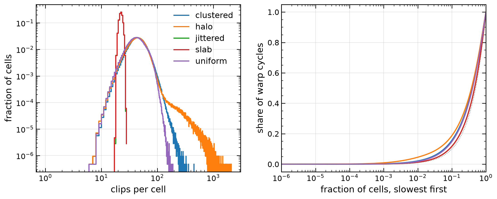

# Measure first: cost per cell, clipping order, memory by array (2026-11-10)

Items A and R3 of [ideas.md](ideas.md). The goal is the measured upper bound of what each speed and memory idea can save, to decide the order of the speed work. Nothing here is optimised.

## Setup

One A100 40 GB on Raven (`gpu1`), 1305 MHz SM clock in every job (from `nvidia-smi` logged every 5 s), double precision, periodic box. voronoi-cpp branch `measure` on origin/main 61e9914. Two builds of `voronoi_bench`: the plain build (`-lineinfo`, the library code of main unchanged) for rates, kernel times and Nsight; the measurement build (`-DVORONOI_MEASURE`) for counters. The switch adds per-cell counters to the warp clipping kernel, two repair counters and a face-ring accessor; with it off the library compiles to the same code. Scripts: `scripts/measure_a100.sh` (jobs), `scripts/measure_tables.py` (every table below; job logs in `build-measure/jobs` on Raven).

Inputs as in [measurements.md](measurements.md#inputs): jittered, uniform, clustered, halo at 2,097,152 (128³) and 16,777,216 (256³) cells; the anisotropic slab is jittered in `--box=2,2,0.0625` (4,194,304 cells, 16 spacings thick) and `--box=2,2,0.03125` (16,777,216 cells). Moving steps use the bench flow at 0.03, 0.1, 0.3 and 1.0 spacings per step.

| Jobs | What | Build |
|---|---|---|
| 32145343, 32145351 | clipping counters, cycle tails, shuffle test, 128³ and 256³ | measurement |
| 32145251, 32145352 | rebuild rates, 128³ and 256³ | plain |
| 32145353 to 32145357, 32145638 to 32145642 | moving steps: rates and kernel times (plain), changes per step (measurement) | both |
| 32145252, 32145370 | Nsight Compute: clipping kernel, step kernels at 0.03 and 0.1 | plain |
| 32145644 | Nsight Systems, 10 against 20 steps | plain |
| 32145254 | device memory by array, 128³ and 256³ | plain |
| 32145643 | slab at 1.0 spacings per step, eight steps | plain |

Commits on branch `measure`: 93f5683 (measurement build), a326728 (format), and the commit of this note.

## A. Cost per cell of a rebuild (warp clipping)

What the counters mean: a cell's walk computes the distance to every particle of the grid cells it opens (**tested**); those within 2R go to the buffer (**taken**); a buffered candidate still within 2R when its turn comes is clipped (**clips**); a clip that removes a vertex keeps a plane (**cuts**). Cycles are `clock64` of the warp from the first to the last instruction of the cell, so they include the waits of a warp that shares its SM with 19 others.

| input | cells | M cells/s | clips mean, p50, p99, max | cuts mean, p99 | peak vertices p50, p99, max | tested mean, p99 | slowest 1 % / 10 % of cells: share of cycles | max / median cycles | to thread kernel |
|---|---|---|---|---|---|---|---|---|---|
| jittered | 2,097,152 | 38.6 | 21.9, 22, 25, 28 | 16.0, 21 | 28, 38, 48 | 76, 80 | 1.3 % / 11.7 % | 1.5 | 0 |
| uniform | 2,097,152 | 19.1 | 48.0, 46, 92, 188 | 17.9, 28 | 26, 44, 62 | 103, 176 | 1.8 % / 14.8 % | 2.9 | 33 |
| clustered | 2,097,152 | 15.0 | 50.7, 48, 106, 448 | 19.8, 34 | 28, 44, 62 | 112, 238 | 2.2 % / 15.7 % | 6.4 | 68 |
| halo | 2,097,152 | 13.8 | 53.6, 48, 210, 2096 | 19.4, 34 | 28, 44, 62 | 115, 440 | 4.6 % / 18.8 % | 24.3 | 261 |
| slab | 4,194,304 | 37.9 | 21.9, 22, 25, 28 | 16.0, 21 | 28, 38, 48 | 76, 80 | 1.3 % / 11.7 % | 1.5 | 0 |
| jittered | 16,777,216 | 38.8 | 21.9, 22, 25, 29 | 16.0, 21 | 28, 38, 48 | 76, 80 | 1.3 % / 11.7 % | 1.6 | 0 |
| uniform | 16,777,216 | 19.5 | 48.0, 46, 92, 199 | 18.0, 28 | 26, 44, 62 | 103, 176 | 1.8 % / 14.8 % | 3.0 | 306 |
| clustered | 16,777,216 | 16.3 | 49.5, 47, 98, 367 | 19.6, 33 | 28, 44, 62 | 108, 203 | 1.9 % / 15.2 % | 5.1 | 315 |
| halo | 16,777,216 | 15.8 | 50.9, 47, 117, 1973 | 19.2, 33 | 28, 44, 62 | 109, 253 | 3.5 % / 17.2 % | 25.5 | 1235 |
| slab | 16,777,216 | 38.0 | 21.9, 22, 25, 29 | 16.0, 21 | 28, 38, 48 | 76, 80 | 1.3 % / 11.7 % | 1.6 | 0 |

Rates are the plain build, median of 5 (`construct_ms`, the warp kernel plus the thread kernel for the cells it gives up). The slab is the jittered cube in every count: the box shape changes nothing per cell. Per cell, 128³ and 256³ agree to a few per cent.

**The tail is thin.** Clips have long tails on clustered and halo input (p99 2 to 4 times the median, a maximum of 2000 clips), but the slowest 1 % of cells take only 1.3 to 4.6 % of the warp cycles, the slowest 10 % take 12 to 19 %. The cells the warp kernel gives up (more than 64 planes or 64 vertices) are few, 0 to 261 at 128³, but they cost more than their number says: the warp kernel alone takes 133.3 ms on clustered and 136.3 ms on halo (Nsight Compute), the whole rebuild 139.7 and 152.1 ms, so the thread-kernel pass and its bookkeeping are 4.6 % and 10.4 % of a rebuild there (0.5 % on jittered, 2.7 % on uniform).

**Where the cycles go.** A non-negative least-squares fit of each cell's cycles to its counts (128³, R² 0.82 to 0.93 on unstructured input; jittered cells are all alike, R² 0.55):

| input | cycles per distance test | per clip that cuts nothing | per cut | per walked grid cell | R² | share: tests, empty clips, cuts, walk |
|---|---|---|---|---|---|---|
| uniform | 357 | 1250 | 5894 | 7 | 0.82 | 20 %, 21 %, 58 %, 1 % |
| clustered | 328 | 1439 | 5838 | 207 | 0.82 | 15 %, 19 %, 48 %, 18 % |
| halo | 371 | 1573 | 5620 | 180 | 0.93 | 17 %, 22 %, 44 %, 17 % |
| jittered | 0 | 779 | 3115 | 217 | 0.55 | 0 %, 6 %, 61 %, 34 % |

A cut costs about four times a clip that removes nothing, and about half of all cycles go to cuts. On unstructured input 61 to 64 % of the clips cut nothing.

**Plume P1, the per-vertex balls.** A particle can cut the cell only if it lies in the ball of some current vertex (centre the vertex, radius its distance to the generator). Counted at the moment the walk tests the particle, against the cell as it is then:

| input | cells | taken / tested | clips that cut | tested outside every ball | taken outside | opened grid cells meeting no ball | their particles / tested |
|---|---|---|---|---|---|---|---|
| jittered | 2,097,152 | 41 % | 73 % | 59 % | 0 % | 59 % | 59 % |
| uniform | 2,097,152 | 56 % | 37 % | 65 % | 37 % | 46 % | 46 % |
| clustered | 2,097,152 | 55 % | 39 % | 64 % | 36 % | 45 % | 44 % |
| halo | 2,097,152 | 56 % | 36 % | 67 % | 41 % | 47 % | 48 % |
| slab | 4,194,304 | 41 % | 73 % | 59 % | 0 % | 59 % | 59 % |

(256³ within a point of these.) On jittered input every taken candidate is in a ball, because the first 31 are taken while the cell is still the starting cube; after the first flush the cell is nearly final and the 2R sphere already rejects the rest. There P1 saves distance tests, not clips. On unstructured input a third of what is buffered could not cut. Priced with the fit above, the clips that cut nothing plus the distance tests of particles outside every ball are **28 % (clustered), 33 % (halo), 34 % (uniform) and 6 % (jittered) of the clipping cycles**: the upper bound of P1 and R8 together, before the cost of the ball test itself (up to 64 vertices per particle or grid cell).

**Nsight Compute, the clipping kernel** (one launch, 2.1M cells; slab 4.2M):

| input | ms | registers | local loads + stores per cell | warps active | threads per instruction | memory wait | fixed-latency wait | instruction fetch | shared-memory wait | issue |
|---|---|---|---|---|---|---|---|---|---|---|
| jittered | 54.0 | 96 | 101 | 31 % | 21.4 | 7 % | 40 % | 15 % | 16 % | 27 % |
| uniform | 106.7 | 96 | 130 | 31 % | 22.7 | 5 % | 33 % | 39 % | 11 % | 18 % |
| clustered | 133.3 | 96 | 139 | 31 % | 22.6 | 8 % | 30 % | 43 % | 10 % | 16 % |
| halo | 136.3 | 96 | 150 | 31 % | 22.7 | 8 % | 31 % | 42 % | 10 % | 16 % |
| slab | 110.4 | 96 | 96 | 31 % | 21.5 | 7 % | 39 % | 18 % | 15 % | 27 % |

Shares are of the warp stall samples (memory wait = long scoreboard + load throttle; instruction fetch = no instruction + branch resolving; shared memory = short scoreboard + MIO throttle; issue = selected + not selected). Registers are capped at 96 by the launch bounds, with a 176 to 208 byte stack frame (`cuobjdump -res-usage`): 100 to 150 local loads and stores per cell. Occupancy is 20 of 64 warps, limited equally by registers and by the 18 KB of shared memory per block. The kernel does not wait for memory. It waits for its own dependent arithmetic and shared memory, and on uniform, clustered and halo input, which take the adaptive kernel (`Kernel<…, true, …>`), for instructions: 39 to 43 % of stalls against 15 to 18 % for the jittered, non-adaptive one. That is the share a smaller adaptive kernel (C, R16, F) could address. It is not a bound on time.

(Left) Clips per cell at 128³; the slab lies on jittered. (Right) The share of all warp cycles in the slowest fraction of cells; the dotted line is equal cost per cell.

## B. Shuffle test of clipping order (V3)

Every 1024th slot at 128³ (every 8192nd at 256³), 2048 cells per input: the warp kernel records every candidate it buffers, in the order it clips them. The host replays each list with `RoundedCell<128, 256>` from the starting cube: the kernel's order, all candidates sorted nearest first, and 64 random orders. A candidate counts as a clip when it is still within 2R at its turn. Means per cell; spread = (largest − smallest) / mean over the random orders, its median and 90th percentile over cells:

| input | cells | clips: kernel, sorted, random mean, worst | cuts: kernel, sorted, random | vertex tests: kernel, sorted, best of 66 | spread of clips p50, p90 | spread of vertex tests p50, p90 |
|---|---|---|---|---|---|---|
| jittered | 2,097,152 | 21.88, 21.88, 28.91, 31.00 | 15.98, 15.98, 23.83 | 350.87, 350.87, 349.29 | 0.21, 0.28 | 0.47, 0.58 |
| uniform | 2,097,152 | 48.52, 43.10, 53.06, 57.29 | 17.92, 16.62, 32.05 | 995.83, 898.95, 829.53 | 0.18, 0.32 | 0.53, 0.75 |
| clustered | 2,097,152 | 50.11, 43.36, 54.85, 59.88 | 19.73, 16.59, 32.59 | 1035.50, 908.33, 839.48 | 0.19, 0.38 | 0.54, 0.80 |
| halo | 2,097,152 | 53.74, 47.56, 57.88, 62.46 | 19.50, 16.74, 32.69 | 1152.04, 1041.08, 934.49 | 0.17, 0.37 | 0.53, 0.79 |
| jittered | 16,777,216 | 21.86, 21.86, 28.91, 31.00 | 15.96, 15.96, 23.81 | 349.31, 349.31, 347.77 | 0.21, 0.28 | 0.47, 0.59 |
| uniform | 16,777,216 | 48.38, 43.06, 52.96, 57.22 | 18.02, 16.59, 31.92 | 995.81, 901.43, 826.74 | 0.18, 0.32 | 0.53, 0.75 |
| clustered | 16,777,216 | 49.76, 43.53, 54.29, 59.07 | 19.59, 16.61, 32.50 | 1031.65, 914.33, 841.84 | 0.19, 0.36 | 0.54, 0.78 |
| halo | 16,777,216 | 50.82, 44.51, 54.94, 59.50 | 19.45, 16.72, 32.31 | 1070.95, 953.37, 869.17 | 0.18, 0.37 | 0.53, 0.78 |

(The slab equals jittered.) The spread is large: a random order makes twice the cuts and 50 % more vertex tests than nearest first. But nearest first is already the best order found: none of the 64 random orders has fewer clips than the sorted one, and the best of all 66 orders saves only a further 8 % of vertex tests below sorted. What is left on the table is the difference between the kernel's batch order (32 candidates sorted at a time) and a full sort: 11 to 13 % fewer clips and 7 to 16 % fewer cuts on unstructured input, none on jittered (one batch holds every candidate). Priced with the fit above, that is **7 % (uniform), 8 % (halo) and 10 % (clustered) of the clipping cycles**.

So: V3 (learned or tuned orders) is not worth pursuing; its room above nearest first is about 8 % of the vertex tests, and only on unstructured input. B (a better nearest-first: more candidates sorted before clipping, or previous neighbours first) has a bound of 7 to 10 %. The replay limits each order to the candidates the kernel collected; a worse order would collect more, so random orders are, if anything, worse than shown.

## A. Cost of a moving step

Rates of the plain build: median of steps 2 to 6, the device step (repair and geometry, as in the README) and in brackets with `update_cells()`. Changes per step from the measurement build, last of four steps (two at 256³): tetrahedra the screen lists, tetrahedra flips create, faces whose ring is walked again, cells whose set of neighbours changed; and every new neighbour of every cell checked against the cell's previous 2-ring and 3-ring of neighbours (all steps measured).

| input | cells | spacings per step | step M cells/s (with update_cells) | flips per cell | rounds | tets screened | tets created | faces re-walked | cells whose neighbours changed | new neighbours outside 2-ring / 3-ring |
|---|---|---|---|---|---|---|---|---|---|---|
| jittered | 2,097,152 | 0.03 | 193 (142) | 0.029 | 6 | 0.6 % | 1.0 % | 3.3 % | 5.6 % | 0 / 0 of 242,558 |
| jittered | 2,097,152 | 0.1 | 114 (91) | 0.096 | 8 | 2.0 % | 3.3 % | 10.4 % | 17.3 % | 0 / 0 of 796,228 |
| jittered | 2,097,152 | 0.3 | 54 (48) | 0.268 | 11 | 5.4 % | 8.9 % | 25.8 % | 40.8 % | 2 / 0 of 2,240,918 |
| jittered | 2,097,152 | 1.0 | 31 (29) | 0.467 | 14 | 9.9 % | 15.1 % | 40.9 % | 60.7 % | 28 / 0 of 5,215,704 |
| uniform | 2,097,152 | 0.03 | 244 (171) | 0.012 | 4 | 0.3 % | 0.4 % | 1.4 % | 2.4 % | 0 / 0 of 99,292 |
| uniform | 2,097,152 | 0.1 | 170 (127) | 0.040 | 7 | 0.9 % | 1.4 % | 4.6 % | 7.5 % | 0 / 0 of 331,598 |
| uniform | 2,097,152 | 0.3 | 97 (78) | 0.119 | 11 | 2.5 % | 4.2 % | 12.9 % | 20.8 % | 2 / 0 of 994,064 |
| uniform | 2,097,152 | 1.0 | 36 (33) | 0.399 | 19 | 7.5 % | 13.2 % | 35.3 % | 52.6 % | 26 / 0 of 3,300,424 |
| clustered | 2,097,152 | 0.03 | 240 (169) | 0.011 | 5 | 0.2 % | 0.4 % | 1.3 % | 2.1 % | 0 / 0 of 91,030 |
| clustered | 2,097,152 | 0.1 | 173 (128) | 0.036 | 6 | 0.8 % | 1.3 % | 4.3 % | 7.0 % | 0 / 0 of 304,192 |
| clustered | 2,097,152 | 0.3 | 100 (81) | 0.109 | 10 | 2.3 % | 3.9 % | 12.0 % | 19.2 % | 0 / 0 of 911,016 |
| clustered | 2,097,152 | 1.0 | 40 (36) | 0.364 | 20 | 6.9 % | 12.1 % | 32.9 % | 49.5 % | 10 / 0 of 3,019,260 |
| halo | 2,097,152 | 0.03 | 245 (171) | 0.012 | 4 | 0.3 % | 0.4 % | 1.4 % | 2.3 % | 0 / 0 of 98,542 |
| halo | 2,097,152 | 0.1 | 172 (128) | 0.039 | 7 | 0.8 % | 1.4 % | 4.6 % | 7.4 % | 0 / 0 of 326,102 |
| halo | 2,097,152 | 0.3 | 100 (80) | 0.116 | 11 | 2.4 % | 4.1 % | 12.7 % | 20.4 % | 0 / 0 of 975,366 |
| halo | 2,097,152 | 1.0 | 37 (34) | 0.389 | 18 | 7.4 % | 12.9 % | 34.7 % | 51.7 % | 34 / 0 of 3,225,590 |
| slab | 4,194,304 | 0.03 | 104 (84) | 0.122 | 8 | 2.5 % | 4.1 % | 12.8 % | 21.4 % | 0 / 0 of 2,010,556 |
| slab | 4,194,304 | 0.1 | 45 (40) | 0.324 | 14 | 6.5 % | 10.5 % | 29.8 % | 47.2 % | 0 / 0 of 5,799,736 |
| slab | 4,194,304 | 0.3 | 39 (36) | 0.365 | 14 | 7.7 % | 11.9 % | 33.5 % | 51.5 % | 70 / 0 of 10,581,082 |
| jittered | 16,777,216 | 0.03 | 276 (193) | 0.015 | 5 | 0.3 % | 0.5 % | 1.7 % | 2.9 % | 0 / 0 of 488,544 |
| jittered | 16,777,216 | 0.1 | 182 (135) | 0.048 | 8 | 1.0 % | 1.7 % | 5.5 % | 9.2 % | 0 / 0 of 1,619,448 |
| jittered | 16,777,216 | 0.3 | 96 (79) | 0.143 | 10 | 2.9 % | 5.0 % | 15.1 % | 24.8 % | 0 / 0 of 4,806,880 |
| uniform | 16,777,216 | 0.03 | 322 (216) | 0.006 | 4 | 0.1 % | 0.2 % | 0.7 % | 1.2 % | 0 / 0 of 198,618 |
| uniform | 16,777,216 | 0.1 | 257 (179) | 0.020 | 6 | 0.4 % | 0.7 % | 2.4 % | 3.9 % | 0 / 0 of 662,496 |
| uniform | 16,777,216 | 0.3 | 165 (123) | 0.059 | 9 | 1.3 % | 2.1 % | 6.8 % | 11.1 % | 0 / 0 of 1,988,380 |
| clustered | 16,777,216 | 0.03 | 324 (217) | 0.005 | 4 | 0.1 % | 0.2 % | 0.7 % | 1.1 % | 0 / 0 of 182,728 |
| clustered | 16,777,216 | 0.1 | 263 (182) | 0.018 | 6 | 0.4 % | 0.7 % | 2.2 % | 3.6 % | 0 / 0 of 610,604 |
| clustered | 16,777,216 | 0.3 | 172 (127) | 0.055 | 9 | 1.2 % | 2.0 % | 6.3 % | 10.3 % | 0 / 0 of 1,834,184 |
| halo | 16,777,216 | 0.03 | 322 (216) | 0.006 | 4 | 0.1 % | 0.2 % | 0.7 % | 1.2 % | 0 / 0 of 195,752 |
| halo | 16,777,216 | 0.1 | 259 (179) | 0.019 | 7 | 0.4 % | 0.7 % | 2.3 % | 3.8 % | 0 / 0 of 653,344 |
| halo | 16,777,216 | 0.3 | 165 (123) | 0.058 | 9 | 1.3 % | 2.1 % | 6.7 % | 10.9 % | 0 / 0 of 1,960,362 |
| slab | 16,777,216 | 0.03 | 108 (87) | 0.122 | 9 | 2.5 % | 4.2 % | 13.1 % | 21.8 % | 0 / 0 of 4,111,556 |
| slab | 16,777,216 | 0.1 | 45 (41) | 0.325 | 14 | 7.5 % | 12.7 % | 34.7 % | 53.7 % | 4 / 0 of 12,967,746 |
| slab | 16,777,216 | 0.3 | 40 (36) | 0.363 | 15 | 15.4 % | 25.5 % | 58.8 % | 81.4 % | 258 / 0 of 30,288,022 |

The bench flow varies on the box scale, so at 256³ neighbours shear half as much per step as at 128³ (half the flips per cell, [measurements.md](measurements.md)); the slab shears across 16 cells at both sizes.

**What changes against what is recomputed (idea E).** At 0.1 spacings a step creates 0.7 to 3.3 % of the tetrahedra and walks 2 to 10 % of the face rings again, and the neighbours of 4 to 17 % of the cells change. Yet every step runs over all tetrahedra (`screen`, `face_numbers`), all faces (`faces`, and at 0.1 and above the full rebuild of the cell lists) and all cells (`cell_sums`). Positions move, so circumcentres, face geometry and cell sums must be recomputed everywhere; the bookkeeping of numbers, rings and lists need not. Kernel times per step (Kokkos Tools, fenced; median of steps 2 to 6, 128³; the bench's own copies left out):

| kernel | runs over | jittered 0.03 | jittered 0.1 | jittered 0.3 | clustered 0.03 | clustered 0.1 | clustered 0.3 |
|---|---|---|---|---|---|---|---|
| `tet_mesh::faces` | all faces | 2.53 | 2.63 | 2.68 | 2.38 | 2.52 | 2.60 |
| `tet_mesh::cell_sums` | all cells | 2.29 | 1.79 | 1.84 | 2.33 | 2.46 | 1.90 |
| `tet_repair::screen` | all tetrahedra | 2.02 | 2.28 | 2.68 | 1.89 | 2.04 | 2.32 |
| `tet_mesh::face_numbers` | all tetrahedra | 1.16 | 1.20 | 1.28 | 1.14 | 1.17 | 1.22 |
| `tet_mesh::cell_sort` | listed cells | 0.61 | 1.24 | 1.26 | 0.52 | 0.64 | 1.26 |
| `tet_mesh::cell_face_fill`, `_counts`, `_start` | all faces, cells | 0.22 | 1.75 | 1.79 | 0.22 | 0.22 | 1.86 |
| `tet_mesh::compact_rings`, `ring_entries` | all faces | 0 | 0.79 | 2.07 | 0 | 0 | 0.55 |
| `tet_mesh::marked_*`, `fresh_*`, `mark_cells` | cells, changed | 0.53 | 0 | 0 | 0.32 | 0.64 | 0 |
| `tet_mesh::dirty_faces`, `append_rings` | changed faces | 1.32 | 4.42 | 12.40 | 0.54 | 1.73 | 5.13 |
| `tet_repair::find`, `plan`, `apply`, `unlist`, `release`, `retry_stuck` | dirty tetrahedra | 2.52 | 6.38 | 16.82 | 1.56 | 3.26 | 7.72 |
| `tet_mesh::circumcentres` | created tetrahedra | 0.08 | 0.14 | 0.33 | 0.05 | 0.08 | 0.18 |
| snaps, `total_volume` | all cells | 0.37 | 0.37 | 0.36 | 0.39 | 0.38 | 0.42 |
| **mesh kernels, total** | | 13.66 | 22.98 | 43.49 | 11.33 | 15.14 | 25.14 |
| topology bookkeeping (numbers, rings, lists) | | 3.84 (28 %) | 9.40 (41 %) | 18.78 (43 %) | 2.74 (24 %) | 4.41 (29 %) | 10.02 (40 %) |

The bookkeeping that runs over everything while 1 to 26 % changed (`face_numbers`, the list rebuild, `cell_sort`, `compact_rings`) is 2.4 ms of 13.7 at jittered 0.03 (17 %) and 5.0 ms of 23.0 at 0.1 (22 %); made proportional to what changed, it would keep a tenth to a quarter of that. Upper bound of E: **11 to 19 % of a step at 0.03 to 0.3 spacings** on jittered input, 15 to 18 % on clustered. One cause is visible in the table: `update_cells()` takes its incremental path only when the repair created at most n/5 tetrahedra, and a jittered step at 0.1 creates 490,000 for 2.1M cells, so every list is rebuilt from scratch (`cell_face_fill`, `_counts`: 1.6 ms).

The screen tests every tetrahedron (2.0 to 2.7 ms) and lists 0.2 to 5 % of them. Its circumcentres are needed anyway; the test of four neighbours each is what V1 and O1 could skip. Upper bound of V1/O1: the screen's share less its circumcentres, **at most about 10 % of a step** (the screen is 6 to 17 % of the step, the circumcentres and their store a part of it).

**Launches (R1).** Nsight Systems, 20 steps against 10 at 128³ jittered 0.1: 61.4 kernel launches, 33.3 stream synchronisations, 26.1 asynchronous copies and 37.5 memsets per step; GPU kernel time 21.75 ms per step against 22.2 ms wall. At 128³ and above the launch structure costs at most a few per cent (the earlier profile found 2 ms of fixed cost per step, 6 % at 128³ and under 1 % at 256³); R1's bound is that, plus whatever duplicate work a queue avoids in rounds (rounds are 4 to 11 per step up to 0.3 spacings).

**Nsight Compute, step kernels** (128³ jittered 0.1, all launches of the start and three steps; `repair#n` is the n-th lambda of `tet_repair::repair`: #2 find, #5 plan, #6 apply by their registers):

| kernel | launches | ms all launches | registers | warps active | threads per instruction | memory wait | fixed-latency wait | DRAM GB/s |
|---|---|---|---|---|---|---|---|---|
| `tet_mesh::update_face_rings#1` (dirty faces) | 5 | 12.15 | 70 | 75 % | 13.1 | 77 % | 6 % | 526 |
| `tet_mesh::faces` | 4 | 10.13 | 80 | 33 % | 20.5 | 76 % | 11 % | 860 |
| `tet_repair::repair#6` (apply) | 22 | 8.62 | 56 | 39 % | 6.3 | 86 % | 8 % | 372 |
| `detail::number_faces` | 8 | 8.00 | 49 | 54 % | 15.6 | 64 % | 10 % | 500 |
| `CellSumsWarp` | 4 | 7.05 | 60 | 47 % | 27.9 | 84 % | 7 % | 773 |
| `tet_mesh::update_face_rings#2` (append rings) | 3 | 6.37 | 38 | 67 % | 15.3 | 93 % | 2 % | 705 |
| `tet_repair::repair#5` (plan) | 22 | 6.30 | 152 | 14 % | 15.2 | 67 % | 17 % | 281 |
| `tet_repair::move_screened` | 3 | 6.09 | 66 | 39 % | 21.3 | 71 % | 18 % | 562 |
| `CellSortWarp` | 4 | 4.92 | 40 | 69 % | 30.7 | 63 % | 12 % | 356 |
| `tet_repair::repair#2` (find) | 28 | 2.85 | 168 | 15 % | 22.0 | 78 % | 13 % | 553 |
| `tet_mesh::circumcentres` | 6 | 1.47 | 134 | 17 % | 31.1 | 71 % | 20 % | 733 |

Unlike the clipping, every step kernel waits on memory (63 to 93 % of stalls), at 280 to 860 GB/s of the A100's 1555: scattered reads through `vertex`, `ring`, `owner` and the renumbering tables, as the earlier profile found. Spills: none (no stack frame) in the step kernels except `plan` and `find` (128 to 448 bytes of stack for their local plan arrays), where 152 and 168 registers leave 14 to 15 % of warps active. The apply kernel runs 6.3 threads per instruction: one flip per thread, with the rest of the warp idle in its branches.

**Stuck cells and large moves (S2).** Up to 0.3 spacings per step no jittered, uniform or halo step got stuck at 128³ or 256³. Clustered at 0.3 left 6 triangles stuck in two of six steps, finished on the host in 5.3 ms each (a quarter of a step). At 1.0 spacings per step uniform, clustered and halo leave 6 to 12 stuck triangles in most steps: the host finishes 6 or 8 in 4 to 9 ms; 12 is above the n / 200000 limit and the mesh is rebuilt, 250 to 590 ms, 7 to 15 steps' worth. The slab at 1.0 spacings per step left 30 stuck at step 5 (rebuilt in 940 ms), and at step 6 the rebuild itself was refused: 1434 cells too wide to certify in one periodic image (the reach rule of #31, which the sheared 16-cell slab breaks; job 32145643). Every new neighbour of every cell in all these steps, 103 million checked, lay in the cell's previous 3-ring, and all but 434 (0.0004 %) in its 2-ring. So a local exact rebuild from a 3-ring candidate list (S2) is always enough here, and a 2-ring nearly always; its bound is the host and rebuild time it replaces, zero at 0.3 spacings or less except clustered input, and 20 % to 15 steps' worth per stuck step at 1.0.

## C. Memory by array at the peak of a moving step (R3)

Kokkos allocations at the peak of four steps at 0.1 spacings, jittered, `step --memory` (job 32145254). 128³ and 256³ give the same bytes per cell to 0.1 B: 1998 B/cell peak, 4.19 GB at 128³ and 33.5 GB at 256³ (34.7 GB on the GPU with the CUDA context). Of the 80 B/cell labelled `positions` at the peak, 48 are the bench's input (two copies while it advects) and 32 the mesh's; the mesh holds **1950 B/cell**. Writers and readers from the code; "hydro" is luna-cpp's `FiniteVolume`, which reads `owner`, `neighbour`, `cell_face_start`, `cell_face`, `area`, `face_centroid`, `centroid`, `volume`, `positions`, `face_rows` and `gradient_weights` through `voronoi::Mesh`, and borrows the spare ring pool as scratch (`Mesh::scratch`).

| array (label) | B/cell | written by | read by | could be |
|---|---|---|---|---|
| `face_rings_pool`, two pools | 501 | `update_face_rings` (append, compact) | `faces` (ring of each face); the spare: hydro scratch, `update_cells` scratch | in use: exact size 174 B/cell (43.5 ring entries a cell) instead of 1.5x and superseded rings, or not stored (walk the edge in `faces`); the spare is the hydro's scratch (its flux rows are 318 B/cell), so it moves rather than goes |
| `face_area`, `face_centroid` | 394 | `faces` | hydro (sweep, fluxes), `cell_sums` | float: −197; computed in the flux kernel (R14): −394 |
| `tet_centre` (double[4], 1/8 spare) | 250 | `screen` (all), `circumcentres` (created) | `faces`, `screen`'s test, `repair` | float: −125; recomputed where read (6 faces read each): −250 |
| `tet_vertex`, `tet_adjacent` | 250 | `from_rings`, repair `apply` | everything topological | needed; the 1/8 spare is 28 |
| `tet_repair_dirty`, `_listed`, `_free`, `_lock` | 157 | `screen`, repair | repair | dirty as a byte, lock 32-bit, lists sized to the dirty set (0.2 to 15 % of tetrahedra): about −110 |
| `cell_face` (+1/32 spare), `cell_face_start`, `_cursor` | 74 | `update_cells` | hydro, `cell_sums` | needed by the hydro |
| `face_rings_owner`, `_neighbour` | 66 | `update_face_rings` | hydro, `faces`, `cell_sums` | needed by the hydro |
| `face_rings_ring_start`, `_ring_length` | 66 | `update_face_rings` | `faces` | 16-bit lengths: −16; none without stored rings |
| `cell_centroid`, `cell_volume` | 32 | `cell_sums`, `faces` (volume) | hydro | needed |
| `positions` (mesh, double[4]) | 32 | `snap` | everything geometric, hydro | double[3]: −8 |
| `face_rings_start` (per tetrahedron) | 31 | `number_faces` | face lookups by edge | needed while faces are numbered from tetrahedra |
| cell list: `slot_positions`, `particle_order`, `cell_offsets`, `slot_fine_keys`, `slot_levels` | 37 | `index` (rebuild) | rebuild and `clip()` only | freed after a start: −37 |
| `tet_repair_point` (int[4]) | 16 | `snap` in `move_screened` | repair predicates | derived from `positions` (exact multiples of the step): −16 |
| `tet_edges`, `_alive`, `_touched`, `_touched_list`, repair `work`, `stuck`, `plans`, `freed` | 45 | repair, `from_rings` | repair, `number_faces` | small |

With every float and every exact size above, the mesh comes to about 1310 B/cell; with face geometry and circumcentres also not stored and rings walked instead of pooled, to about 760 (the spare pool stays: it is the hydro's scratch). The hydro adds about 320 B/cell of its own (2319 B/cell peak of a two-pass Sedov run, luna-cpp `research_notes/profile_2026-11-06.md`, against this mesh's 1998). That is about 1630 B/cell in all, or 1080 B/cell: either way 256³ fits on one A100 and 384³ does not. 384³ on one A100 40 GB needs about 720 B/cell in all. **384³ is out of reach with the mesh's storage alone**: even with face geometry and circumcentres computed where they are used (R14) and rings walked, which trades memory for exactly the scattered reads the step kernels already wait on, the hydro's scratch and its own rows would have to shrink too.

## Ranked list: measured upper bounds

Bounds are per cent of the time of the stage named, on the inputs named; each is a ceiling before the idea's own cost.

**Construction (rebuild, start).** At 128³ the clipping is 29 % of a whole start (58 of 200 ms, jittered); `from_rings`, the check and the patch are the rest (the bench's `start` line).

| rank | idea | upper bound | measured from |
|---|---|---|---|
| 1 | P1 with R8: per-vertex balls or cheaper bounds before the clip | 28 to 34 % of clipping on uniform, clustered, halo; 6 % on jittered and the slab | empty clips and tests outside every ball, priced by the fit |
| 2 | P2 / O7 / R7: finish large cells on the device, or a tail queue | 10 % of a rebuild on halo, 5 % clustered, 3 % uniform, under 1 % jittered (thread-kernel pass); the slowest 1 % of cells hold only 1.3 to 4.6 % of warp cycles | warp kernel time against rebuild time; cycle tails |
| 3 | B: nearest first over more candidates (full sort, previous neighbours first) | 7 to 10 % of clipping on unstructured input, 0 on jittered | shuffle replay, sorted against kernel order |
| 4 | C, R16, F, T5: smaller adaptive kernel, cell layout, launch shape | not a time bound: instruction fetch is 39 to 43 % of stalls in the adaptive kernel (15 to 18 % jittered); 31 % occupancy, set equally by registers and shared memory; memory wait 5 to 8 % | Nsight Compute |
| 5 | V3: learned or tuned clipping order | about 8 % of vertex tests beyond nearest first on unstructured input, nothing on jittered: drop | shuffle replay, best of 66 orders |
| — | D: start without clipping | at most the clipping's 29 % of a start; the rest of the start is from `from_rings` and the exact check | bench `start` line |

**Moving step.**

| rank | idea | upper bound | measured from |
|---|---|---|---|
| 1 | #34 / R15: re-sort when the order has decayed | 2x by step 500 on the smooth flow (earlier profile, job 31953232; not remeasured) | earlier profile |
| 2 | E: bookkeeping proportional to change; the incremental `update_cells()` past n/5 created tetrahedra | 11 to 19 % of a step at 0.03 to 0.3 spacings (jittered), 15 to 18 % (clustered) | kernel times, changed fractions |
| 3 | V1 / O1: predict topology events instead of testing every tetrahedron | at most 10 % of a step | the screen's time and listed fraction |
| 4 | S2 (with P2): local exact rebuild from the 3-ring | zero up to 0.3 spacings except clustered (a quarter of a step in a third of steps); at 1.0 spacings 20 % of a step to 15 steps per stuck step | stuck counts, host and rebuild times; 3-ring always held every new neighbour |
| 5 | faces numbered by owner, owner bit (from the profile) | about 5 % of a step, 8 % of the hydro | earlier profile |
| 6 | R1: one queue instead of rounds and launches | a few per cent at 128³, under 1 % at 256³ | Nsight Systems: 61 launches, 33 synchronisations per step; 21.75 ms GPU in 22.2 ms wall |

**Memory** (mesh 1950 B/cell at a step's peak, 1998 with the bench's positions):

| rank | idea | saving, B/cell |
|---|---|---|
| 1 | R14: face area and centroid computed in the flux kernel (float rows: half) | 394 (197) |
| 2 | Rings walked, not pooled; or the in-use pool sized exactly | 250 + 66 (76) |
| 3 | `tet_centre` recomputed where read (float: half) | 250 (125) |
| 4 | Repair lists sized to the dirty set, byte flags, 32-bit locks | about 110 |
| 5 | Tetrahedron spare 1/8 to 1/32 | about 55 |
| 6 | Cell list freed after the start; snapped integers derived from positions; positions double[3] | 37 + 16 + 8 |

The float and exact-size changes (#28's list, confirmed here array by array) give about 1310 B/cell for the mesh; all the drops together about 760. With the hydro, both fit 256³ and neither reaches 384³ without the hydro's scratch shrinking as well.
