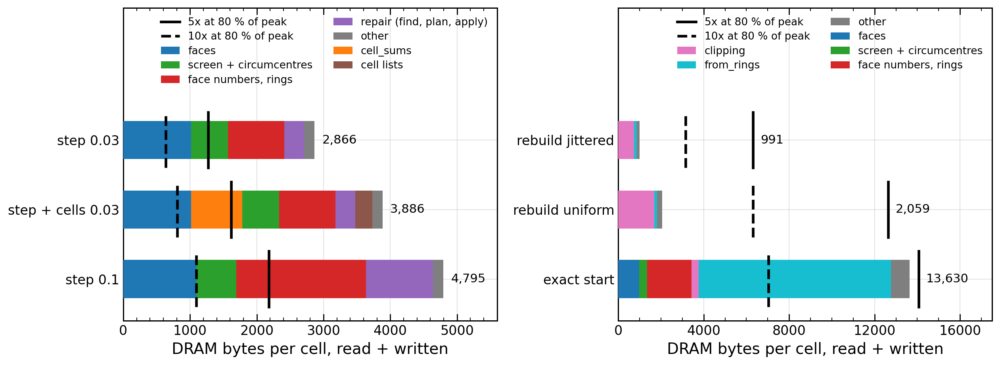

# The bandwidth ceiling and FP32 geometry (2026-11-12)

The goal set on 2026-11-12: the mesh at least 5×, ideally 10× faster than main 69de1d3, with about half the memory (step peak 1950 → about 1000 B/cell) and the same accuracy. This note measures how far the A100's memory bandwidth allows that with today's data movement (part 1), and whether the stored geometry can be float without losing accuracy (part 2). Nothing here is optimised.

## Setup

One A100-SXM4 40 GB on Raven (`gpu1` and `gpudev`), double precision, periodic unit box, 2,097,152 cells (128³), jittered input unless named. Clock: the jobs log 1305 MHz application clock; Nsight Compute ran with `--clock-control none` and measured 1279 to 1305 MHz SM clock per kernel (`sm__cycles_elapsed.avg.per_second`). Peak DRAM bandwidth 1555 GB/s; "80 % of peak" is 1244 GB/s. GB are 10⁹ bytes; B/cell is bytes divided by 2,097,152.

Code: main 69de1d3 (the library unchanged). The bench gains `--nvtx` (an NVTX range per phase and per Kokkos kernel label, so Nsight names and filters kernels by label) and `--nvtx=phases` (phase ranges only: the per-label ranges go through Kokkos Tools callbacks, which fence after every kernel). Branch `measure-ceiling`; scripts `scripts/ceiling_a100.sh` (jobs), `scripts/ceiling_tables.py` (tables), `scripts/ceiling_figure.py` (figure); job logs in `build-nvtx/jobs` of the worktree on Raven.

What is timed:

- **Moving step**: step 3 of the bench flow (`voronoi_bench step 2097152 jittered <d> 3`), `update()` and `update_cells()` as separate phases. The baseline rates (196 / 114 M cells/s at 0.03 / 0.1 spacings) are `update()` alone, 154 at 0.03 is with `update_cells()`.
- **Rebuild**: one call of the cell list and the warp clipping (`rebuild 2097152 <kind> 1`, the timed call; the warm-up is profiled too and divided out). The baseline rate is the clipping alone.
- **Exact start**: the first `update()` of the step bench: clipping with rings, `from_rings`, `tet_start`, circumcentres and faces. The baseline 17.7 M cells/s is the bench's `start_ms` (clipping and `tet_start::build`, without the geometry: 123.7 ms in job 32222228, 17.0 M cells/s).
- Nsight Compute replays every kernel with the caches flushed (`--cache-control all`), so DRAM bytes are from a cold L2 (40 MB, against 0.1 to 4 GB of arrays per phase). Kernel times are Nsight Compute's (`gpu__time_duration`); the Nsight Systems sums of the same phases (job 32222166) are within 5 %.

| Jobs | What |
|---|---|
| 32222161, 32222162 | Nsight Compute, step 3 at 0.03 and 0.1 spacings, `update()` and `update_cells()` |
| 32222164, 32222165 | Nsight Compute, rebuild jittered and uniform |
| 32222228 | Nsight Compute, exact start (32222163 failed: the profiler was busy) |
| 32222166 | Nsight Systems with per-label ranges (fenced): kernel time per label |
| 32222996 (32222626 on a 1095 MHz node) | Nsight Systems with phase ranges only: launches, synchronisations, copies, host gaps |
| 32222167 | plain rates of the same binary, without NVTX |

Plain rates of this binary (job 32222167, steps 2 to 10): 0.03 spacings 190 to 201 M cells/s, 0.1: 98 to 115 (one slow step in ten, from a ring compaction), rebuild 38.7 jittered, 19.1 uniform. So the profiled code is the baseline.

## Part 1: the bandwidth ceiling

### The table that decides the plan

Budget = the bytes per cell that the target rate allows if every kernel streams at 80 % of peak: 1244 GB/s / (rate). Ceiling = the rate at today's bytes per cell if every kernel ran at 80 % of peak.

| what | baseline M cells/s | 5×: M cells/s, B/cell budget | 10×: M cells/s, B/cell budget | measured DRAM B/cell | ceiling at today's bytes, M cells/s (× baseline) | today's kernels: GB/s, % of peak |
|---|---|---|---|---|---|---|
| step, 0.03 spacings | 196 | 980, **1269** | 1960, **635** | 2866 | 434 (2.2×) | 605, 39 % |
| step + `update_cells()`, 0.03 | 154 | 770, **1616** | 1540, **808** | 3886 | 320 (2.1×) | 602, 39 % |
| step, 0.1 spacings | 114 | 570, **2182** | 1140, **1091** | 4795 | 259 (2.3×) | 579, 37 % |
| rebuild, jittered | 39.4 | 197, 6315 | 394, 3157 | 991 | 1255 (32×) | 38, 2 % |
| rebuild, uniform | 19.7 | 99, 12629 | 197, 6315 | 2059 | 604 (31×) | 38, 2 % |
| exact start | 17.7 | 89, 14056 | 177, 7028 | 13630 | 91 (5.2×) | 215, 14 % |

DRAM bytes per cell of each phase, stacked by kernel group (Nsight Compute, 128³); the bars across each row are the budgets of 5× (solid) and 10× (dashed) at 80 % of peak. The rebuilds and the start are not limited by bytes: their bars sit far left of their budgets (start: just inside the 5× budget).

Three findings decide the plan:

1. **The moving step cannot reach 5× by faster kernels alone.** At today's bytes it is capped at 2.1 to 2.3× (all kernels at 80 % of peak, no host time). 5× needs the step's DRAM traffic cut from 2866 to 1269 B/cell at 0.03 spacings (−56 %) and from 4795 to 2182 at 0.1 (−55 %), *and* every kernel near 80 % of peak, *and* no host gaps. 10× needs 635 B/cell (−78 %), less than the arrays the step rewrites today (`faces` alone writes 397 B/cell, `screen` 247).
2. **The rebuild is not a bandwidth problem at all**: the clipping moves 734 (jittered) to 1656 (uniform) B/cell at 2 % of peak. It waits on its own dependent arithmetic and instructions (part A of [measure_2026-11-10.md](measure_2026-11-10.md)). 5× there means 5× fewer issued instructions per cell or 5× better issue; see below.
3. **The exact start sits just inside the 5× byte budget** (13630 against 14056 B/cell), at 14 % of peak: it needs both a faster clipping (43 % of its kernel time) and about half the bytes of `from_rings` for 5×, and is byte-bound before 10×.

### Every kernel

Per kernel label: launches in the phase, kernel time, DRAM bytes per cell read + written, achieved bandwidth and its share of 1555 GB/s, the time those bytes would take at 80 % of peak, registers per thread, warps active against the occupancy limit, threads per issued instruction (32 = no divergence), FP64 pipe busy, and the bound: memory (DRAM at 60 % of peak or more), compute (SM throughput 60 % or more), L1/L2 (another memory unit at 60 % or more), latency (none of these), launch (under 10 µs a launch). Kernels under 0.1 ms (0.05 for `update_cells()`, 1 ms for the start) are summed in "others"; all are in `build-nvtx/jobs/ceiling_tables.txt`.

**Moving step, 0.03 spacings, `update()`** (step 3; job 32222161)

| kernel | launches | ms | B/cell read + written | GB/s | % of DRAM peak | ms at 80 % | registers | warps active / possible | threads per instruction | FP64 pipe % | bound |
|---|---|---|---|---|---|---|---|---|---|---|---|
| `tet_mesh::faces` | 1 | 2.51 | 622 + 397 | 852 | 55 | 1.72 | 78 | 33 / 38 % | 20.6 | 58 | latency |
| `tet_repair::screen` | 1 | 2.13 | 281 + 247 | 520 | 33 | 0.89 | 72 | 39 / 44 % | 21.6 | 41 | L1/L2 |
| `tet_mesh::face_numbers` | 2 | 1.13 | 235 + 187 | 780 | 50 | 0.71 | 49 | 55 / 56 % | 22.9 | 0 | latency |
| `tet_repair::apply` | 6 | 1.13 | 105 + 37 | 263 | 17 | 0.24 | 56 | 33 / 56 % | 6.6 | 0 | latency |
| `tet_repair::plan` | 6 | 0.90 | 55 + 20 | 174 | 11 | 0.13 | 152 | 10 / 19 % | 13.6 | 1 | latency |
| `tet_mesh::append_rings` | 1 | 0.66 | 179 + 29 | 668 | 43 | 0.35 | 38 | 66 / 75 % | 15.7 | 0 | latency |
| `tet_mesh::dirty_faces` | 1 | 0.64 | 203 + 13 | 708 | 46 | 0.36 | 28 | 67 / 100 % | 11.1 | 0 | latency |
| `tet_repair::find` | 8 | 0.40 | 70 + 4 | 382 | 25 | 0.12 | 168 | 13 / 19 % | 21.5 | 4 | latency |
| `voronoi::snap` | 1 | 0.17 | 54 + 34 | 1058 | 68 | 0.15 | 32 | 90 / 100 % | 32.0 | 9 | memory |
| 6 others | 19 | 0.26 | 67 + 27 | | | 0.16 | | | | | |
| **total** | 46 | 9.94 | 1870 + 996 = **2866** | 605 | 39 | 4.83 | | | | | |

**Moving step, 0.03 spacings, `update_cells()`** (step 3; incremental lists)

| kernel | launches | ms | B/cell read + written | GB/s | % of DRAM peak | ms at 80 % | registers | warps active / possible | threads per instruction | FP64 pipe % | bound |
|---|---|---|---|---|---|---|---|---|---|---|---|
| `tet_mesh::cell_sums` | 1 | 2.29 | 668 + 98 | 701 | 45 | 1.29 | 60 | 47 / 50 % | 27.9 | 17 | L1/L2 |
| `tet_mesh::cell_sort` | 1 | 0.60 | 54 + 16 | 247 | 16 | 0.12 | 40 | 55 / 75 % | 31.7 | 0 | compute |
| `tet_mesh::marked_fill` | 1 | 0.27 | 49 + 21 | 555 | 36 | 0.12 | 22 | 82 / 100 % | 8.8 | 0 | latency |
| `tet_mesh::cell_face_start` | 2 | 0.21 | 15 + 0 | 154 | 10 | 0.03 | 46 | 58 / 62 % | 28.7 | 0 | latency |
| `tet_mesh::marked_counts` | 1 | 0.11 | 40 + 10 | 988 | 64 | 0.08 | 32 | 81 / 100 % | 9.4 | 0 | memory |
| `tet_mesh::fresh_fill` | 1 | 0.07 | 12 + 13 | 788 | 51 | 0.04 | 26 | 84 / 100 % | 23.0 | 0 | latency |
| 2 others | 2 | 0.06 | 16 + 7 | | | 0.04 | | | | | |
| **total** | 9 | 3.60 | 855 + 165 = **1020** | 594 | 38 | 1.72 | | | | | |

**Moving step, 0.1 spacings, `update()`** (step 3; job 32222162)

| kernel | launches | ms | B/cell read + written | GB/s | % of DRAM peak | ms at 80 % | registers | warps active / possible | threads per instruction | FP64 pipe % | bound |
|---|---|---|---|---|---|---|---|---|---|---|---|
| `tet_repair::apply` | 8 | 2.95 | 365 + 137 | 356 | 23 | 0.85 | 56 | 40 / 56 % | 6.2 | 0 | latency |
| `tet_mesh::faces` | 1 | 2.68 | 694 + 401 | 858 | 55 | 1.85 | 78 | 33 / 38 % | 20.6 | 54 | latency |
| `tet_repair::screen` | 1 | 2.34 | 303 + 250 | 496 | 32 | 0.93 | 72 | 39 / 44 % | 20.5 | 38 | L1/L2 |
| `tet_mesh::dirty_faces` | 1 | 2.33 | 730 + 53 | 705 | 45 | 1.32 | 28 | 99 / 100 % | 10.2 | 0 | latency |
| `tet_repair::plan` | 8 | 2.20 | 180 + 79 | 247 | 16 | 0.44 | 152 | 14 / 19 % | 14.8 | 2 | latency |
| `tet_mesh::append_rings` | 1 | 2.18 | 644 + 87 | 702 | 45 | 1.23 | 38 | 67 / 75 % | 15.3 | 0 | latency |
| `tet_mesh::face_numbers` | 2 | 1.17 | 237 + 195 | 774 | 50 | 0.73 | 49 | 55 / 56 % | 22.5 | 0 | latency |
| `tet_repair::find` | 10 | 0.95 | 213 + 9 | 489 | 31 | 0.37 | 168 | 15 / 19 % | 21.8 | 6 | latency |
| `voronoi::snap` | 1 | 0.17 | 54 + 34 | 1066 | 69 | 0.15 | 32 | 90 / 100 % | 32.0 | 9 | memory |
| `tet_mesh::circumcentres` | 1 | 0.14 | 36 + 8 | 658 | 42 | 0.07 | 126 | 22 / 25 % | 31.3 | 14 | latency |
| 5 others | 21 | 0.25 | 63 + 25 | | | 0.15 | | | | | |
| **total** | 55 | 17.36 | 3519 + 1276 = **4795** | 579 | 37 | 8.08 | | | | | |

**Moving step, 0.1 spacings, `update_cells()`** (step 3; past n/5 created tetrahedra, so the lists are rebuilt)

| kernel | launches | ms | B/cell read + written | GB/s | % of DRAM peak | ms at 80 % | registers | warps active / possible | threads per instruction | FP64 pipe % | bound |
|---|---|---|---|---|---|---|---|---|---|---|---|
| `tet_mesh::cell_sums` | 1 | 1.77 | 619 + 41 | 779 | 50 | 1.11 | 60 | 47 / 50 % | 27.9 | 22 | L1/L2 |
| `tet_mesh::cell_sort` | 1 | 1.23 | 143 + 68 | 362 | 23 | 0.36 | 40 | 70 / 75 % | 30.7 | 0 | compute |
| `tet_mesh::cell_face_fill` | 1 | 0.95 | 83 + 81 | 360 | 23 | 0.28 | 22 | 88 / 100 % | 32.0 | 0 | latency |
| `tet_mesh::cell_face_counts` | 1 | 0.58 | 70 + 13 | 301 | 19 | 0.14 | 17 | 90 / 100 % | 32.0 | 0 | latency |
| `tet_mesh::cell_face_start` | 2 | 0.19 | 8 + 9 | 184 | 12 | 0.03 | 46 | 58 / 62 % | 28.9 | 0 | latency |
| **total** | 6 | 4.73 | 923 + 212 = **1135** | 504 | 32 | 1.91 | | | | | |

**Rebuild, jittered**, one call of the cell list and the warp clipping (job 32222164)

| kernel | launches | ms | B/cell read + written | GB/s | % of DRAM peak | ms at 80 % | registers | warps active / possible | threads per instruction | FP64 pipe % | bound |
|---|---|---|---|---|---|---|---|---|---|---|---|
| `shell_voronoi::construct_warp` | 1 | 53.91 | 75 + 659 | 29 | 2 | 1.24 | 96 | 31 / 31 % | 21.4 | 34 | compute |
| `cub::DeviceRadixSort` | 9 | 0.42 | 93 + 37 | 647 | 42 | 0.22 | 56 | 49 / 57 % | 31.3 | 0 | latency |
| 7 others | 7 | 0.32 | 93 + 34 | | | 0.21 | | | | | |
| **total** | 17 | 54.65 | 260 + 731 = **991** | 38 | 2 | 1.67 | | | | | |

**Rebuild, uniform** (job 32222165)

| kernel | launches | ms | B/cell read + written | GB/s | % of DRAM peak | ms at 80 % | registers | warps active / possible | threads per instruction | FP64 pipe % | bound |
|---|---|---|---|---|---|---|---|---|---|---|---|
| `shell_voronoi::construct_warp` | 1 | 108.65 | 583 + 1073 | 32 | 2 | 2.79 | 96 | 31 / 31 % | 22.7 | 28 | latency |
| `shell_voronoi::construct` | 2 | 2.55 | 17 + 12 | 23 | 1 | 0.05 | 112 | 9 / 25 % | 18.3 | 1 | latency |
| `cub::DeviceRadixSort` | 9 | 0.43 | 93 + 38 | 638 | 41 | 0.22 | 56 | 49 / 57 % | 31.6 | 0 | latency |
| `cell_list::positions` | 1 | 0.34 | 143 + 24 | 1033 | 66 | 0.28 | 22 | 96 / 100 % | 32.0 | 0 | memory |
| 5 others | 5 | 0.20 | 57 + 21 | | | 0.13 | | | | | |
| **total** | 18 | 112.17 | 892 + 1167 = **2059** | 38 | 2 | 3.47 | | | | | |

**Exact start**: the first `update()`, clipping with rings, `from_rings`, `tet_start`, geometry (job 32222228)

| kernel | launches | ms | B/cell read + written | GB/s | % of DRAM peak | ms at 80 % | registers | warps active / possible | threads per instruction | FP64 pipe % | bound |
|---|---|---|---|---|---|---|---|---|---|---|---|
| `shell_voronoi::construct_warp_rings` | 1 | 57.83 | 43 + 281 | 12 | 1 | 0.55 | 96 | 31 / 31 % | 21.1 | 32 | compute |
| `tet_mesh::emit` | 1 | 16.91 | 1741 + 454 | 272 | 18 | 3.70 | 40 | 60 / 75 % | 8.7 | 0 | latency |
| `tet_mesh::adjacency` | 1 | 15.10 | 1340 + 129 | 204 | 13 | 2.48 | 38 | 62 / 75 % | 3.7 | 0 | latency |
| `tet_mesh::face_particles` | 1 | 7.49 | 1835 + 570 | 673 | 43 | 4.05 | 32 | 95 / 100 % | 15.7 | 0 | latency |
| `tet_start::check` | 1 | 5.48 | 334 + 15 | 134 | 9 | 0.59 | 168 | 12 / 12 % | 23.0 | 21 | latency |
| `tet_mesh::compact_rings` | 2 | 5.24 | 532 + 215 | 299 | 19 | 1.26 | 70 | 43 / 44 % | 16.8 | 0 | latency |
| `Kokkos::ViewCopy-2D` | 3 | 4.88 | 445 + 455 | 387 | 25 | 1.52 | 32 | 49 / 50 % | 15.3 | 0 | latency |
| `tet_mesh::face_numbers` | 2 | 4.52 | 434 + 173 | 282 | 18 | 1.02 | 49 | 54 / 56 % | 10.2 | 0 | latency |
| `tet_mesh::represent_dropped` | 1 | 3.66 | 372 + 9 | 218 | 14 | 0.64 | 32 | 94 / 100 % | 19.3 | 0 | latency |
| `tet_mesh::first_tet` | 2 | 2.75 | 527 + 48 | 439 | 28 | 0.97 | 53 | 55 / 56 % | 15.7 | 0 | latency |
| `tet_mesh::faces` | 1 | 2.40 | 587 + 394 | 859 | 55 | 1.65 | 78 | 33 / 38 % | 20.6 | 60 | compute |
| `tet_mesh::face_lengths` | 1 | 2.09 | 634 + 377 | 1015 | 65 | 1.70 | 30 | 94 / 100 % | 20.9 | 0 | memory |
| `tet_mesh::circumcentres` | 1 | 1.01 | 146 + 215 | 746 | 48 | 0.61 | 126 | 23 / 25 % | 31.4 | 54 | L1/L2 |
| 21 others | 31 | 3.31 | 1033 + 290 | | | 2.23 | | | | | |
| **total** | 49 | 132.66 | 10004 + 3626 = **13630** | 215 | 14 | 22.98 | | | | | |

### Near the limit, far below it

- **Near what their bytes allow** (DRAM 45 to 86 % of peak, or a memory unit at 60 to 80 %): `faces` (852 GB/s, and its FP64 pipe 54 to 60 % busy, so it is close to both limits), `cell_sums` (701 to 779 GB/s; its L1/L2 at 63 to 79 %), `face_numbers` (780), the snaps (1058 to 1335), the cell-list kernels of the rebuild (1070 to 1360), `face_lengths` and `represent` in the start. These can gain at most 1.5× (to 80 %) by better kernels; beyond that only fewer bytes help. They are **74 % of the step's bytes at 0.03 spacings**.
- **Far below, latency and divergence**: the repair (`find`, `plan`, `apply`: 170 to 490 GB/s; `plan` and `find` run 152 and 168 registers, 10 to 15 % of warps active; `apply` 6.2 to 6.6 threads per instruction), the ring re-walk (`dirty_faces`, `append_rings`: 670 to 710 GB/s but 10 to 16 threads per instruction and 88 to 91 % of stalls on memory latency), `screen` (520 GB/s, 39 % warps active at 72 registers), the start's `emit` and `adjacency` (204 to 272 GB/s, 3.7 and 8.7 threads per instruction: one thread per face, most of the warp idle).
- **Compute and issue, not bytes**: the warp clipping (rebuild and start). Issue active 53 to 66 % of cycles, 21.1 to 22.7 of 32 threads per instruction, 31 % warps active (96 registers, shared memory), FP64 pipe 28 to 34 %. Perfect issue and no divergence would give at most 1 / (0.66 × 21.4/32) = 2.3× (jittered) and 1 / (0.53 × 22.7/32) = 2.7× (uniform).
- **Launch-sized**: `unlist`, `release`, `retry_stuck` (under 10 µs each, 1 to 2 % of the step's kernel time but one launch and one synchronisation each per round).

### Launches, synchronisations and host gaps

Nsight Systems with phase ranges only (no per-kernel callbacks, so no added fences), mean of steps 2 to 10, job 32222996 at 1305 MHz (job 32222626 on a 1095 MHz node gave the same counts and host gaps). Host gap = phase wall time less the sum of its kernel times.

| phase | kernel launches | stream synchronisations | copies (device to host) | memsets | kernel ms | wall ms | host gap ms (share of wall) |
|---|---|---|---|---|---|---|---|
| `update()`, 0.03 spacings | 43.2 | 26.1 | 20.1 | 29.7 | 9.95 | 10.98 | 1.03 (9.4 %) |
| `update_cells()`, 0.03 | 9 | 2 | 2 | 1 | 3.63 | 3.89 | 0.26 (6.7 %) |
| `update()`, 0.1 spacings | 56.9 | 31.9 | 25.4 | 37.3 | 18.14 | 19.34 | 1.20 (6.2 %) |
| `update_cells()`, 0.1 | 6 | 2 | 0 | 1 | 4.81 | 4.85 | 0.04 (1 %) |
| rebuild, jittered (clipping) | 4 | 21 | 8 | 6 | 53.97 | 54.44 | 0.47 (0.9 %) |
| rebuild, uniform (clipping) | 5 | 21 | 8 | 6 | 109.13 | 111.00 | 1.87 (1.7 %) |
| first `update()` (exact start, with allocation) | 49 | 169 | 91 | 74 | 133.7 to 133.9 | 186 to 218 | 52 to 84, mostly `cudaMalloc` and `cudaFree` |

Two synchronisations per phase are the bench's own fences. A step at 0.1 spacings: 63 launches and 34 synchronisations, as on 2026-11-10 (61 and 33). The host gap is 1.0 to 1.2 ms per `update()` whatever the spacing: 9 % of today's step at 0.03, but **at 5× the whole step at 0.03 spacings is 2.1 ms, so these gaps alone would take half of it**. They come from the counts read back after each round (20 to 25 copies, each followed by a synchronisation) and the launches between them. Removing them (R1, a device-side queue or CUDA graphs with the counts kept on the device) is worth 1.10× today and is required for 5×. The first `update()` spends 52 to 84 ms in allocation and freeing here (up to 314 ms on the 1095 MHz node), on top of its 134 ms of kernels; the start's baseline rate is the bench's warm `start_ms`, which excludes it.

### Where the bytes come from

The all-element kernels of the step, measured DRAM bytes against the bytes of the arrays they must touch once (sizes per cell from the memory table of [measure_2026-11-10.md](measure_2026-11-10.md) and [data_arrays.png](figures/data_arrays.png): 6.95 tetrahedra, 7.95 faces, 43.5 ring entries per cell):

| kernel | arrays read (B/cell, touched once) | arrays written | sum read + written | measured 0.03 / 0.1 | amplification |
|---|---|---|---|---|---|
| `faces` | owner, neighbour, ring_start, ring_length 127; ring entries 174; `tet_centre` 222; positions 32 | `face_area`, `face_centroid` 382; volume 8 | 555 + 390 | 1019 / 1095 | 1.08 / 1.16 |
| `screen` | `tet_vertex` 111, `tet_adjacent` 111, alive 7, positions 32 | `tet_centre` 222, dirty 28 | 261 + 250 | 528 / 553 | 1.03 / 1.08 |
| `face_numbers` (2 launches) | edges, touched 14; `tet_vertex` 111; last step's start, rings 92 | start 28, owner and neighbour 64, ring_start and length 64, renumbering 32 | 217 + 188 | 421 / 432 | 1.04 / 1.07 |
| `cell_sums` | cell_face_start and entries 68; area and centroid 382; owner 64; positions 32 | centroid, volume 32 | 546 + 32 | 766 / 659 | 1.33 / 1.14 |
| snaps (two) | caller's positions 32 (twice) | positions 32, `tet_repair_point` 16 | 64 + 48 | 148 / 148 | 1.3 |

The all-element kernels already move close to the minimum their arrays need (1.03 to 1.33×). Locality is not their problem on step 3 (the memory order is fresh; #34 is about keeping it): their bytes are the arrays themselves, so **only storing less, smaller, or not re-touching cuts them**. By array, the step's traffic at 0.03 spacings is about: face area and centroid 382 written + 382 read by `cell_sums` (764, 20 % of step and cells), `tet_centre` 222 written + 222 read (444, 11 %), topology rows (`tet_vertex`, `tet_adjacent`) read by `screen`, `face_numbers` and `faces` (about 330, 9 %), face numbering and rings 127 + 174 + 188 (about 490, 13 %), the change-proportional repair and ring re-walk (716 at 0.03, 2496 at 0.1).

The change-proportional kernels are the opposite case. At 0.03 spacings 0.029 flips per cell cost 716 B/cell in `find`, `plan`, `apply`, `dirty_faces` and `append_rings`: **about 25 kB of DRAM traffic per flip**, the same at 0.1 (2496 B/cell for 0.096 flips per cell, 26 kB per flip). A flip rewrites a handful of tetrahedra (64 B of vertex and adjacency each) and about 30 face rings; the 25 kB are the ring re-walks (15 kB per flip in `dirty_faces` and `append_rings`: each walk gathers 32-byte rows around an edge from random places) and the repair's rounds, which re-read their lists every round (8 rounds at 0.1). At 0.1 spacings this is 52 % of the step's bytes.

### Levers, with their share of the goal

Shares are for the step at 0.03 spacings (`update()`, 2866 B/cell, 9.94 ms of kernels at 39 % of peak); "alone" is the speed-up with today's bandwidth efficiency, "within 5×" is how much of the 1597 B/cell the 5× budget needs removed.

| lever | B/cell saved (0.03 / 0.1) | alone | within 5× | depends on |
|---|---|---|---|---|
| Kernels to 80 % of peak: occupancy and registers of `screen`, `faces`, `plan`, `find`; warp-per-flip `apply`; no idle lanes in ring walks | 0 | 2.06× (all kernels) | needed in every case | |
| Repair and ring re-walk bytes per flip from 25 kB to about 3 kB (walk each touched edge once, rounds that do not re-read whole lists, no stored rings) | about 630 / 2200 | 1.28× / 1.85× | 39 % | E, R1, rings not stored (R3) |
| Face numbers kept for untouched tetrahedra (E): `face_numbers` over touched ones only | about 380 / 390 | 1.15× | 24 % | E |
| Face area and centroid stored as float (part 2: breaks closure, raises small-amplitude error floors; option only) | 191 written (and 191 less read by `cell_sums`) | 1.07× (1.11× with `update_cells()`) | 12 % | part 2 verdict |
| `tet_centre` stored as float offsets from a corner (part 2: closure exact) | about 235 (124 written by `screen`, 111 read by `faces`) | 1.09× | 15 % | part 2 verdict |
| Face geometry not stored at all, computed in the flux kernel (R14); instead of float rows, not on top | 397 (all of `faces`' writes) and 670 of `cell_sums` | 1.16× (1.38× with `update_cells()`) | 25 % | the hydro recomputes it; cell sums by atomics in `faces` lose the fixed summation order (O6) |
| One snap, the integer point derived from positions | about 80 | 1.03× | 5 % | |
| `tet_centre` recomputed where read instead of stored | 444 | none: `faces` reads 43.5 centres per cell, 6.3× the 6.95 computed, and its FP64 pipe is already 58 % busy | — | rejected by the numbers |
| Host gaps and launches (R1, CUDA graphs): 1.0 to 1.2 ms per `update()`, 26 to 32 synchronisations | 0 | 1.10× | needed: at 5× the whole step is 2.1 ms | R1 |

With every byte lever above except R14 the step at 0.03 comes to about 1350 B/cell, at 0.1 to about 1700: a ceiling of 4.7× and 6.4× of the baseline at 80 % of peak. **5× at 0.03 needs R14 as well** (about 1140 B/cell, 5.5× ceiling), and every kernel near 80 % and no host gaps; at 0.1 the repair's bytes per flip decide it. **10× (635 B/cell at 0.03) is not reachable by trimming this design**: the topology rows and positions alone are about 260 B/cell per read pass, and today's step reads them in three passes (`screen`, `face_numbers`, `faces`). 10× needs one tetrahedron-centric pass that screens, computes the circumcentre once and adds each tetrahedron's share of its six faces' area and centroid to the faces and cells (about 500 B/cell: topology 222, positions 32 with reuse, float face rows 191, cell sums 32), with flips handled locally. That is a research item, not a tuning step.

For the rebuild, bytes do not matter. The clipping's ceiling from issue and divergence is 2.3× (jittered) and 2.7× (uniform); the measured bounds of fewer clips (P1 with R8: 28 to 34 % of clipping cycles on unstructured input, 6 % on jittered; B: 7 to 10 %) give at most 1.5× more on uniform input. **5× on the rebuild is out of reach of the current clipping kernel on jittered input** (2.3 × 1.06 ≈ 2.5× at best) and at its edge on uniform input (2.7 × 1.7 ≈ 4.6×); it needs fewer instructions per clip (C, R16: smaller cell representation, float filters with exact fallback) or no clipping (D). For the exact start, the clipping is 43 % of its kernel time and `from_rings` most of the rest (`emit` and `adjacency` at 3.7 to 8.7 threads per instruction): 5× needs both.

## Part 2: FP32 geometry

Topology and predicates stay exact; the question is only which stored geometry can be float. Code: voronoi-cpp branch `probe-fp32` a9de1d3 (`src/bench/fp32_probe.cpp`, worktree `voronoi-cpp-probe32`) and luna-cpp branch `probe-fp32` 75f17af on main d814706 (float geometry presets added to `hydro_wave3d` and `hydro_kh2d`, a new `hydro_wave2d_fp32`, `runs-fp32/` scripts and `analyse.py`, worktree `luna-cpp-fp32`).

### Geometry against double

`fp32_probe` builds the double mesh on the A100 and compares, cell by cell and face by face, against the device's double values:

- **float rows**: face area vector and centroid computed in double and rounded to float, as luna-cpp's `FaceReal = float` stores them;
- **centres float, relative**: circumcentres stored as float offsets from a corner of their tetrahedron, faces then computed in double;
- **centres float, absolute**: circumcentres stored as float box coordinates;
- **faces in float**: the face arithmetic itself in float.

Jobs 32223617 to 32223620 (A100, 128³ unless named; steps = 10 moving steps at 0.1 spacings before the comparison). Face errors are per h² (area) and per h (centroid), h the mean spacing; volumes relative; closure = |sum of a cell's area vectors| / sum of their magnitudes, maximum over cells; volume sum = (sum of volumes − box volume) / box volume. Double for reference: closure up to 2.4e-15, volume sum 1e-17.

| input | variant | face area / h², p99 (max) | face centroid / h, p99 | cell volume, p99 (max) | cell closure, max | volume sum |
|---|---|---|---|---|---|---|
| jittered | float rows | 4.4e-8 (6.0e-8) | 3.3e-8 | 2.0e-8 (3.9e-8) | 2.3e-8 | −5.7e-13 |
| jittered | centres float, relative | 4.0e-8 (8.5e-8) | 7.9e-8 | 2.1e-8 (4.0e-8) | 1.2e-16 | 3.8e-18 |
| jittered | centres float, absolute | 5.9e-6 (1.2e-5) | 1.0e-5 | 3.0e-6 (6.3e-6) | 4.0e-11 | 8.4e-17 |
| jittered | faces in float | 1.1e-7 (3.5e-7) | 1.0e-7 | 5.2e-8 (1.1e-7) | 7.7e-8 | −1.1e-12 |
| uniform | float rows | 4.9e-8 (1.4e-7) | 4.0e-8 | 1.7e-8 (3.3e-8) | 3.6e-8 | −1.1e-12 |
| uniform | centres float, relative | 4.4e-8 (1.7e-7) | 3.1e-8 | 2.2e-8 (1.1e-7) | 2.1e-16 | 1.4e-17 |
| uniform | centres float, absolute | 6.2e-6 (1.5e-5) | 4.0e-6 | 3.5e-6 (1.2e-5) | 1.6e-11 | 2.2e-17 |
| clustered | float rows | 8.6e-8 (3.3e-7) | 5.7e-8 | 1.7e-8 (3.2e-8) | 3.5e-8 | 1.4e-12 |
| clustered | centres float, relative | 9.1e-8 (3.5e-7) | 3.7e-8 | 2.3e-8 (7.4e-8) | 2.1e-16 | −1.7e-17 |
| clustered | centres float, absolute | 7.4e-6 (2.6e-5) | 3.8e-6 | 1.1e-5 (4.4e-5) | 3.4e-10 | 2.5e-17 |
| halo | float rows | 9.9e-8 (6.4e-7) | 5.8e-8 | 1.7e-8 (3.5e-8) | 3.7e-8 | −1.3e-11 |
| halo | centres float, relative | 1.1e-7 (5.2e-7) | 3.9e-8 | 2.3e-8 (6.7e-8) | 1.9e-16 | −1.3e-17 |
| halo | centres float, absolute | 7.4e-6 (3.3e-5) | 3.8e-6 | 1.9e-5 (1.4e-4) | 6.1e-9 | −1.8e-17 |
| jittered, 256³ | float rows | 4.4e-8 (6.1e-8) | 3.3e-8 | 2.0e-8 (3.9e-8) | 2.5e-8 | 2.9e-12 |
| jittered, 256³ | centres float, absolute | 1.2e-5 (2.6e-5) | 2.1e-5 | 6.0e-6 (1.4e-5) | 3.0e-10 | 1.9e-16 |

Box side 1e6 and 0.05 (cells far from the origin, and small cells) give the same errors as the unit box for float rows (area p99 3.2e-8 and 4.5e-8) and for relative centres (4.0e-8): both are stored relative to the cell or the tetrahedron. Absolute centres lose a factor 2 per doubling of n (1.2e-5 at 256³), so they are ruled out. After 10 moving steps the errors are unchanged.

So: float rows and relative float centres both put about one float rounding (2 to 10e-8 of h²) into each face. The difference is closure: **float rows break each cell's closure at 2 to 4e-8** (a shared face is rounded once, but the sum over a cell of rounded vectors no longer cancels), while **relative float centres keep closure and the volume sum at double rounding**, because the faces are still computed in double from one consistent set of vertices.

### Hydro accuracy, double against float face rows

luna-cpp, same code and settings per test, HLLC, one A100 at 1305 MHz, jobs 32223609 (Sedov), 32223610 (vortex), 32223611 (3D sound), 32223612 (2D moving-lattice wave, KH), 32223613 (KH 512); analysis `runs-fp32/analyse.py` (run on the login node, `runs-fp32/analyse_login.out`). Presets: `double`; `geo32` = float face rows only (the question here); `mixed` = also float gradients and fluxes; `low` = also half-precision gradients and a float Riemann solve. L1 against the exact solution (cell averages); "diff" = volume-weighted L1 of ρ against the double run of the same test.

| test | N | motion | L1 double | L1 `geo32` | diff `geo32` | L1 `mixed` | L1 `low` |
|---|---|---|---|---|---|---|---|
| 3D sound, amplitude 1e-3, L1(ρ)/amp | 128³ | static | 2.75e-3 | 2.72e-3 | 5.3e-5 | 2.72e-3 | 2.67e-3 |
| 3D sound, amplitude 1e-3 | 128³ | moving | 2.75e-3 | 2.75e-3 | 7.3e-6 | 2.75e-3 | 2.74e-3 |
| 3D sound, amplitude 1e-6, L1(ρ)/amp | 128³ | static | 9.4e-4 | **6.2e-3** | 6.1e-3 | 2.3e-2 | 3.5 |
| 3D sound, amplitude 1e-6, L1(v)/amp | 128³ | static | 9.4e-4 | **1.0e-1** | | 1.1e-1 | 1.7e-1 |
| 3D sound, amplitude 1e-6, L1(ρ)/amp | 128³ | moving | 9.4e-4 | **3.5e-3** | 3.2e-3 | 5.5e-3 | 3.0 |
| 3D sound, amplitude 1e-6, L1(v)/amp | 128³ | moving | 9.4e-4 | **1.1e-2** | | 1.7e-2 | 6.4e-2 |
| 3D sound, amplitude 1e-6, L1(ρ)/amp | 64³ | static / moving | 3.7e-3 / 3.7e-3 | 7.0e-3 / 3.5e-3 | 6.4e-3 / 3.6e-3 | 2.4e-2 / 7.0e-3 | 1.6 / 1.2 |
| 3D vortex, L1(ρ) | 128³ | static | 6.53e-5 | 6.53e-5 | 8.0e-9 | 6.53e-5 | 6.53e-5 |
| 3D vortex, L1(ρ) | 128³ | moving | 9.59e-5 | 9.59e-5 | 3.1e-6 | 9.59e-5 | 9.59e-5 |
| 2D moving-lattice sound wave, amplitude 1e-8, L1/amp | 256² | static | 2.33e-4 | 2.33e-4 (identical) | 0 | 0.63 | 443 |
| 2D moving-lattice sound wave, amplitude 1e-8, L1/amp | 256² | moving | 2.33e-4 | **0.179** | | 0.64 | 408 |
| 2D moving-lattice sound wave, amplitude 1e-8, L1/amp | 32² to 128² | moving | 1.5e-2, 3.9e-3, 9.6e-4 | 0.39, 0.58, 0.28 | | 0.74, 0.58, 0.69 | 46 to 206 |
| Sedov, field L1 ρ/ρ0, v_r/v_max, P/P_max | 128³ | static | 0.0776, 0.0300, 0.0216 | identical to 4 digits | | identical | identical |
| Sedov | 128³ | moving | 0.0648, 0.0210, 0.0170 | identical to 4 digits | | identical | 0.0648, 0.0210, 0.0170 |
| KH 2D, mode amplitude M at t = 1.5 | 256² | static / moving | 0.14742 / 0.14646 | 0.14742 (identical) / 0.14647 | 0 / 1.3e-3 (ρ) | 0.14742 / 0.14647 | |
| KH 2D | 512² | static / moving | 0.14788 / 0.14797 | identical / 0.14797 | 0 / 9.3e-4 (ρ) | 0.14788 / 0.14797 | |

(Static lattice runs, 2D wave and KH, are bit-identical in `geo32`: axis-aligned faces of a lattice are exact in float. The KH moving ρ difference, 1e-3 mean, is the divergence of a chaotic flow; M changes in the fifth digit, against 3e-3 between 256² and 512².)

**The error floor moves where the perturbation is small against the background.** Float face rows leave Sedov, KH, the vortex and the 1e-3 sound wave unchanged. At amplitude 1e-6 the 3D sound wave's density error rises 3.7× (moving) to 6.6× (static) and its velocity error 12× to 110×; the 2D moving wave at 1e-8 goes from 2.3e-4 to 0.18 of the amplitude (770×), and its error no longer falls with resolution. This is the broken closure: with |Σ a| / Σ |a| ≈ 3e-8 per cell, a uniform pressure P exerts a spurious force of about 3e-8 P on each cell, which competes with a perturbation of 1e-6 and swamps one of 1e-8. Float centres stored relative to a corner keep closure (1e-16) and were not run in the hydro: no library path stores them yet.

### Verdict

| quantity | float? | evidence | memory saved, B/cell | DRAM saved per step at 0.03, B/cell (step speed-up alone) |
|---|---|---|---|---|
| Face area and centroid (float rows) | **only for flows whose perturbations are well above 1e-7 of the background** (Sedov, KH, vortex, sound at 1e-3); **no** as a default: it raises the error floor of small-amplitude problems 4× to 770× | broken closure 2 to 4e-8 | 197 (of 394) | 191 written by `faces`, 191 less read by `cell_sums` (1.07× step, 1.11× step + cells) |
| Circumcentres (`tet_centre`), as float offsets from a corner | **yes, geometrically**: faces 4e-8 to 1e-7 of h², closure and volume sum stay at double rounding on every input and box; hydro not yet run | probe | 125 (of 250) | about 235 (124 written by `screen`, 111 read by `faces`) (1.09×) |
| Circumcentres in absolute float coordinates | **no**: 6e-6 to 3e-5 of h² at 128³, doubling with each doubling of n | probe | | |
| Face arithmetic in float | **no** for stored output: 1e-7 to 2e-6 of h², closure 1e-7 | probe | | |
| Cell volumes and centroids | keep double: 16 B/cell to gain, and volumes divide every conserved quantity | float rows give 2e-8 relative already through the faces | 16 (of 32) | about 16 |

A float face row that keeps closure would need the faces' area vectors re-balanced per cell or computed in the flux kernel from double or relative-float vertices (R14): then the stored bytes go and closure is exact. With float relative circumcentres the step saves about 235 B/cell (8 % of 2866) and the mesh 125 B/cell of its 1950; float face rows as an option for large-amplitude flows add 191 to 382 B/cell per step and 197 B/cell of memory. Together they are 15 to 25 % of the bytes the 5× budget needs removed (part 1): useful, not decisive.

## What was not verified

- One step (step 3) per spacing, one seed, 128³ jittered input; the step's bytes on uniform, clustered and halo input and at 256³ were not profiled. Step 5 of ten is slower than its neighbours (a ring compaction) and is not in the profile.
- Cold-L2 bytes (Nsight Compute flushes the caches between replays): in the pipeline a kernel can find part of its input in the 40 MB L2, so the step's real DRAM traffic may be a few per cent lower.
- The compulsory-bytes column is computed from array sizes and the code, not measured; the per-flip bytes are a ratio of totals, not a per-flip count.
- The lever estimates are upper bounds from bytes and Nsight counters, not prototypes; none was implemented.
- The exact start is profiled as the first `update()` (with geometry), while its baseline rate is the bench's `start_ms` without geometry.
- Float circumcentres were checked for geometry only; no hydro run used them (no library path stores them). Their effect on the 1e-6 and 1e-8 waves is expected to be small because closure stays exact, but is not measured.
- The hydro comparison has one seed per test, two resolutions (Sedov one), and the presets `mixed` and `low` change more than geometry; only `geo32` isolates the face rows. The final states are in `luna-cpp-fp32/runs-fp32/set/` as `.npy`/`.bin`, not yet converted to npz for luna-reference-solutions.
